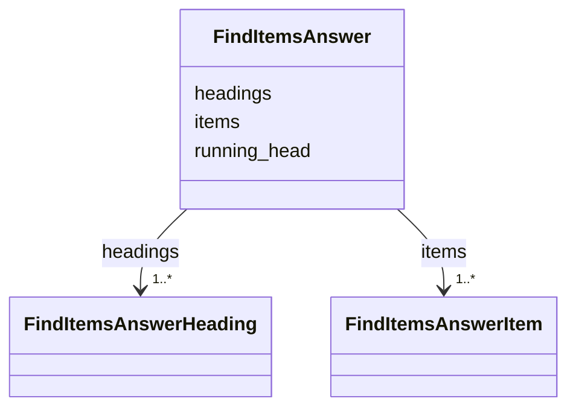

---
search:
  boost: 10.0
---

# Class: Answer (FindItemsAnswer) 


_The page's items in reading order, the headings over several items, the running head._


<div data-search-exclude markdown="1">


URI: [pc:FindItemsAnswer](https://pruzhany.org/ns/sourced-entities#FindItemsAnswer)





<!-- no inheritance hierarchy -->

## Slots

| Name | Cardinality and Range | Description | Inheritance |
| ---  | --- | --- | --- |
| [items](items.md) | 1..* <br/> [FindItemsAnswerItem](FindItemsAnswerItem.md) | The items field in the Answer response. | direct |
| [headings](headings.md) | 1..* <br/> [FindItemsAnswerHeading](FindItemsAnswerHeading.md) | The headings field in the Answer response. | direct |
| [running_head](running_head.md) | 1..* <br/> [Integer](Integer.md) | The running_head field in the Answer response. | direct |


## Identifier and Mapping Information


### Annotations

| property | value |
| --- | --- |
| asking | find_items |


### Schema Source


* from schema: https://pruzhany.org/ns/answers


## Mappings

| Mapping Type | Mapped Value |
| ---  | ---  |
| self | pc:FindItemsAnswer |
| native | pc:FindItemsAnswer |


## LinkML Source

<!-- TODO: investigate https://stackoverflow.com/questions/37606292/how-to-create-tabbed-code-blocks-in-mkdocs-or-sphinx -->

### Direct

<details>
```yaml
name: FindItemsAnswer
annotations:
  asking:
    tag: asking
    value: find_items
description: The page's items in reading order, the headings over several items, the
  running head.
title: Answer
from_schema: https://pruzhany.org/ns/answers
rank: 1000
attributes:
  items:
    name: items
    annotations:
      description_in_wire:
        tag: description_in_wire
        value: false
    description: The items field in the Answer response.
    title: Items
    from_schema: https://pruzhany.org/ns/answers
    rank: 1000
    domain_of:
    - FindItemsAnswer
    range: FindItemsAnswerItem
    required: true
    multivalued: true
    inlined: true
    inlined_as_list: true
  headings:
    name: headings
    annotations:
      default_empty_list:
        tag: default_empty_list
        value: true
      description_in_wire:
        tag: description_in_wire
        value: false
    description: The headings field in the Answer response.
    title: Headings
    from_schema: https://pruzhany.org/ns/answers
    rank: 1000
    domain_of:
    - FindItemsAnswer
    range: FindItemsAnswerHeading
    required: true
    multivalued: true
    inlined: true
    inlined_as_list: true
  running_head:
    name: running_head
    annotations:
      default_empty_list:
        tag: default_empty_list
        value: true
      description_in_wire:
        tag: description_in_wire
        value: false
    description: The running_head field in the Answer response.
    title: Running Head
    from_schema: https://pruzhany.org/ns/answers
    rank: 1000
    domain_of:
    - FindItemsAnswer
    range: integer
    required: true
    multivalued: true

```
</details>

### Induced

<details>
```yaml
name: FindItemsAnswer
annotations:
  asking:
    tag: asking
    value: find_items
description: The page's items in reading order, the headings over several items, the
  running head.
title: Answer
from_schema: https://pruzhany.org/ns/answers
rank: 1000
attributes:
  items:
    name: items
    annotations:
      description_in_wire:
        tag: description_in_wire
        value: false
    description: The items field in the Answer response.
    title: Items
    from_schema: https://pruzhany.org/ns/answers
    rank: 1000
    owner: FindItemsAnswer
    domain_of:
    - FindItemsAnswer
    range: FindItemsAnswerItem
    required: true
    multivalued: true
    inlined: true
    inlined_as_list: true
  headings:
    name: headings
    annotations:
      default_empty_list:
        tag: default_empty_list
        value: true
      description_in_wire:
        tag: description_in_wire
        value: false
    description: The headings field in the Answer response.
    title: Headings
    from_schema: https://pruzhany.org/ns/answers
    rank: 1000
    owner: FindItemsAnswer
    domain_of:
    - FindItemsAnswer
    range: FindItemsAnswerHeading
    required: true
    multivalued: true
    inlined: true
    inlined_as_list: true
  running_head:
    name: running_head
    annotations:
      default_empty_list:
        tag: default_empty_list
        value: true
      description_in_wire:
        tag: description_in_wire
        value: false
    description: The running_head field in the Answer response.
    title: Running Head
    from_schema: https://pruzhany.org/ns/answers
    rank: 1000
    owner: FindItemsAnswer
    domain_of:
    - FindItemsAnswer
    range: integer
    required: true
    multivalued: true

```
</details></div>
