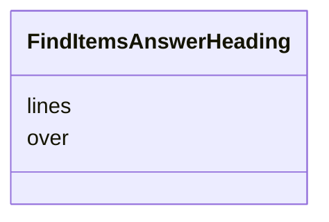

---
search:
  boost: 10.0
---

# Class: AnswerHeading (FindItemsAnswerHeading) 


_A heading over several items as the model gives it: its lines, and the items' numbers._


<div data-search-exclude markdown="1">


URI: [pc:FindItemsAnswerHeading](https://pruzhany.org/ns/sourced-entities#FindItemsAnswerHeading)





<!-- no inheritance hierarchy -->

## Slots

| Name | Cardinality and Range | Description | Inheritance |
| ---  | --- | --- | --- |
| [lines](lines.md) | 1..* <br/> [Integer](Integer.md) | The lines field in the AnswerHeading response. | direct |
| [over](over.md) | 1..* <br/> [Integer](Integer.md) | The over field in the AnswerHeading response. | direct |


## Usages

| used by | used in | type | used |
| ---  | --- | --- | --- |
| [FindItemsAnswer](FindItemsAnswer.md) | [headings](headings.md) | range | [FindItemsAnswerHeading](FindItemsAnswerHeading.md) |


## Identifier and Mapping Information


### Schema Source


* from schema: https://pruzhany.org/ns/answers


## Mappings

| Mapping Type | Mapped Value |
| ---  | ---  |
| self | pc:FindItemsAnswerHeading |
| native | pc:FindItemsAnswerHeading |


## LinkML Source

<!-- TODO: investigate https://stackoverflow.com/questions/37606292/how-to-create-tabbed-code-blocks-in-mkdocs-or-sphinx -->

### Direct

<details>
```yaml
name: FindItemsAnswerHeading
description: 'A heading over several items as the model gives it: its lines, and the
  items'' numbers.'
title: AnswerHeading
from_schema: https://pruzhany.org/ns/answers
rank: 1000
attributes:
  lines:
    name: lines
    annotations:
      description_in_wire:
        tag: description_in_wire
        value: false
    description: The lines field in the AnswerHeading response.
    title: Lines
    from_schema: https://pruzhany.org/ns/answers
    rank: 1000
    domain_of:
    - FindItemsAnswerHeading
    - ReadLatinAnswer
    range: integer
    required: true
    multivalued: true
  over:
    name: over
    annotations:
      description_in_wire:
        tag: description_in_wire
        value: false
    description: The over field in the AnswerHeading response.
    title: Over
    from_schema: https://pruzhany.org/ns/answers
    rank: 1000
    domain_of:
    - FindItemsAnswerHeading
    range: integer
    required: true
    multivalued: true

```
</details>

### Induced

<details>
```yaml
name: FindItemsAnswerHeading
description: 'A heading over several items as the model gives it: its lines, and the
  items'' numbers.'
title: AnswerHeading
from_schema: https://pruzhany.org/ns/answers
rank: 1000
attributes:
  lines:
    name: lines
    annotations:
      description_in_wire:
        tag: description_in_wire
        value: false
    description: The lines field in the AnswerHeading response.
    title: Lines
    from_schema: https://pruzhany.org/ns/answers
    rank: 1000
    owner: FindItemsAnswerHeading
    domain_of:
    - FindItemsAnswerHeading
    - ReadLatinAnswer
    range: integer
    required: true
    multivalued: true
  over:
    name: over
    annotations:
      description_in_wire:
        tag: description_in_wire
        value: false
    description: The over field in the AnswerHeading response.
    title: Over
    from_schema: https://pruzhany.org/ns/answers
    rank: 1000
    owner: FindItemsAnswerHeading
    domain_of:
    - FindItemsAnswerHeading
    range: integer
    required: true
    multivalued: true

```
</details></div>
