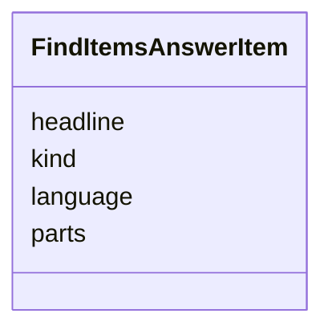

---
search:
  boost: 10.0
---

# Class: AnswerItem (FindItemsAnswerItem) 


_One item as the model gives it: its parts in order, its kind, language and headline._


<div data-search-exclude markdown="1">


URI: [pc:FindItemsAnswerItem](https://pruzhany.org/ns/sourced-entities#FindItemsAnswerItem)





<!-- no inheritance hierarchy -->

## Slots

| Name | Cardinality and Range | Description | Inheritance |
| ---  | --- | --- | --- |
| [parts](parts.md) | 1..* <br/> [Integer](Integer.md) | The parts field in the AnswerItem response. | direct |
| [kind](kind.md) | 1 <br/> [String](String.md) | The kind field in the AnswerItem response. | direct |
| [language](language.md) | 1 <br/> [String](String.md) | The language field in the AnswerItem response. | direct |
| [headline](headline.md) | 1..* <br/> [Integer](Integer.md) | The headline field in the AnswerItem response. | direct |


## Usages

| used by | used in | type | used |
| ---  | --- | --- | --- |
| [FindItemsAnswer](FindItemsAnswer.md) | [items](items.md) | range | [FindItemsAnswerItem](FindItemsAnswerItem.md) |


## Identifier and Mapping Information


### Schema Source


* from schema: https://pruzhany.org/ns/answers


## Mappings

| Mapping Type | Mapped Value |
| ---  | ---  |
| self | pc:FindItemsAnswerItem |
| native | pc:FindItemsAnswerItem |


## LinkML Source

<!-- TODO: investigate https://stackoverflow.com/questions/37606292/how-to-create-tabbed-code-blocks-in-mkdocs-or-sphinx -->

### Direct

<details>
```yaml
name: FindItemsAnswerItem
description: 'One item as the model gives it: its parts in order, its kind, language
  and headline.'
title: AnswerItem
from_schema: https://pruzhany.org/ns/answers
rank: 1000
attributes:
  parts:
    name: parts
    annotations:
      description_in_wire:
        tag: description_in_wire
        value: false
    description: The parts field in the AnswerItem response.
    title: Parts
    from_schema: https://pruzhany.org/ns/answers
    rank: 1000
    domain_of:
    - FindItemsAnswerItem
    range: integer
    required: true
    multivalued: true
  kind:
    name: kind
    annotations:
      description_in_wire:
        tag: description_in_wire
        value: false
    description: The kind field in the AnswerItem response.
    title: Kind
    from_schema: https://pruzhany.org/ns/answers
    rank: 1000
    domain_of:
    - FindItemsAnswerItem
    - WriteEnglishAnsweredPiece
    - WriteEnglishLifeEvent
    - WriteEnglishOrganization
    - WriteEnglishPlace
    range: string
    required: true
    equals_string_in:
    - article
    - advert
    - death notice
  language:
    name: language
    annotations:
      description_in_wire:
        tag: description_in_wire
        value: false
    description: The language field in the AnswerItem response.
    title: Language
    from_schema: https://pruzhany.org/ns/answers
    rank: 1000
    domain_of:
    - FindItemsAnswerItem
    range: string
    required: true
    equals_string_in:
    - yi
    - he
    - pl
  headline:
    name: headline
    annotations:
      description_in_wire:
        tag: description_in_wire
        value: false
    description: The headline field in the AnswerItem response.
    title: Headline
    from_schema: https://pruzhany.org/ns/answers
    rank: 1000
    domain_of:
    - FindItemsAnswerItem
    range: integer
    required: true
    multivalued: true

```
</details>

### Induced

<details>
```yaml
name: FindItemsAnswerItem
description: 'One item as the model gives it: its parts in order, its kind, language
  and headline.'
title: AnswerItem
from_schema: https://pruzhany.org/ns/answers
rank: 1000
attributes:
  parts:
    name: parts
    annotations:
      description_in_wire:
        tag: description_in_wire
        value: false
    description: The parts field in the AnswerItem response.
    title: Parts
    from_schema: https://pruzhany.org/ns/answers
    rank: 1000
    owner: FindItemsAnswerItem
    domain_of:
    - FindItemsAnswerItem
    range: integer
    required: true
    multivalued: true
  kind:
    name: kind
    annotations:
      description_in_wire:
        tag: description_in_wire
        value: false
    description: The kind field in the AnswerItem response.
    title: Kind
    from_schema: https://pruzhany.org/ns/answers
    rank: 1000
    owner: FindItemsAnswerItem
    domain_of:
    - FindItemsAnswerItem
    - WriteEnglishAnsweredPiece
    - WriteEnglishLifeEvent
    - WriteEnglishOrganization
    - WriteEnglishPlace
    range: string
    required: true
    equals_string_in:
    - article
    - advert
    - death notice
  language:
    name: language
    annotations:
      description_in_wire:
        tag: description_in_wire
        value: false
    description: The language field in the AnswerItem response.
    title: Language
    from_schema: https://pruzhany.org/ns/answers
    rank: 1000
    owner: FindItemsAnswerItem
    domain_of:
    - FindItemsAnswerItem
    range: string
    required: true
    equals_string_in:
    - yi
    - he
    - pl
  headline:
    name: headline
    annotations:
      description_in_wire:
        tag: description_in_wire
        value: false
    description: The headline field in the AnswerItem response.
    title: Headline
    from_schema: https://pruzhany.org/ns/answers
    rank: 1000
    owner: FindItemsAnswerItem
    domain_of:
    - FindItemsAnswerItem
    range: integer
    required: true
    multivalued: true

```
</details></div>
