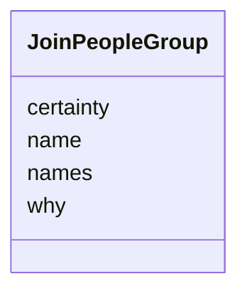

---
search:
  boost: 10.0
---

# Class: Group (JoinPeopleGroup) 


_Names that are one person, and the name the person is given._


<div data-search-exclude markdown="1">


URI: [pc:JoinPeopleGroup](https://pruzhany.org/ns/sourced-entities#JoinPeopleGroup)





<!-- no inheritance hierarchy -->

## Slots

| Name | Cardinality and Range | Description | Inheritance |
| ---  | --- | --- | --- |
| [names](names.md) | 1..* <br/> [Integer](Integer.md) | The numbers of the names that are one person. | direct |
| [name](name.md) | 1 <br/> [String](String.md) | The fullest English name the edition gives the person. | direct |
| [certainty](certainty.md) | 1 <br/> [String](String.md) | The certainty field in the Group response. | direct |
| [why](why.md) | 1 <br/> [String](String.md) | In a few words. | direct |


## Usages

| used by | used in | type | used |
| ---  | --- | --- | --- |
| [JoinPeopleAnswer](JoinPeopleAnswer.md) | [groups](groups.md) | range | [JoinPeopleGroup](JoinPeopleGroup.md) |


## Identifier and Mapping Information


### Schema Source


* from schema: https://pruzhany.org/ns/answers


## Mappings

| Mapping Type | Mapped Value |
| ---  | ---  |
| self | pc:JoinPeopleGroup |
| native | pc:JoinPeopleGroup |


## LinkML Source

<!-- TODO: investigate https://stackoverflow.com/questions/37606292/how-to-create-tabbed-code-blocks-in-mkdocs-or-sphinx -->

### Direct

<details>
```yaml
name: JoinPeopleGroup
description: Names that are one person, and the name the person is given.
title: Group
from_schema: https://pruzhany.org/ns/answers
rank: 1000
attributes:
  names:
    name: names
    description: The numbers of the names that are one person.
    title: Names
    from_schema: https://pruzhany.org/ns/answers
    rank: 1000
    domain_of:
    - JoinPeopleGroup
    range: integer
    required: true
    multivalued: true
  name:
    name: name
    description: The fullest English name the edition gives the person.
    title: Name
    from_schema: https://pruzhany.org/ns/answers
    domain_of:
    - WriteEnglishLifeEvent
    - WriteEnglishOrganization
    - WriteEnglishPerson
    - WriteEnglishPlace
    - JoinPeopleGroup
    range: string
    required: true
  certainty:
    name: certainty
    annotations:
      description_in_wire:
        tag: description_in_wire
        value: false
    description: The certainty field in the Group response.
    title: Certainty
    from_schema: https://pruzhany.org/ns/answers
    rank: 1000
    domain_of:
    - JoinPeopleGroup
    range: string
    required: true
    equals_string_in:
    - certain
    - likely
  why:
    name: why
    description: In a few words.
    title: Why
    from_schema: https://pruzhany.org/ns/answers
    domain_of:
    - WriteEnglishDoubt
    - JoinPeopleGroup
    range: string
    required: true

```
</details>

### Induced

<details>
```yaml
name: JoinPeopleGroup
description: Names that are one person, and the name the person is given.
title: Group
from_schema: https://pruzhany.org/ns/answers
rank: 1000
attributes:
  names:
    name: names
    description: The numbers of the names that are one person.
    title: Names
    from_schema: https://pruzhany.org/ns/answers
    rank: 1000
    owner: JoinPeopleGroup
    domain_of:
    - JoinPeopleGroup
    range: integer
    required: true
    multivalued: true
  name:
    name: name
    description: The fullest English name the edition gives the person.
    title: Name
    from_schema: https://pruzhany.org/ns/answers
    owner: JoinPeopleGroup
    domain_of:
    - WriteEnglishLifeEvent
    - WriteEnglishOrganization
    - WriteEnglishPerson
    - WriteEnglishPlace
    - JoinPeopleGroup
    range: string
    required: true
  certainty:
    name: certainty
    annotations:
      description_in_wire:
        tag: description_in_wire
        value: false
    description: The certainty field in the Group response.
    title: Certainty
    from_schema: https://pruzhany.org/ns/answers
    rank: 1000
    owner: JoinPeopleGroup
    domain_of:
    - JoinPeopleGroup
    range: string
    required: true
    equals_string_in:
    - certain
    - likely
  why:
    name: why
    description: In a few words.
    title: Why
    from_schema: https://pruzhany.org/ns/answers
    owner: JoinPeopleGroup
    domain_of:
    - WriteEnglishDoubt
    - JoinPeopleGroup
    range: string
    required: true

```
</details></div>
