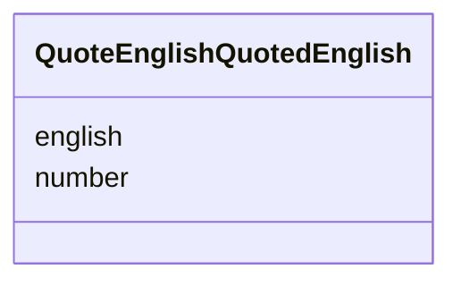

---
search:
  boost: 10.0
---

# Class: QuotedEnglish (QuoteEnglishQuotedEnglish) 


_One quotation's English, with the number it was sent under._


<div data-search-exclude markdown="1">


URI: [pc:QuoteEnglishQuotedEnglish](https://pruzhany.org/ns/sourced-entities#QuoteEnglishQuotedEnglish)





<!-- no inheritance hierarchy -->

## Slots

| Name | Cardinality and Range | Description | Inheritance |
| ---  | --- | --- | --- |
| [number](number.md) | 1 <br/> [Integer](Integer.md) | The number field in the QuotedEnglish response. | direct |
| [english](english.md) | 1 <br/> [String](String.md) | The english field in the QuotedEnglish response. | direct |


## Usages

| used by | used in | type | used |
| ---  | --- | --- | --- |
| [QuoteEnglishAnswer](QuoteEnglishAnswer.md) | [quotations](quotations.md) | range | [QuoteEnglishQuotedEnglish](QuoteEnglishQuotedEnglish.md) |


## Identifier and Mapping Information


### Schema Source


* from schema: https://pruzhany.org/ns/answers


## Mappings

| Mapping Type | Mapped Value |
| ---  | ---  |
| self | pc:QuoteEnglishQuotedEnglish |
| native | pc:QuoteEnglishQuotedEnglish |


## LinkML Source

<!-- TODO: investigate https://stackoverflow.com/questions/37606292/how-to-create-tabbed-code-blocks-in-mkdocs-or-sphinx -->

### Direct

<details>
```yaml
name: QuoteEnglishQuotedEnglish
description: One quotation's English, with the number it was sent under.
title: QuotedEnglish
from_schema: https://pruzhany.org/ns/answers
rank: 1000
attributes:
  number:
    name: number
    annotations:
      description_in_wire:
        tag: description_in_wire
        value: false
    description: The number field in the QuotedEnglish response.
    title: Number
    from_schema: https://pruzhany.org/ns/answers
    domain_of:
    - WriteEnglishAnsweredPiece
    - QuoteEnglishQuotedEnglish
    range: integer
    required: true
  english:
    name: english
    annotations:
      description_in_wire:
        tag: description_in_wire
        value: false
    description: The english field in the QuotedEnglish response.
    title: English
    from_schema: https://pruzhany.org/ns/answers
    domain_of:
    - WriteEnglishAnsweredPiece
    - QuoteEnglishQuotedEnglish
    range: string
    required: true

```
</details>

### Induced

<details>
```yaml
name: QuoteEnglishQuotedEnglish
description: One quotation's English, with the number it was sent under.
title: QuotedEnglish
from_schema: https://pruzhany.org/ns/answers
rank: 1000
attributes:
  number:
    name: number
    annotations:
      description_in_wire:
        tag: description_in_wire
        value: false
    description: The number field in the QuotedEnglish response.
    title: Number
    from_schema: https://pruzhany.org/ns/answers
    owner: QuoteEnglishQuotedEnglish
    domain_of:
    - WriteEnglishAnsweredPiece
    - QuoteEnglishQuotedEnglish
    range: integer
    required: true
  english:
    name: english
    annotations:
      description_in_wire:
        tag: description_in_wire
        value: false
    description: The english field in the QuotedEnglish response.
    title: English
    from_schema: https://pruzhany.org/ns/answers
    owner: QuoteEnglishQuotedEnglish
    domain_of:
    - WriteEnglishAnsweredPiece
    - QuoteEnglishQuotedEnglish
    range: string
    required: true

```
</details></div>
