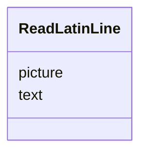

---
search:
  boost: 10.0
---

# Class: Line (ReadLatinLine) 


_One picture as the model answers for it: the picture's number and the text printed in it._


<div data-search-exclude markdown="1">


URI: [pc:ReadLatinLine](https://pruzhany.org/ns/sourced-entities#ReadLatinLine)





<!-- no inheritance hierarchy -->

## Slots

| Name | Cardinality and Range | Description | Inheritance |
| ---  | --- | --- | --- |
| [picture](picture.md) | 1 <br/> [Integer](Integer.md) | The picture field in the Line response. | direct |
| [text](text.md) | 1 <br/> [String](String.md) | The text field in the Line response. | direct |


## Usages

| used by | used in | type | used |
| ---  | --- | --- | --- |
| [ReadLatinAnswer](ReadLatinAnswer.md) | [lines](lines.md) | range | [ReadLatinLine](ReadLatinLine.md) |


## Identifier and Mapping Information


### Schema Source


* from schema: https://pruzhany.org/ns/answers


## Mappings

| Mapping Type | Mapped Value |
| ---  | ---  |
| self | pc:ReadLatinLine |
| native | pc:ReadLatinLine |


## LinkML Source

<!-- TODO: investigate https://stackoverflow.com/questions/37606292/how-to-create-tabbed-code-blocks-in-mkdocs-or-sphinx -->

### Direct

<details>
```yaml
name: ReadLatinLine
description: 'One picture as the model answers for it: the picture''s number and the
  text printed in it.'
title: Line
from_schema: https://pruzhany.org/ns/answers
rank: 1000
attributes:
  picture:
    name: picture
    annotations:
      description_in_wire:
        tag: description_in_wire
        value: false
    description: The picture field in the Line response.
    title: Picture
    from_schema: https://pruzhany.org/ns/answers
    rank: 1000
    domain_of:
    - ReadLatinLine
    range: integer
    required: true
  text:
    name: text
    annotations:
      description_in_wire:
        tag: description_in_wire
        value: false
    description: The text field in the Line response.
    title: Text
    from_schema: https://pruzhany.org/ns/answers
    rank: 1000
    domain_of:
    - ReadLatinLine
    range: string
    required: true

```
</details>

### Induced

<details>
```yaml
name: ReadLatinLine
description: 'One picture as the model answers for it: the picture''s number and the
  text printed in it.'
title: Line
from_schema: https://pruzhany.org/ns/answers
rank: 1000
attributes:
  picture:
    name: picture
    annotations:
      description_in_wire:
        tag: description_in_wire
        value: false
    description: The picture field in the Line response.
    title: Picture
    from_schema: https://pruzhany.org/ns/answers
    rank: 1000
    owner: ReadLatinLine
    domain_of:
    - ReadLatinLine
    range: integer
    required: true
  text:
    name: text
    annotations:
      description_in_wire:
        tag: description_in_wire
        value: false
    description: The text field in the Line response.
    title: Text
    from_schema: https://pruzhany.org/ns/answers
    rank: 1000
    owner: ReadLatinLine
    domain_of:
    - ReadLatinLine
    range: string
    required: true

```
</details></div>
