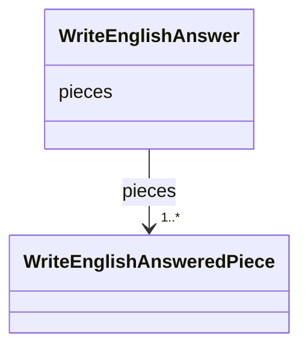

---
search:
  boost: 10.0
---

# Class: Answer (WriteEnglishAnswer) 


_The answer about one page: every piece it was sent, by its number._


<div data-search-exclude markdown="1">


URI: [pc:WriteEnglishAnswer](https://pruzhany.org/ns/sourced-entities#WriteEnglishAnswer)





<!-- no inheritance hierarchy -->

## Slots

| Name | Cardinality and Range | Description | Inheritance |
| ---  | --- | --- | --- |
| [pieces](pieces.md) | 1..* <br/> [WriteEnglishAnsweredPiece](WriteEnglishAnsweredPiece.md) | The pieces field in the Answer response. | direct |


## Identifier and Mapping Information


### Annotations

| property | value |
| --- | --- |
| asking | write_english |


### Schema Source


* from schema: https://pruzhany.org/ns/answers


## Mappings

| Mapping Type | Mapped Value |
| ---  | ---  |
| self | pc:WriteEnglishAnswer |
| native | pc:WriteEnglishAnswer |


## LinkML Source

<!-- TODO: investigate https://stackoverflow.com/questions/37606292/how-to-create-tabbed-code-blocks-in-mkdocs-or-sphinx -->

### Direct

<details>
```yaml
name: WriteEnglishAnswer
annotations:
  asking:
    tag: asking
    value: write_english
description: 'The answer about one page: every piece it was sent, by its number.'
title: Answer
from_schema: https://pruzhany.org/ns/answers
rank: 1000
attributes:
  pieces:
    name: pieces
    annotations:
      description_in_wire:
        tag: description_in_wire
        value: false
    description: The pieces field in the Answer response.
    title: Pieces
    from_schema: https://pruzhany.org/ns/answers
    rank: 1000
    domain_of:
    - WriteEnglishAnswer
    range: WriteEnglishAnsweredPiece
    required: true
    multivalued: true
    inlined: true
    inlined_as_list: true

```
</details>

### Induced

<details>
```yaml
name: WriteEnglishAnswer
annotations:
  asking:
    tag: asking
    value: write_english
description: 'The answer about one page: every piece it was sent, by its number.'
title: Answer
from_schema: https://pruzhany.org/ns/answers
rank: 1000
attributes:
  pieces:
    name: pieces
    annotations:
      description_in_wire:
        tag: description_in_wire
        value: false
    description: The pieces field in the Answer response.
    title: Pieces
    from_schema: https://pruzhany.org/ns/answers
    rank: 1000
    owner: WriteEnglishAnswer
    domain_of:
    - WriteEnglishAnswer
    range: WriteEnglishAnsweredPiece
    required: true
    multivalued: true
    inlined: true
    inlined_as_list: true

```
</details></div>
