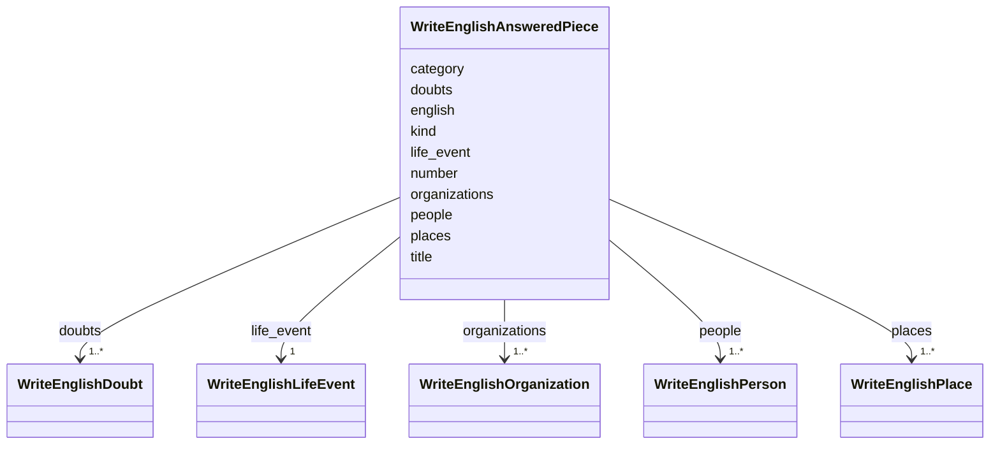

---
search:
  boost: 10.0
---

# Class: AnsweredPiece (WriteEnglishAnsweredPiece) 


_A piece of the answer, with the number it was sent under._


<div data-search-exclude markdown="1">


URI: [pc:WriteEnglishAnsweredPiece](https://pruzhany.org/ns/sourced-entities#WriteEnglishAnsweredPiece)





<!-- no inheritance hierarchy -->

## Slots

| Name | Cardinality and Range | Description | Inheritance |
| ---  | --- | --- | --- |
| [kind](kind.md) | 1 <br/> [String](String.md) | The kind field in the AnsweredPiece response. | direct |
| [title](title.md) | 1 <br/> [String](String.md) | The title field in the AnsweredPiece response. | direct |
| [category](category.md) | 1 <br/> [String](String.md) | The category field in the AnsweredPiece response. | direct |
| [english](english.md) | 1 <br/> [String](String.md) | The english field in the AnsweredPiece response. | direct |
| [people](people.md) | 1..* <br/> [WriteEnglishPerson](WriteEnglishPerson.md) | The people field in the AnsweredPiece response. | direct |
| [places](places.md) | 1..* <br/> [WriteEnglishPlace](WriteEnglishPlace.md) | The places field in the AnsweredPiece response. | direct |
| [organizations](organizations.md) | 1..* <br/> [WriteEnglishOrganization](WriteEnglishOrganization.md) | The organizations field in the AnsweredPiece response. | direct |
| [life_event](life_event.md) | 1 <br/> [WriteEnglishLifeEvent](WriteEnglishLifeEvent.md) | The life_event field in the AnsweredPiece response. | direct |
| [doubts](doubts.md) | 1..* <br/> [WriteEnglishDoubt](WriteEnglishDoubt.md) | The doubts field in the AnsweredPiece response. | direct |
| [number](number.md) | 1 <br/> [Integer](Integer.md) | The number field in the AnsweredPiece response. | direct |


## Usages

| used by | used in | type | used |
| ---  | --- | --- | --- |
| [WriteEnglishAnswer](WriteEnglishAnswer.md) | [pieces](pieces.md) | range | [WriteEnglishAnsweredPiece](WriteEnglishAnsweredPiece.md) |


## Identifier and Mapping Information


### Schema Source


* from schema: https://pruzhany.org/ns/answers


## Mappings

| Mapping Type | Mapped Value |
| ---  | ---  |
| self | pc:WriteEnglishAnsweredPiece |
| native | pc:WriteEnglishAnsweredPiece |


## LinkML Source

<!-- TODO: investigate https://stackoverflow.com/questions/37606292/how-to-create-tabbed-code-blocks-in-mkdocs-or-sphinx -->

### Direct

<details>
```yaml
name: WriteEnglishAnsweredPiece
description: A piece of the answer, with the number it was sent under.
title: AnsweredPiece
from_schema: https://pruzhany.org/ns/answers
rank: 1000
attributes:
  kind:
    name: kind
    annotations:
      description_in_wire:
        tag: description_in_wire
        value: false
    description: The kind field in the AnsweredPiece response.
    title: Kind
    from_schema: https://pruzhany.org/ns/answers
    domain_of:
    - FindItemsAnswerItem
    - WriteEnglishAnsweredPiece
    - WriteEnglishLifeEvent
    - WriteEnglishOrganization
    - WriteEnglishPlace
    range: string
    required: true
    equals_string_in:
    - article
    - notice
    - ad
    - congratulation
    - obituary
    - other
  title:
    name: title
    annotations:
      description_in_wire:
        tag: description_in_wire
        value: false
    description: The title field in the AnsweredPiece response.
    title: Title
    from_schema: https://pruzhany.org/ns/answers
    rank: 1000
    domain_of:
    - WriteEnglishAnsweredPiece
    range: string
    required: true
  category:
    name: category
    annotations:
      description_in_wire:
        tag: description_in_wire
        value: false
    description: The category field in the AnsweredPiece response.
    title: Category
    from_schema: https://pruzhany.org/ns/answers
    rank: 1000
    domain_of:
    - WriteEnglishAnsweredPiece
    range: string
    required: true
  english:
    name: english
    annotations:
      description_in_wire:
        tag: description_in_wire
        value: false
    description: The english field in the AnsweredPiece response.
    title: English
    from_schema: https://pruzhany.org/ns/answers
    rank: 1000
    domain_of:
    - WriteEnglishAnsweredPiece
    - QuoteEnglishQuotedEnglish
    range: string
    required: true
  people:
    name: people
    annotations:
      description_in_wire:
        tag: description_in_wire
        value: false
    description: The people field in the AnsweredPiece response.
    title: People
    from_schema: https://pruzhany.org/ns/answers
    rank: 1000
    domain_of:
    - WriteEnglishAnsweredPiece
    range: WriteEnglishPerson
    required: true
    multivalued: true
    inlined: true
    inlined_as_list: true
  places:
    name: places
    annotations:
      description_in_wire:
        tag: description_in_wire
        value: false
    description: The places field in the AnsweredPiece response.
    title: Places
    from_schema: https://pruzhany.org/ns/answers
    rank: 1000
    domain_of:
    - WriteEnglishAnsweredPiece
    range: WriteEnglishPlace
    required: true
    multivalued: true
    inlined: true
    inlined_as_list: true
  organizations:
    name: organizations
    annotations:
      description_in_wire:
        tag: description_in_wire
        value: false
    description: The organizations field in the AnsweredPiece response.
    title: Organizations
    from_schema: https://pruzhany.org/ns/answers
    rank: 1000
    domain_of:
    - WriteEnglishAnsweredPiece
    range: WriteEnglishOrganization
    required: true
    multivalued: true
    inlined: true
    inlined_as_list: true
  life_event:
    name: life_event
    annotations:
      nullable:
        tag: nullable
        value: true
      description_in_wire:
        tag: description_in_wire
        value: false
    description: The life_event field in the AnsweredPiece response.
    from_schema: https://pruzhany.org/ns/answers
    rank: 1000
    domain_of:
    - WriteEnglishAnsweredPiece
    range: WriteEnglishLifeEvent
    required: true
    inlined: true
  doubts:
    name: doubts
    annotations:
      description_in_wire:
        tag: description_in_wire
        value: false
    description: The doubts field in the AnsweredPiece response.
    title: Doubts
    from_schema: https://pruzhany.org/ns/answers
    rank: 1000
    domain_of:
    - WriteEnglishAnsweredPiece
    range: WriteEnglishDoubt
    required: true
    multivalued: true
    inlined: true
    inlined_as_list: true
  number:
    name: number
    annotations:
      description_in_wire:
        tag: description_in_wire
        value: false
    description: The number field in the AnsweredPiece response.
    title: Number
    from_schema: https://pruzhany.org/ns/answers
    rank: 1000
    domain_of:
    - WriteEnglishAnsweredPiece
    - QuoteEnglishQuotedEnglish
    range: integer
    required: true

```
</details>

### Induced

<details>
```yaml
name: WriteEnglishAnsweredPiece
description: A piece of the answer, with the number it was sent under.
title: AnsweredPiece
from_schema: https://pruzhany.org/ns/answers
rank: 1000
attributes:
  kind:
    name: kind
    annotations:
      description_in_wire:
        tag: description_in_wire
        value: false
    description: The kind field in the AnsweredPiece response.
    title: Kind
    from_schema: https://pruzhany.org/ns/answers
    owner: WriteEnglishAnsweredPiece
    domain_of:
    - FindItemsAnswerItem
    - WriteEnglishAnsweredPiece
    - WriteEnglishLifeEvent
    - WriteEnglishOrganization
    - WriteEnglishPlace
    range: string
    required: true
    equals_string_in:
    - article
    - notice
    - ad
    - congratulation
    - obituary
    - other
  title:
    name: title
    annotations:
      description_in_wire:
        tag: description_in_wire
        value: false
    description: The title field in the AnsweredPiece response.
    title: Title
    from_schema: https://pruzhany.org/ns/answers
    rank: 1000
    owner: WriteEnglishAnsweredPiece
    domain_of:
    - WriteEnglishAnsweredPiece
    range: string
    required: true
  category:
    name: category
    annotations:
      description_in_wire:
        tag: description_in_wire
        value: false
    description: The category field in the AnsweredPiece response.
    title: Category
    from_schema: https://pruzhany.org/ns/answers
    rank: 1000
    owner: WriteEnglishAnsweredPiece
    domain_of:
    - WriteEnglishAnsweredPiece
    range: string
    required: true
  english:
    name: english
    annotations:
      description_in_wire:
        tag: description_in_wire
        value: false
    description: The english field in the AnsweredPiece response.
    title: English
    from_schema: https://pruzhany.org/ns/answers
    rank: 1000
    owner: WriteEnglishAnsweredPiece
    domain_of:
    - WriteEnglishAnsweredPiece
    - QuoteEnglishQuotedEnglish
    range: string
    required: true
  people:
    name: people
    annotations:
      description_in_wire:
        tag: description_in_wire
        value: false
    description: The people field in the AnsweredPiece response.
    title: People
    from_schema: https://pruzhany.org/ns/answers
    rank: 1000
    owner: WriteEnglishAnsweredPiece
    domain_of:
    - WriteEnglishAnsweredPiece
    range: WriteEnglishPerson
    required: true
    multivalued: true
    inlined: true
    inlined_as_list: true
  places:
    name: places
    annotations:
      description_in_wire:
        tag: description_in_wire
        value: false
    description: The places field in the AnsweredPiece response.
    title: Places
    from_schema: https://pruzhany.org/ns/answers
    rank: 1000
    owner: WriteEnglishAnsweredPiece
    domain_of:
    - WriteEnglishAnsweredPiece
    range: WriteEnglishPlace
    required: true
    multivalued: true
    inlined: true
    inlined_as_list: true
  organizations:
    name: organizations
    annotations:
      description_in_wire:
        tag: description_in_wire
        value: false
    description: The organizations field in the AnsweredPiece response.
    title: Organizations
    from_schema: https://pruzhany.org/ns/answers
    rank: 1000
    owner: WriteEnglishAnsweredPiece
    domain_of:
    - WriteEnglishAnsweredPiece
    range: WriteEnglishOrganization
    required: true
    multivalued: true
    inlined: true
    inlined_as_list: true
  life_event:
    name: life_event
    annotations:
      nullable:
        tag: nullable
        value: true
      description_in_wire:
        tag: description_in_wire
        value: false
    description: The life_event field in the AnsweredPiece response.
    from_schema: https://pruzhany.org/ns/answers
    rank: 1000
    owner: WriteEnglishAnsweredPiece
    domain_of:
    - WriteEnglishAnsweredPiece
    range: WriteEnglishLifeEvent
    required: true
    inlined: true
  doubts:
    name: doubts
    annotations:
      description_in_wire:
        tag: description_in_wire
        value: false
    description: The doubts field in the AnsweredPiece response.
    title: Doubts
    from_schema: https://pruzhany.org/ns/answers
    rank: 1000
    owner: WriteEnglishAnsweredPiece
    domain_of:
    - WriteEnglishAnsweredPiece
    range: WriteEnglishDoubt
    required: true
    multivalued: true
    inlined: true
    inlined_as_list: true
  number:
    name: number
    annotations:
      description_in_wire:
        tag: description_in_wire
        value: false
    description: The number field in the AnsweredPiece response.
    title: Number
    from_schema: https://pruzhany.org/ns/answers
    rank: 1000
    owner: WriteEnglishAnsweredPiece
    domain_of:
    - WriteEnglishAnsweredPiece
    - QuoteEnglishQuotedEnglish
    range: integer
    required: true

```
</details></div>
