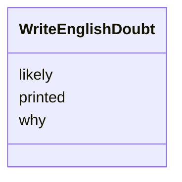

---
search:
  boost: 10.0
---

# Class: Doubt (WriteEnglishDoubt) 


_A word or short phrase the model believes the machine misread._


<div data-search-exclude markdown="1">


URI: [pc:WriteEnglishDoubt](https://pruzhany.org/ns/sourced-entities#WriteEnglishDoubt)





<!-- no inheritance hierarchy -->

## Slots

| Name | Cardinality and Range | Description | Inheritance |
| ---  | --- | --- | --- |
| [printed](printed.md) | 1 <br/> [String](String.md) | The printed field in the Doubt response. | direct |
| [likely](likely.md) | 1 <br/> [String](String.md) | The likely field in the Doubt response. | direct |
| [why](why.md) | 1 <br/> [String](String.md) | The why field in the Doubt response. | direct |


## Usages

| used by | used in | type | used |
| ---  | --- | --- | --- |
| [WriteEnglishAnsweredPiece](WriteEnglishAnsweredPiece.md) | [doubts](doubts.md) | range | [WriteEnglishDoubt](WriteEnglishDoubt.md) |


## Identifier and Mapping Information


### Schema Source


* from schema: https://pruzhany.org/ns/answers


## Mappings

| Mapping Type | Mapped Value |
| ---  | ---  |
| self | pc:WriteEnglishDoubt |
| native | pc:WriteEnglishDoubt |


## LinkML Source

<!-- TODO: investigate https://stackoverflow.com/questions/37606292/how-to-create-tabbed-code-blocks-in-mkdocs-or-sphinx -->

### Direct

<details>
```yaml
name: WriteEnglishDoubt
description: A word or short phrase the model believes the machine misread.
title: Doubt
from_schema: https://pruzhany.org/ns/answers
rank: 1000
attributes:
  printed:
    name: printed
    annotations:
      description_in_wire:
        tag: description_in_wire
        value: false
    description: The printed field in the Doubt response.
    title: Printed
    from_schema: https://pruzhany.org/ns/answers
    rank: 1000
    domain_of:
    - WriteEnglishDoubt
    - WriteEnglishOrganization
    - WriteEnglishPerson
    - WriteEnglishPlace
    range: string
    required: true
  likely:
    name: likely
    annotations:
      description_in_wire:
        tag: description_in_wire
        value: false
    description: The likely field in the Doubt response.
    title: Likely
    from_schema: https://pruzhany.org/ns/answers
    rank: 1000
    domain_of:
    - WriteEnglishDoubt
    range: string
    required: true
  why:
    name: why
    annotations:
      description_in_wire:
        tag: description_in_wire
        value: false
    description: The why field in the Doubt response.
    title: Why
    from_schema: https://pruzhany.org/ns/answers
    rank: 1000
    domain_of:
    - WriteEnglishDoubt
    - JoinPeopleGroup
    range: string
    required: true

```
</details>

### Induced

<details>
```yaml
name: WriteEnglishDoubt
description: A word or short phrase the model believes the machine misread.
title: Doubt
from_schema: https://pruzhany.org/ns/answers
rank: 1000
attributes:
  printed:
    name: printed
    annotations:
      description_in_wire:
        tag: description_in_wire
        value: false
    description: The printed field in the Doubt response.
    title: Printed
    from_schema: https://pruzhany.org/ns/answers
    rank: 1000
    owner: WriteEnglishDoubt
    domain_of:
    - WriteEnglishDoubt
    - WriteEnglishOrganization
    - WriteEnglishPerson
    - WriteEnglishPlace
    range: string
    required: true
  likely:
    name: likely
    annotations:
      description_in_wire:
        tag: description_in_wire
        value: false
    description: The likely field in the Doubt response.
    title: Likely
    from_schema: https://pruzhany.org/ns/answers
    rank: 1000
    owner: WriteEnglishDoubt
    domain_of:
    - WriteEnglishDoubt
    range: string
    required: true
  why:
    name: why
    annotations:
      description_in_wire:
        tag: description_in_wire
        value: false
    description: The why field in the Doubt response.
    title: Why
    from_schema: https://pruzhany.org/ns/answers
    rank: 1000
    owner: WriteEnglishDoubt
    domain_of:
    - WriteEnglishDoubt
    - JoinPeopleGroup
    range: string
    required: true

```
</details></div>
