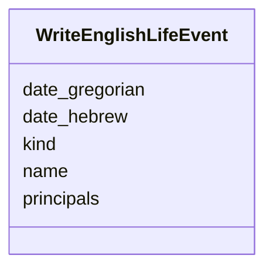

---
search:
  boost: 10.0
---

# Class: LifeEvent (WriteEnglishLifeEvent) 


_The one family event a piece announces, greets or mourns._


<div data-search-exclude markdown="1">


URI: [pc:WriteEnglishLifeEvent](https://pruzhany.org/ns/sourced-entities#WriteEnglishLifeEvent)





<!-- no inheritance hierarchy -->

## Slots

| Name | Cardinality and Range | Description | Inheritance |
| ---  | --- | --- | --- |
| [kind](kind.md) | 1 <br/> [String](String.md) | The kind field in the LifeEvent response. | direct |
| [name](name.md) | 1 <br/> [String](String.md) | A short English name for the event. | direct |
| [principals](principals.md) | 1..* <br/> [String](String.md) | Their English names as in people. | direct |
| [date_hebrew](date_hebrew.md) | 1 <br/> [String](String.md) | The date_hebrew field in the LifeEvent response. | direct |
| [date_gregorian](date_gregorian.md) | 1 <br/> [String](String.md) | YYYY-MM-DD, only as printed. | direct |


## Usages

| used by | used in | type | used |
| ---  | --- | --- | --- |
| [WriteEnglishAnsweredPiece](WriteEnglishAnsweredPiece.md) | [life_event](life_event.md) | range | [WriteEnglishLifeEvent](WriteEnglishLifeEvent.md) |


## Identifier and Mapping Information


### Schema Source


* from schema: https://pruzhany.org/ns/answers


## Mappings

| Mapping Type | Mapped Value |
| ---  | ---  |
| self | pc:WriteEnglishLifeEvent |
| native | pc:WriteEnglishLifeEvent |


## LinkML Source

<!-- TODO: investigate https://stackoverflow.com/questions/37606292/how-to-create-tabbed-code-blocks-in-mkdocs-or-sphinx -->

### Direct

<details>
```yaml
name: WriteEnglishLifeEvent
description: The one family event a piece announces, greets or mourns.
title: LifeEvent
from_schema: https://pruzhany.org/ns/answers
rank: 1000
attributes:
  kind:
    name: kind
    annotations:
      description_in_wire:
        tag: description_in_wire
        value: false
    description: The kind field in the LifeEvent response.
    title: Kind
    from_schema: https://pruzhany.org/ns/answers
    domain_of:
    - FindItemsAnswerItem
    - WriteEnglishAnsweredPiece
    - WriteEnglishLifeEvent
    - WriteEnglishOrganization
    - WriteEnglishPlace
    range: string
    required: true
    equals_string_in:
    - wedding
    - birth
    - death
    - bar_mitzvah
    - celebration
    - other
  name:
    name: name
    description: A short English name for the event.
    title: Name
    from_schema: https://pruzhany.org/ns/answers
    rank: 1000
    domain_of:
    - WriteEnglishLifeEvent
    - WriteEnglishOrganization
    - WriteEnglishPerson
    - WriteEnglishPlace
    - JoinPeopleGroup
    range: string
    required: true
  principals:
    name: principals
    description: Their English names as in people.
    title: Principals
    from_schema: https://pruzhany.org/ns/answers
    rank: 1000
    domain_of:
    - WriteEnglishLifeEvent
    range: string
    required: true
    multivalued: true
  date_hebrew:
    name: date_hebrew
    annotations:
      nullable:
        tag: nullable
        value: true
      description_in_wire:
        tag: description_in_wire
        value: false
    description: The date_hebrew field in the LifeEvent response.
    title: Date Hebrew
    from_schema: https://pruzhany.org/ns/answers
    rank: 1000
    domain_of:
    - WriteEnglishLifeEvent
    range: string
    required: true
  date_gregorian:
    name: date_gregorian
    annotations:
      nullable:
        tag: nullable
        value: true
    description: YYYY-MM-DD, only as printed.
    title: Date Gregorian
    from_schema: https://pruzhany.org/ns/answers
    rank: 1000
    domain_of:
    - WriteEnglishLifeEvent
    range: string
    required: true

```
</details>

### Induced

<details>
```yaml
name: WriteEnglishLifeEvent
description: The one family event a piece announces, greets or mourns.
title: LifeEvent
from_schema: https://pruzhany.org/ns/answers
rank: 1000
attributes:
  kind:
    name: kind
    annotations:
      description_in_wire:
        tag: description_in_wire
        value: false
    description: The kind field in the LifeEvent response.
    title: Kind
    from_schema: https://pruzhany.org/ns/answers
    owner: WriteEnglishLifeEvent
    domain_of:
    - FindItemsAnswerItem
    - WriteEnglishAnsweredPiece
    - WriteEnglishLifeEvent
    - WriteEnglishOrganization
    - WriteEnglishPlace
    range: string
    required: true
    equals_string_in:
    - wedding
    - birth
    - death
    - bar_mitzvah
    - celebration
    - other
  name:
    name: name
    description: A short English name for the event.
    title: Name
    from_schema: https://pruzhany.org/ns/answers
    rank: 1000
    owner: WriteEnglishLifeEvent
    domain_of:
    - WriteEnglishLifeEvent
    - WriteEnglishOrganization
    - WriteEnglishPerson
    - WriteEnglishPlace
    - JoinPeopleGroup
    range: string
    required: true
  principals:
    name: principals
    description: Their English names as in people.
    title: Principals
    from_schema: https://pruzhany.org/ns/answers
    rank: 1000
    owner: WriteEnglishLifeEvent
    domain_of:
    - WriteEnglishLifeEvent
    range: string
    required: true
    multivalued: true
  date_hebrew:
    name: date_hebrew
    annotations:
      nullable:
        tag: nullable
        value: true
      description_in_wire:
        tag: description_in_wire
        value: false
    description: The date_hebrew field in the LifeEvent response.
    title: Date Hebrew
    from_schema: https://pruzhany.org/ns/answers
    rank: 1000
    owner: WriteEnglishLifeEvent
    domain_of:
    - WriteEnglishLifeEvent
    range: string
    required: true
  date_gregorian:
    name: date_gregorian
    annotations:
      nullable:
        tag: nullable
        value: true
    description: YYYY-MM-DD, only as printed.
    title: Date Gregorian
    from_schema: https://pruzhany.org/ns/answers
    rank: 1000
    owner: WriteEnglishLifeEvent
    domain_of:
    - WriteEnglishLifeEvent
    range: string
    required: true

```
</details></div>
