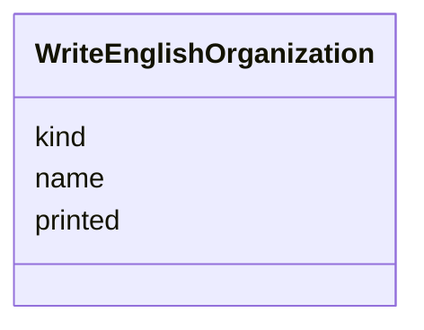

---
search:
  boost: 10.0
---

# Class: Organization (WriteEnglishOrganization) 


_An organisation, institution or named business a piece names._


<div data-search-exclude markdown="1">


URI: [pc:WriteEnglishOrganization](https://pruzhany.org/ns/sourced-entities#WriteEnglishOrganization)





<!-- no inheritance hierarchy -->

## Slots

| Name | Cardinality and Range | Description | Inheritance |
| ---  | --- | --- | --- |
| [name](name.md) | 1 <br/> [String](String.md) | In English. | direct |
| [printed](printed.md) | 1 <br/> [String](String.md) | As in the text. | direct |
| [kind](kind.md) | 1 <br/> [String](String.md) | In a word or two: school, bank, party, society, shop. | direct |


## Usages

| used by | used in | type | used |
| ---  | --- | --- | --- |
| [WriteEnglishAnsweredPiece](WriteEnglishAnsweredPiece.md) | [organizations](organizations.md) | range | [WriteEnglishOrganization](WriteEnglishOrganization.md) |


## Identifier and Mapping Information


### Schema Source


* from schema: https://pruzhany.org/ns/answers


## Mappings

| Mapping Type | Mapped Value |
| ---  | ---  |
| self | pc:WriteEnglishOrganization |
| native | pc:WriteEnglishOrganization |


## LinkML Source

<!-- TODO: investigate https://stackoverflow.com/questions/37606292/how-to-create-tabbed-code-blocks-in-mkdocs-or-sphinx -->

### Direct

<details>
```yaml
name: WriteEnglishOrganization
description: An organisation, institution or named business a piece names.
title: Organization
from_schema: https://pruzhany.org/ns/answers
rank: 1000
attributes:
  name:
    name: name
    description: In English.
    title: Name
    from_schema: https://pruzhany.org/ns/answers
    domain_of:
    - WriteEnglishLifeEvent
    - WriteEnglishOrganization
    - WriteEnglishPerson
    - WriteEnglishPlace
    - JoinPeopleGroup
    range: string
    required: true
  printed:
    name: printed
    description: As in the text.
    title: Printed
    from_schema: https://pruzhany.org/ns/answers
    domain_of:
    - WriteEnglishDoubt
    - WriteEnglishOrganization
    - WriteEnglishPerson
    - WriteEnglishPlace
    range: string
    required: true
  kind:
    name: kind
    description: 'In a word or two: school, bank, party, society, shop.'
    title: Kind
    from_schema: https://pruzhany.org/ns/answers
    domain_of:
    - FindItemsAnswerItem
    - WriteEnglishAnsweredPiece
    - WriteEnglishLifeEvent
    - WriteEnglishOrganization
    - WriteEnglishPlace
    range: string
    required: true

```
</details>

### Induced

<details>
```yaml
name: WriteEnglishOrganization
description: An organisation, institution or named business a piece names.
title: Organization
from_schema: https://pruzhany.org/ns/answers
rank: 1000
attributes:
  name:
    name: name
    description: In English.
    title: Name
    from_schema: https://pruzhany.org/ns/answers
    owner: WriteEnglishOrganization
    domain_of:
    - WriteEnglishLifeEvent
    - WriteEnglishOrganization
    - WriteEnglishPerson
    - WriteEnglishPlace
    - JoinPeopleGroup
    range: string
    required: true
  printed:
    name: printed
    description: As in the text.
    title: Printed
    from_schema: https://pruzhany.org/ns/answers
    owner: WriteEnglishOrganization
    domain_of:
    - WriteEnglishDoubt
    - WriteEnglishOrganization
    - WriteEnglishPerson
    - WriteEnglishPlace
    range: string
    required: true
  kind:
    name: kind
    description: 'In a word or two: school, bank, party, society, shop.'
    title: Kind
    from_schema: https://pruzhany.org/ns/answers
    owner: WriteEnglishOrganization
    domain_of:
    - FindItemsAnswerItem
    - WriteEnglishAnsweredPiece
    - WriteEnglishLifeEvent
    - WriteEnglishOrganization
    - WriteEnglishPlace
    range: string
    required: true

```
</details></div>
