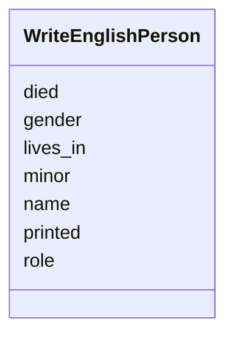

---
search:
  boost: 10.0
---

# Class: Person (WriteEnglishPerson) 


_A person a piece names._


<div data-search-exclude markdown="1">


URI: [pc:WriteEnglishPerson](https://pruzhany.org/ns/sourced-entities#WriteEnglishPerson)





<!-- no inheritance hierarchy -->

## Slots

| Name | Cardinality and Range | Description | Inheritance |
| ---  | --- | --- | --- |
| [name](name.md) | 1 <br/> [String](String.md) | In English, as the instructions say. | direct |
| [printed](printed.md) | 1 <br/> [String](String.md) | As in the text. | direct |
| [gender](gender.md) | 1 <br/> [String](String.md) | The gender field in the Person response. | direct |
| [role](role.md) | 1 <br/> [String](String.md) | What the person is in this piece, in a few words. | direct |
| [lives_in](lives_in.md) | 1 <br/> [String](String.md) | The town the piece says the person lives in. | direct |
| [minor](minor.md) | 1 <br/> [Boolean](Boolean.md) | True only if the piece shows the person was a child. | direct |
| [died](died.md) | 1 <br/> [Boolean](Boolean.md) | True only if the piece says the person has died. | direct |


## Usages

| used by | used in | type | used |
| ---  | --- | --- | --- |
| [WriteEnglishAnsweredPiece](WriteEnglishAnsweredPiece.md) | [people](people.md) | range | [WriteEnglishPerson](WriteEnglishPerson.md) |


## Identifier and Mapping Information


### Schema Source


* from schema: https://pruzhany.org/ns/answers


## Mappings

| Mapping Type | Mapped Value |
| ---  | ---  |
| self | pc:WriteEnglishPerson |
| native | pc:WriteEnglishPerson |


## LinkML Source

<!-- TODO: investigate https://stackoverflow.com/questions/37606292/how-to-create-tabbed-code-blocks-in-mkdocs-or-sphinx -->

### Direct

<details>
```yaml
name: WriteEnglishPerson
description: A person a piece names.
title: Person
from_schema: https://pruzhany.org/ns/answers
rank: 1000
attributes:
  name:
    name: name
    description: In English, as the instructions say.
    title: Name
    from_schema: https://pruzhany.org/ns/answers
    domain_of:
    - WriteEnglishLifeEvent
    - WriteEnglishOrganization
    - WriteEnglishPerson
    - WriteEnglishPlace
    - JoinPeopleGroup
    range: string
    required: true
  printed:
    name: printed
    description: As in the text.
    title: Printed
    from_schema: https://pruzhany.org/ns/answers
    domain_of:
    - WriteEnglishDoubt
    - WriteEnglishOrganization
    - WriteEnglishPerson
    - WriteEnglishPlace
    range: string
    required: true
  gender:
    name: gender
    annotations:
      description_in_wire:
        tag: description_in_wire
        value: false
    description: The gender field in the Person response.
    title: Gender
    from_schema: https://pruzhany.org/ns/answers
    rank: 1000
    domain_of:
    - WriteEnglishPerson
    range: string
    required: true
    equals_string_in:
    - male
    - female
    - unknown
  role:
    name: role
    description: What the person is in this piece, in a few words.
    title: Role
    from_schema: https://pruzhany.org/ns/answers
    rank: 1000
    domain_of:
    - WriteEnglishPerson
    range: string
    required: true
  lives_in:
    name: lives_in
    annotations:
      nullable:
        tag: nullable
        value: true
    description: The town the piece says the person lives in.
    title: Lives In
    from_schema: https://pruzhany.org/ns/answers
    rank: 1000
    domain_of:
    - WriteEnglishPerson
    range: string
    required: true
  minor:
    name: minor
    description: True only if the piece shows the person was a child.
    title: Minor
    from_schema: https://pruzhany.org/ns/answers
    rank: 1000
    domain_of:
    - WriteEnglishPerson
    range: boolean
    required: true
  died:
    name: died
    description: True only if the piece says the person has died.
    title: Died
    from_schema: https://pruzhany.org/ns/answers
    rank: 1000
    domain_of:
    - WriteEnglishPerson
    range: boolean
    required: true

```
</details>

### Induced

<details>
```yaml
name: WriteEnglishPerson
description: A person a piece names.
title: Person
from_schema: https://pruzhany.org/ns/answers
rank: 1000
attributes:
  name:
    name: name
    description: In English, as the instructions say.
    title: Name
    from_schema: https://pruzhany.org/ns/answers
    owner: WriteEnglishPerson
    domain_of:
    - WriteEnglishLifeEvent
    - WriteEnglishOrganization
    - WriteEnglishPerson
    - WriteEnglishPlace
    - JoinPeopleGroup
    range: string
    required: true
  printed:
    name: printed
    description: As in the text.
    title: Printed
    from_schema: https://pruzhany.org/ns/answers
    owner: WriteEnglishPerson
    domain_of:
    - WriteEnglishDoubt
    - WriteEnglishOrganization
    - WriteEnglishPerson
    - WriteEnglishPlace
    range: string
    required: true
  gender:
    name: gender
    annotations:
      description_in_wire:
        tag: description_in_wire
        value: false
    description: The gender field in the Person response.
    title: Gender
    from_schema: https://pruzhany.org/ns/answers
    rank: 1000
    owner: WriteEnglishPerson
    domain_of:
    - WriteEnglishPerson
    range: string
    required: true
    equals_string_in:
    - male
    - female
    - unknown
  role:
    name: role
    description: What the person is in this piece, in a few words.
    title: Role
    from_schema: https://pruzhany.org/ns/answers
    rank: 1000
    owner: WriteEnglishPerson
    domain_of:
    - WriteEnglishPerson
    range: string
    required: true
  lives_in:
    name: lives_in
    annotations:
      nullable:
        tag: nullable
        value: true
    description: The town the piece says the person lives in.
    title: Lives In
    from_schema: https://pruzhany.org/ns/answers
    rank: 1000
    owner: WriteEnglishPerson
    domain_of:
    - WriteEnglishPerson
    range: string
    required: true
  minor:
    name: minor
    description: True only if the piece shows the person was a child.
    title: Minor
    from_schema: https://pruzhany.org/ns/answers
    rank: 1000
    owner: WriteEnglishPerson
    domain_of:
    - WriteEnglishPerson
    range: boolean
    required: true
  died:
    name: died
    description: True only if the piece says the person has died.
    title: Died
    from_schema: https://pruzhany.org/ns/answers
    rank: 1000
    owner: WriteEnglishPerson
    domain_of:
    - WriteEnglishPerson
    range: boolean
    required: true

```
</details></div>
