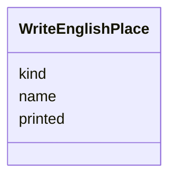

---
search:
  boost: 10.0
---

# Class: Place (WriteEnglishPlace) 


_A place a piece names._


<div data-search-exclude markdown="1">


URI: [pc:WriteEnglishPlace](https://pruzhany.org/ns/sourced-entities#WriteEnglishPlace)





<!-- no inheritance hierarchy -->

## Slots

| Name | Cardinality and Range | Description | Inheritance |
| ---  | --- | --- | --- |
| [name](name.md) | 1 <br/> [String](String.md) | Its usual English name. | direct |
| [printed](printed.md) | 1 <br/> [String](String.md) | As in the text. | direct |
| [kind](kind.md) | 1 <br/> [String](String.md) | The kind field in the Place response. | direct |


## Usages

| used by | used in | type | used |
| ---  | --- | --- | --- |
| [WriteEnglishAnsweredPiece](WriteEnglishAnsweredPiece.md) | [places](places.md) | range | [WriteEnglishPlace](WriteEnglishPlace.md) |


## Identifier and Mapping Information


### Schema Source


* from schema: https://pruzhany.org/ns/answers


## Mappings

| Mapping Type | Mapped Value |
| ---  | ---  |
| self | pc:WriteEnglishPlace |
| native | pc:WriteEnglishPlace |


## LinkML Source

<!-- TODO: investigate https://stackoverflow.com/questions/37606292/how-to-create-tabbed-code-blocks-in-mkdocs-or-sphinx -->

### Direct

<details>
```yaml
name: WriteEnglishPlace
description: A place a piece names.
title: Place
from_schema: https://pruzhany.org/ns/answers
rank: 1000
attributes:
  name:
    name: name
    description: Its usual English name.
    title: Name
    from_schema: https://pruzhany.org/ns/answers
    domain_of:
    - WriteEnglishLifeEvent
    - WriteEnglishOrganization
    - WriteEnglishPerson
    - WriteEnglishPlace
    - JoinPeopleGroup
    range: string
    required: true
  printed:
    name: printed
    description: As in the text.
    title: Printed
    from_schema: https://pruzhany.org/ns/answers
    domain_of:
    - WriteEnglishDoubt
    - WriteEnglishOrganization
    - WriteEnglishPerson
    - WriteEnglishPlace
    range: string
    required: true
  kind:
    name: kind
    annotations:
      description_in_wire:
        tag: description_in_wire
        value: false
    description: The kind field in the Place response.
    title: Kind
    from_schema: https://pruzhany.org/ns/answers
    domain_of:
    - FindItemsAnswerItem
    - WriteEnglishAnsweredPiece
    - WriteEnglishLifeEvent
    - WriteEnglishOrganization
    - WriteEnglishPlace
    range: string
    required: true
    equals_string_in:
    - city
    - town
    - village
    - shtetl
    - street
    - address
    - landmark
    - country
    - region
    - district

```
</details>

### Induced

<details>
```yaml
name: WriteEnglishPlace
description: A place a piece names.
title: Place
from_schema: https://pruzhany.org/ns/answers
rank: 1000
attributes:
  name:
    name: name
    description: Its usual English name.
    title: Name
    from_schema: https://pruzhany.org/ns/answers
    owner: WriteEnglishPlace
    domain_of:
    - WriteEnglishLifeEvent
    - WriteEnglishOrganization
    - WriteEnglishPerson
    - WriteEnglishPlace
    - JoinPeopleGroup
    range: string
    required: true
  printed:
    name: printed
    description: As in the text.
    title: Printed
    from_schema: https://pruzhany.org/ns/answers
    owner: WriteEnglishPlace
    domain_of:
    - WriteEnglishDoubt
    - WriteEnglishOrganization
    - WriteEnglishPerson
    - WriteEnglishPlace
    range: string
    required: true
  kind:
    name: kind
    annotations:
      description_in_wire:
        tag: description_in_wire
        value: false
    description: The kind field in the Place response.
    title: Kind
    from_schema: https://pruzhany.org/ns/answers
    owner: WriteEnglishPlace
    domain_of:
    - FindItemsAnswerItem
    - WriteEnglishAnsweredPiece
    - WriteEnglishLifeEvent
    - WriteEnglishOrganization
    - WriteEnglishPlace
    range: string
    required: true
    equals_string_in:
    - city
    - town
    - village
    - shtetl
    - street
    - address
    - landmark
    - country
    - region
    - district

```
</details></div>
