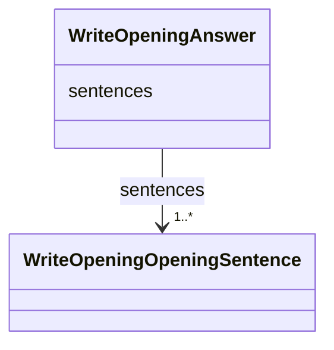

---
search:
  boost: 10.0
---

# Class: Answer (WriteOpeningAnswer) 


_The opening of one piece: its sentences, in order._


<div data-search-exclude markdown="1">


URI: [pc:WriteOpeningAnswer](https://pruzhany.org/ns/sourced-entities#WriteOpeningAnswer)





<!-- no inheritance hierarchy -->

## Slots

| Name | Cardinality and Range | Description | Inheritance |
| ---  | --- | --- | --- |
| [sentences](sentences.md) | 1..* <br/> [WriteOpeningOpeningSentence](WriteOpeningOpeningSentence.md) | The sentences field in the Answer response. | direct |


## Identifier and Mapping Information


### Annotations

| property | value |
| --- | --- |
| asking | write_opening |


### Schema Source


* from schema: https://pruzhany.org/ns/answers


## Mappings

| Mapping Type | Mapped Value |
| ---  | ---  |
| self | pc:WriteOpeningAnswer |
| native | pc:WriteOpeningAnswer |


## LinkML Source

<!-- TODO: investigate https://stackoverflow.com/questions/37606292/how-to-create-tabbed-code-blocks-in-mkdocs-or-sphinx -->

### Direct

<details>
```yaml
name: WriteOpeningAnswer
annotations:
  asking:
    tag: asking
    value: write_opening
description: 'The opening of one piece: its sentences, in order.'
title: Answer
from_schema: https://pruzhany.org/ns/answers
rank: 1000
attributes:
  sentences:
    name: sentences
    annotations:
      description_in_wire:
        tag: description_in_wire
        value: false
    description: The sentences field in the Answer response.
    title: Sentences
    from_schema: https://pruzhany.org/ns/answers
    rank: 1000
    domain_of:
    - WriteOpeningAnswer
    - JudgeOpeningAnswer
    range: WriteOpeningOpeningSentence
    required: true
    multivalued: true
    inlined: true
    inlined_as_list: true

```
</details>

### Induced

<details>
```yaml
name: WriteOpeningAnswer
annotations:
  asking:
    tag: asking
    value: write_opening
description: 'The opening of one piece: its sentences, in order.'
title: Answer
from_schema: https://pruzhany.org/ns/answers
rank: 1000
attributes:
  sentences:
    name: sentences
    annotations:
      description_in_wire:
        tag: description_in_wire
        value: false
    description: The sentences field in the Answer response.
    title: Sentences
    from_schema: https://pruzhany.org/ns/answers
    rank: 1000
    owner: WriteOpeningAnswer
    domain_of:
    - WriteOpeningAnswer
    - JudgeOpeningAnswer
    range: WriteOpeningOpeningSentence
    required: true
    multivalued: true
    inlined: true
    inlined_as_list: true

```
</details></div>
