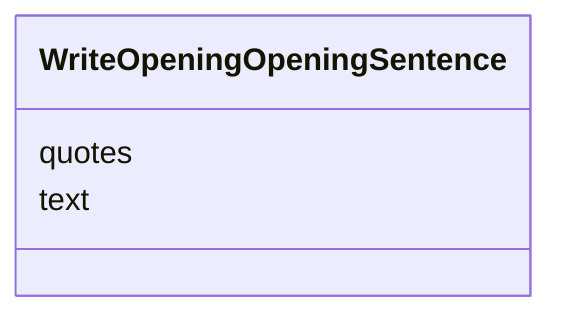

---
search:
  boost: 10.0
---

# Class: OpeningSentence (WriteOpeningOpeningSentence) 


_One sentence of the opening, with the exact words of the English it rests on._


<div data-search-exclude markdown="1">


URI: [pc:WriteOpeningOpeningSentence](https://pruzhany.org/ns/sourced-entities#WriteOpeningOpeningSentence)





<!-- no inheritance hierarchy -->

## Slots

| Name | Cardinality and Range | Description | Inheritance |
| ---  | --- | --- | --- |
| [text](text.md) | 1 <br/> [String](String.md) | The sentence, as the reader will read it. | direct |
| [quotes](quotes.md) | 1..* <br/> [String](String.md) | The passages of the English the sentence rests on, each copied exactly. | direct |


## Usages

| used by | used in | type | used |
| ---  | --- | --- | --- |
| [WriteOpeningAnswer](WriteOpeningAnswer.md) | [sentences](sentences.md) | range | [WriteOpeningOpeningSentence](WriteOpeningOpeningSentence.md) |


## Identifier and Mapping Information


### Schema Source


* from schema: https://pruzhany.org/ns/answers


## Mappings

| Mapping Type | Mapped Value |
| ---  | ---  |
| self | pc:WriteOpeningOpeningSentence |
| native | pc:WriteOpeningOpeningSentence |


## LinkML Source

<!-- TODO: investigate https://stackoverflow.com/questions/37606292/how-to-create-tabbed-code-blocks-in-mkdocs-or-sphinx -->

### Direct

<details>
```yaml
name: WriteOpeningOpeningSentence
description: One sentence of the opening, with the exact words of the English it rests
  on.
title: OpeningSentence
from_schema: https://pruzhany.org/ns/answers
rank: 1000
attributes:
  text:
    name: text
    description: The sentence, as the reader will read it.
    title: Text
    from_schema: https://pruzhany.org/ns/answers
    domain_of:
    - ReadLatinLine
    - WriteOpeningOpeningSentence
    range: string
    required: true
  quotes:
    name: quotes
    description: The passages of the English the sentence rests on, each copied exactly.
    title: Quotes
    from_schema: https://pruzhany.org/ns/answers
    rank: 1000
    domain_of:
    - WriteOpeningOpeningSentence
    range: string
    required: true
    multivalued: true

```
</details>

### Induced

<details>
```yaml
name: WriteOpeningOpeningSentence
description: One sentence of the opening, with the exact words of the English it rests
  on.
title: OpeningSentence
from_schema: https://pruzhany.org/ns/answers
rank: 1000
attributes:
  text:
    name: text
    description: The sentence, as the reader will read it.
    title: Text
    from_schema: https://pruzhany.org/ns/answers
    owner: WriteOpeningOpeningSentence
    domain_of:
    - ReadLatinLine
    - WriteOpeningOpeningSentence
    range: string
    required: true
  quotes:
    name: quotes
    description: The passages of the English the sentence rests on, each copied exactly.
    title: Quotes
    from_schema: https://pruzhany.org/ns/answers
    rank: 1000
    owner: WriteOpeningOpeningSentence
    domain_of:
    - WriteOpeningOpeningSentence
    range: string
    required: true
    multivalued: true

```
</details></div>
