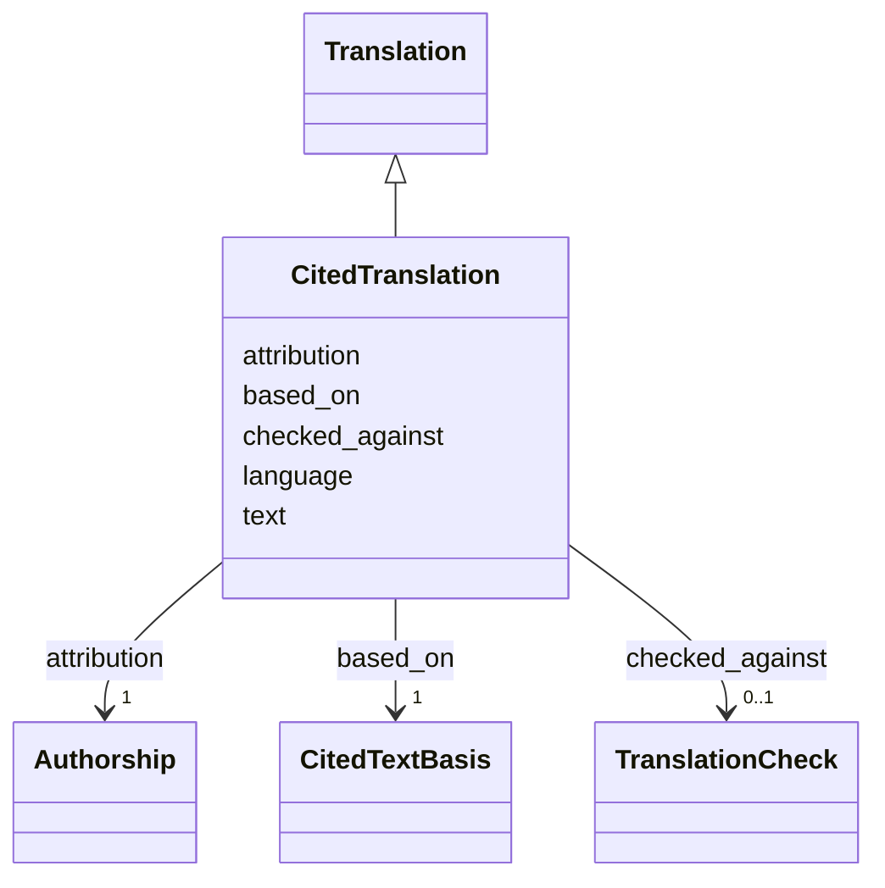

---
search:
  boost: 10.0
---

# Class: CitedTranslation 


_English of a citation's quote or a source title, located by its containing record. Reuses Translation's English, attribution and check contract without requiring an image and box for a book page or archive record._


<div data-search-exclude markdown="1">


URI: [pc:CitedTranslation](https://pruzhany.org/ns/sourced-entities#CitedTranslation)





## Inheritance
* [Translation](Translation.md)
    * **CitedTranslation**


## Slots

| Name | Cardinality and Range | Description | Inheritance |
| ---  | --- | --- | --- |
| [text](text.md) | 1 <br/> [NonBlankText](NonBlankText.md) | The English text. | [Translation](Translation.md) |
| [language](language.md) | 1 <br/> [String](String.md) | The translation's language, always English (en). | [Translation](Translation.md) |
| [based_on](based_on.md) | 1 <br/> [CitedTextBasis](CitedTextBasis.md) | The exact quote or title translated; source_text equals that original field, including whitespace and punctuation. | [Translation](Translation.md) |
| [attribution](attribution.md) | 1 <br/> [Authorship](Authorship.md) | Who translated it, and on which day. | [Translation](Translation.md) |
| [checked_against](checked_against.md) | 0..1 <br/> [TranslationCheck](TranslationCheck.md) | A later check of this translation against the reading, where one was made. | [Translation](Translation.md) |


## Identifier and Mapping Information


### Schema Source


* from schema: https://pruzhany.org/ns/content_items


## Mappings

| Mapping Type | Mapped Value |
| ---  | ---  |
| self | pc:CitedTranslation |
| native | pc:CitedTranslation |


## LinkML Source

<!-- TODO: investigate https://stackoverflow.com/questions/37606292/how-to-create-tabbed-code-blocks-in-mkdocs-or-sphinx -->

### Direct

<details>
```yaml
name: CitedTranslation
description: English of a citation's quote or a source title, located by its containing
  record. Reuses Translation's English, attribution and check contract without requiring
  an image and box for a book page or archive record.
from_schema: https://pruzhany.org/ns/content_items
rank: 1000
is_a: Translation
slot_usage:
  based_on:
    name: based_on
    description: The exact quote or title translated; source_text equals that original
      field, including whitespace and punctuation.
    range: CitedTextBasis

```
</details>

### Induced

<details>
```yaml
name: CitedTranslation
description: English of a citation's quote or a source title, located by its containing
  record. Reuses Translation's English, attribution and check contract without requiring
  an image and box for a book page or archive record.
from_schema: https://pruzhany.org/ns/content_items
rank: 1000
is_a: Translation
slot_usage:
  based_on:
    name: based_on
    description: The exact quote or title translated; source_text equals that original
      field, including whitespace and punctuation.
    range: CitedTextBasis
attributes:
  text:
    name: text
    description: The English text.
    from_schema: https://pruzhany.org/ns/site_common
    owner: CitedTranslation
    domain_of:
    - ReadingStatus
    - PrintedAddress
    - PrintedTitle
    - SuppliedTitle
    - Translation
    range: NonBlankText
    required: true
  language:
    name: language
    description: The translation's language, always English (en).
    from_schema: https://pruzhany.org/ns/site_common
    owner: CitedTranslation
    domain_of:
    - ContentItem
    - SuppliedTitle
    - Translation
    range: string
    required: true
    equals_string: en
  based_on:
    name: based_on
    description: The exact quote or title translated; source_text equals that original
      field, including whitespace and punctuation.
    from_schema: https://pruzhany.org/ns/content_items
    owner: CitedTranslation
    domain_of:
    - SuppliedTitle
    - Translation
    range: CitedTextBasis
    required: true
    inlined: true
  attribution:
    name: attribution
    description: Who translated it, and on which day.
    from_schema: https://pruzhany.org/ns/site_common
    owner: CitedTranslation
    domain_of:
    - EnglishCheck
    - SuppliedTitle
    - Translation
    range: Authorship
    required: true
    inlined: true
  checked_against:
    name: checked_against
    description: A later check of this translation against the reading, where one
      was made.
    from_schema: https://pruzhany.org/ns/site_common
    exact_mappings:
    - pc:site_checked_against_text
    owner: CitedTranslation
    domain_of:
    - SuppliedTitle
    - Translation
    range: TranslationCheck
    inlined: true

```
</details></div>
