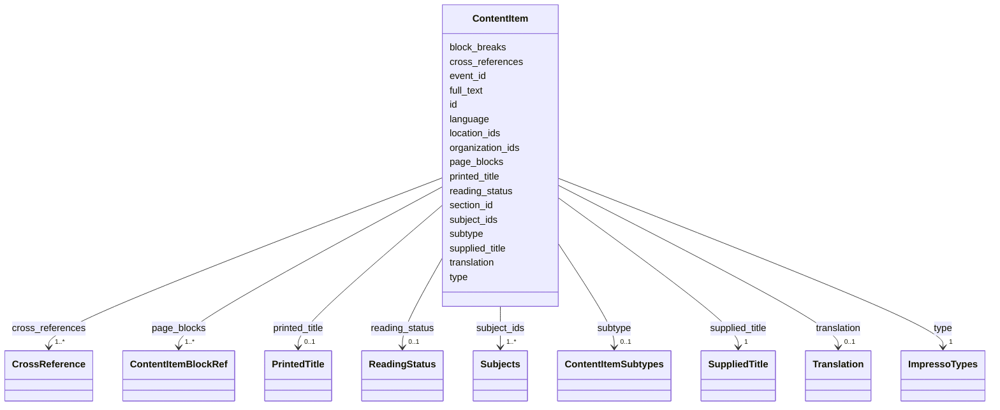

---
search:
  boost: 10.0
---

# Class: ContentItem 


_One article, notice, greeting or advertisement of the issue: its kind, its titles, its text and English, the regions it is printed in and what it names._


<div data-search-exclude markdown="1">


URI: [ehri:RecordResource](http://lod.ehri-project-test.eu/ontology#RecordResource)





<!-- no inheritance hierarchy -->

## Class Properties

| Property | Value |
| --- | --- |
| Class URI | [ehri:RecordResource](http://lod.ehri-project-test.eu/ontology#RecordResource) |


## Slots

| Name | Cardinality and Range | Description | Inheritance |
| ---  | --- | --- | --- |
| [id](id.md) | 1 <br/> [NonBlankText](NonBlankText.md) | The content item's id within the issue. | direct |
| [type](type.md) | 1 <br/> [ImpressoTypes](ImpressoTypes.md) | The content item's kind, one of Impresso's content item types. | direct |
| [subtype](subtype.md) | 0..1 <br/> [ContentItemSubtypes](ContentItemSubtypes.md) | The narrower form the content item takes within its kind, such as a wedding greeting within advertisements, where one is known. | direct |
| [printed_title](printed_title.md) | 0..1 <br/> [PrintedTitle](PrintedTitle.md) | The title as printed above the content item, where it has one. | direct |
| [supplied_title](supplied_title.md) | 1 <br/> [SuppliedTitle](SuppliedTitle.md) | A title in English supplied for the content item. | direct |
| [subject_ids](subject_ids.md) | 1..* <br/> [Subjects](Subjects.md) | What the content item is about, as subjects of the site-content vocabulary. | direct |
| [section_id](section_id.md) | 0..1 <br/> [NonBlankText](NonBlankText.md) | The printed section the content item stands under, by the section's id, where it stands under one. | direct |
| [full_text](full_text.md) | 1 <br/> [String](String.md) | The content item's printed text, a copy made for the site from the lines of its regions. | direct |
| [translation](translation.md) | 0..1 <br/> [Translation](Translation.md) | The content item's text in English, where it has been translated. | direct |
| [reading_status](reading_status.md) | 0..1 <br/> [ReadingStatus](ReadingStatus.md) | How far the text and the English have been checked; left out or null where it is not recorded. | direct |
| [block_breaks](block_breaks.md) | 1..* <br/> [NonNegativeInteger](NonNegativeInteger.md) | Where each region's text begins in the full text, counted in Unicode code points. | direct |
| [page_blocks](page_blocks.md) | 1..* <br/> [ContentItemBlockRef](ContentItemBlockRef.md) | The regions the content item is printed in, page by page, in reading order. | direct |
| [location_ids](location_ids.md) | 1..* <br/> [NonBlankText](NonBlankText.md) | The places the content item names, by their ids in the shared record. | direct |
| [organization_ids](organization_ids.md) | 1..* <br/> [NonBlankText](NonBlankText.md) | The organisations the content item names, by their ids in the shared record. | direct |
| [cross_references](cross_references.md) | 1..* <br/> [CrossReference](CrossReference.md) | Links from this content item to others in the issue. | direct |
| [event_id](event_id.md) | 0..1 <br/> [NonBlankText](NonBlankText.md) | The life event the content item prints, by the event's id, where it prints one. | direct |
| [language](language.md) | 0..1 <br/> [LanguageTag](LanguageTag.md) | The language most of the item is printed in, as the reading step judged it, as a two- or three-letter ISO 639 code (Impresso's lg). | direct |


## Usages

| used by | used in | type | used |
| ---  | --- | --- | --- |
| [ContentItemsData](ContentItemsData.md) | [content_items](content_items.md) | range | [ContentItem](ContentItem.md) |


## Rules


### 

| Rule Applied | Preconditions | Postconditions | Elseconditions |
|--------------|---------------|----------------|----------------|
| slot_conditions |```{'subtype': {'equals_string_in': ['wedding_greeting', 'engagement_greeting', 'birth_greeting', 'bar_mitzvah_greeting', 'new_year_greeting', 'departure_greeting', 'greeting', 'thanks', 'meeting_notice', 'announcement', 'appeal', 'commercial_advertisement']}}``` |```{'type': {'equals_string': 'ad'}}``` | |


### 

| Rule Applied | Preconditions | Postconditions | Elseconditions |
|--------------|---------------|----------------|----------------|
| slot_conditions |```{'subtype': {'equals_string_in': ['condolence', 'memorial_notice', 'death_announcement']}}``` |```{'type': {'equals_string': 'death_notice'}}``` | |


### 

| Rule Applied | Preconditions | Postconditions | Elseconditions |
|--------------|---------------|----------------|----------------|
| slot_conditions |```{'subtype': {'equals_string_in': ['editorial', 'opinion', 'letter', 'poem', 'sketch']}}``` |```{'type': {'equals_string': 'article'}}``` | |


### 

| Rule Applied | Preconditions | Postconditions | Elseconditions |
|--------------|---------------|----------------|----------------|
| slot_conditions |```{'subtype': {'equals_string_in': ['humour']}}``` |```{'type': {'equals_string': 'entertainment'}}``` | |


## Identifier and Mapping Information


### Annotations

| property | value |
| --- | --- |
| impresso | A content item file (paper_contentitem.schema.json). |


### Schema Source


* from schema: https://pruzhany.org/ns/content_items


## Mappings

| Mapping Type | Mapped Value |
| ---  | ---  |
| self | ehri:RecordResource |
| native | pc:ContentItem |


## LinkML Source

<!-- TODO: investigate https://stackoverflow.com/questions/37606292/how-to-create-tabbed-code-blocks-in-mkdocs-or-sphinx -->

### Direct

<details>
```yaml
name: ContentItem
annotations:
  impresso:
    tag: impresso
    value: A content item file (paper_contentitem.schema.json).
description: 'One article, notice, greeting or advertisement of the issue: its kind,
  its titles, its text and English, the regions it is printed in and what it names.'
from_schema: https://pruzhany.org/ns/content_items
rank: 1000
attributes:
  id:
    name: id
    annotations:
      impresso:
        tag: impresso
        value: The content item's id.
    description: The content item's id within the issue.
    from_schema: https://pruzhany.org/ns/content_items
    rank: 1000
    domain_of:
    - ContentItem
    - PrintedSection
    range: NonBlankText
    required: true
  type:
    name: type
    annotations:
      impresso:
        tag: impresso
        value: The content item's type (tp).
    description: The content item's kind, one of Impresso's content item types.
    from_schema: https://pruzhany.org/ns/content_items
    rank: 1000
    domain_of:
    - ContentItem
    range: ImpressoTypes
    required: true
  subtype:
    name: subtype
    description: The narrower form the content item takes within its kind, such as
      a wedding greeting within advertisements, where one is known.
    from_schema: https://pruzhany.org/ns/content_items
    rank: 1000
    slot_uri: rico:hasDocumentaryFormType
    domain_of:
    - ContentItem
    range: ContentItemSubtypes
  printed_title:
    name: printed_title
    annotations:
      impresso:
        tag: impresso
        value: The content item's title.
    description: The title as printed above the content item, where it has one.
    from_schema: https://pruzhany.org/ns/content_items
    rank: 1000
    slot_uri: rico:hasOrHadTitle
    domain_of:
    - ContentItem
    - PrintedSection
    range: PrintedTitle
    inlined: true
  supplied_title:
    name: supplied_title
    description: A title in English supplied for the content item.
    from_schema: https://pruzhany.org/ns/content_items
    rank: 1000
    slot_uri: rico:hasOrHadTitle
    domain_of:
    - ContentItem
    - PrintedSection
    range: SuppliedTitle
    required: true
    inlined: true
  subject_ids:
    name: subject_ids
    description: What the content item is about, as subjects of the site-content vocabulary.
    from_schema: https://pruzhany.org/ns/content_items
    rank: 1000
    slot_uri: rico:hasOrHadSubject
    domain_of:
    - ContentItem
    range: Subjects
    required: true
    multivalued: true
  section_id:
    name: section_id
    description: The printed section the content item stands under, by the section's
      id, where it stands under one.
    from_schema: https://pruzhany.org/ns/content_items
    rank: 1000
    domain_of:
    - ContentItem
    range: NonBlankText
  full_text:
    name: full_text
    annotations:
      impresso:
        tag: impresso
        value: The content item's rebuilt full text (ft).
    description: The content item's printed text, a copy made for the site from the
      lines of its regions.
    from_schema: https://pruzhany.org/ns/content_items
    related_mappings:
    - pc:site_site_copy
    rank: 1000
    domain_of:
    - ContentItem
    required: true
  translation:
    name: translation
    description: The content item's text in English, where it has been translated.
    from_schema: https://pruzhany.org/ns/content_items
    rank: 1000
    domain_of:
    - ContentItem
    range: Translation
    inlined: true
  reading_status:
    name: reading_status
    description: How far the text and the English have been checked; left out or null
      where it is not recorded.
    from_schema: https://pruzhany.org/ns/content_items
    exact_mappings:
    - pc:site_reading_status
    rank: 1000
    domain_of:
    - ContentItem
    range: ReadingStatus
    inlined: true
  block_breaks:
    name: block_breaks
    annotations:
      impresso:
        tag: impresso
        value: The text offsets of page regions (rb).
    description: Where each region's text begins in the full text, counted in Unicode
      code points.
    from_schema: https://pruzhany.org/ns/content_items
    related_mappings:
    - pc:site_site_copy
    rank: 1000
    domain_of:
    - ContentItem
    range: NonNegativeInteger
    required: true
    multivalued: true
  page_blocks:
    name: page_blocks
    description: The regions the content item is printed in, page by page, in reading
      order.
    from_schema: https://pruzhany.org/ns/content_items
    related_mappings:
    - pc:site_site_copy
    rank: 1000
    domain_of:
    - ContentItem
    range: ContentItemBlockRef
    required: true
    multivalued: true
    inlined_as_list: true
    minimum_cardinality: 1
  location_ids:
    name: location_ids
    description: The places the content item names, by their ids in the shared record.
    from_schema: https://pruzhany.org/ns/content_items
    rank: 1000
    domain_of:
    - ContentItem
    range: NonBlankText
    required: true
    multivalued: true
  organization_ids:
    name: organization_ids
    description: The organisations the content item names, by their ids in the shared
      record.
    from_schema: https://pruzhany.org/ns/content_items
    rank: 1000
    domain_of:
    - ContentItem
    range: NonBlankText
    required: true
    multivalued: true
  cross_references:
    name: cross_references
    description: Links from this content item to others in the issue.
    from_schema: https://pruzhany.org/ns/content_items
    rank: 1000
    domain_of:
    - ContentItem
    range: CrossReference
    required: true
    multivalued: true
    inlined_as_list: true
  event_id:
    name: event_id
    description: The life event the content item prints, by the event's id, where
      it prints one.
    from_schema: https://pruzhany.org/ns/content_items
    rank: 1000
    domain_of:
    - ContentItem
    range: NonBlankText
  language:
    name: language
    annotations:
      impresso:
        tag: impresso
        value: The content item's language (lg in paper_contentitem.schema.json and
          issue.schema.json, standards/impresso-329323c, read 1 November 2026).
    description: The language most of the item is printed in, as the reading step
      judged it, as a two- or three-letter ISO 639 code (Impresso's lg).
    from_schema: https://pruzhany.org/ns/content_items
    rank: 1000
    slot_uri: rico:hasOrHadLanguage
    domain_of:
    - ContentItem
    - SuppliedTitle
    - Translation
    range: LanguageTag
    pattern: ^[a-z]{2,3}$(?![\s\S])
class_uri: ehri:RecordResource
rules:
- preconditions:
    slot_conditions:
      subtype:
        name: subtype
        equals_string_in:
        - wedding_greeting
        - engagement_greeting
        - birth_greeting
        - bar_mitzvah_greeting
        - new_year_greeting
        - departure_greeting
        - greeting
        - thanks
        - meeting_notice
        - announcement
        - appeal
        - commercial_advertisement
  postconditions:
    slot_conditions:
      type:
        name: type
        equals_string: ad
  description: A greeting, thanks, notice, announcement, appeal or commercial advertisement
    is an advertisement (ad).
- preconditions:
    slot_conditions:
      subtype:
        name: subtype
        equals_string_in:
        - condolence
        - memorial_notice
        - death_announcement
  postconditions:
    slot_conditions:
      type:
        name: type
        equals_string: death_notice
  description: A condolence, memorial notice or death announcement is a death notice
    (death_notice).
- preconditions:
    slot_conditions:
      subtype:
        name: subtype
        equals_string_in:
        - editorial
        - opinion
        - letter
        - poem
        - sketch
  postconditions:
    slot_conditions:
      type:
        name: type
        equals_string: article
  description: An editorial, opinion, letter, poem or sketch is an article.
- preconditions:
    slot_conditions:
      subtype:
        name: subtype
        equals_string_in:
        - humour
  postconditions:
    slot_conditions:
      type:
        name: type
        equals_string: entertainment
  description: A humorous piece (humour) is entertainment.

```
</details>

### Induced

<details>
```yaml
name: ContentItem
annotations:
  impresso:
    tag: impresso
    value: A content item file (paper_contentitem.schema.json).
description: 'One article, notice, greeting or advertisement of the issue: its kind,
  its titles, its text and English, the regions it is printed in and what it names.'
from_schema: https://pruzhany.org/ns/content_items
rank: 1000
attributes:
  id:
    name: id
    annotations:
      impresso:
        tag: impresso
        value: The content item's id.
    description: The content item's id within the issue.
    from_schema: https://pruzhany.org/ns/content_items
    rank: 1000
    owner: ContentItem
    domain_of:
    - ContentItem
    - PrintedSection
    range: NonBlankText
    required: true
  type:
    name: type
    annotations:
      impresso:
        tag: impresso
        value: The content item's type (tp).
    description: The content item's kind, one of Impresso's content item types.
    from_schema: https://pruzhany.org/ns/content_items
    rank: 1000
    owner: ContentItem
    domain_of:
    - ContentItem
    range: ImpressoTypes
    required: true
  subtype:
    name: subtype
    description: The narrower form the content item takes within its kind, such as
      a wedding greeting within advertisements, where one is known.
    from_schema: https://pruzhany.org/ns/content_items
    rank: 1000
    slot_uri: rico:hasDocumentaryFormType
    owner: ContentItem
    domain_of:
    - ContentItem
    range: ContentItemSubtypes
  printed_title:
    name: printed_title
    annotations:
      impresso:
        tag: impresso
        value: The content item's title.
    description: The title as printed above the content item, where it has one.
    from_schema: https://pruzhany.org/ns/content_items
    rank: 1000
    slot_uri: rico:hasOrHadTitle
    owner: ContentItem
    domain_of:
    - ContentItem
    - PrintedSection
    range: PrintedTitle
    inlined: true
  supplied_title:
    name: supplied_title
    description: A title in English supplied for the content item.
    from_schema: https://pruzhany.org/ns/content_items
    rank: 1000
    slot_uri: rico:hasOrHadTitle
    owner: ContentItem
    domain_of:
    - ContentItem
    - PrintedSection
    range: SuppliedTitle
    required: true
    inlined: true
  subject_ids:
    name: subject_ids
    description: What the content item is about, as subjects of the site-content vocabulary.
    from_schema: https://pruzhany.org/ns/content_items
    rank: 1000
    slot_uri: rico:hasOrHadSubject
    owner: ContentItem
    domain_of:
    - ContentItem
    range: Subjects
    required: true
    multivalued: true
  section_id:
    name: section_id
    description: The printed section the content item stands under, by the section's
      id, where it stands under one.
    from_schema: https://pruzhany.org/ns/content_items
    rank: 1000
    owner: ContentItem
    domain_of:
    - ContentItem
    range: NonBlankText
  full_text:
    name: full_text
    annotations:
      impresso:
        tag: impresso
        value: The content item's rebuilt full text (ft).
    description: The content item's printed text, a copy made for the site from the
      lines of its regions.
    from_schema: https://pruzhany.org/ns/content_items
    related_mappings:
    - pc:site_site_copy
    rank: 1000
    owner: ContentItem
    domain_of:
    - ContentItem
    range: string
    required: true
  translation:
    name: translation
    description: The content item's text in English, where it has been translated.
    from_schema: https://pruzhany.org/ns/content_items
    rank: 1000
    owner: ContentItem
    domain_of:
    - ContentItem
    range: Translation
    inlined: true
  reading_status:
    name: reading_status
    description: How far the text and the English have been checked; left out or null
      where it is not recorded.
    from_schema: https://pruzhany.org/ns/content_items
    exact_mappings:
    - pc:site_reading_status
    rank: 1000
    owner: ContentItem
    domain_of:
    - ContentItem
    range: ReadingStatus
    inlined: true
  block_breaks:
    name: block_breaks
    annotations:
      impresso:
        tag: impresso
        value: The text offsets of page regions (rb).
    description: Where each region's text begins in the full text, counted in Unicode
      code points.
    from_schema: https://pruzhany.org/ns/content_items
    related_mappings:
    - pc:site_site_copy
    rank: 1000
    owner: ContentItem
    domain_of:
    - ContentItem
    range: NonNegativeInteger
    required: true
    multivalued: true
  page_blocks:
    name: page_blocks
    description: The regions the content item is printed in, page by page, in reading
      order.
    from_schema: https://pruzhany.org/ns/content_items
    related_mappings:
    - pc:site_site_copy
    rank: 1000
    owner: ContentItem
    domain_of:
    - ContentItem
    range: ContentItemBlockRef
    required: true
    multivalued: true
    inlined: true
    inlined_as_list: true
    minimum_cardinality: 1
  location_ids:
    name: location_ids
    description: The places the content item names, by their ids in the shared record.
    from_schema: https://pruzhany.org/ns/content_items
    rank: 1000
    owner: ContentItem
    domain_of:
    - ContentItem
    range: NonBlankText
    required: true
    multivalued: true
  organization_ids:
    name: organization_ids
    description: The organisations the content item names, by their ids in the shared
      record.
    from_schema: https://pruzhany.org/ns/content_items
    rank: 1000
    owner: ContentItem
    domain_of:
    - ContentItem
    range: NonBlankText
    required: true
    multivalued: true
  cross_references:
    name: cross_references
    description: Links from this content item to others in the issue.
    from_schema: https://pruzhany.org/ns/content_items
    rank: 1000
    owner: ContentItem
    domain_of:
    - ContentItem
    range: CrossReference
    required: true
    multivalued: true
    inlined: true
    inlined_as_list: true
  event_id:
    name: event_id
    description: The life event the content item prints, by the event's id, where
      it prints one.
    from_schema: https://pruzhany.org/ns/content_items
    rank: 1000
    owner: ContentItem
    domain_of:
    - ContentItem
    range: NonBlankText
  language:
    name: language
    annotations:
      impresso:
        tag: impresso
        value: The content item's language (lg in paper_contentitem.schema.json and
          issue.schema.json, standards/impresso-329323c, read 1 November 2026).
    description: The language most of the item is printed in, as the reading step
      judged it, as a two- or three-letter ISO 639 code (Impresso's lg).
    from_schema: https://pruzhany.org/ns/content_items
    rank: 1000
    slot_uri: rico:hasOrHadLanguage
    owner: ContentItem
    domain_of:
    - ContentItem
    - SuppliedTitle
    - Translation
    range: LanguageTag
    pattern: ^[a-z]{2,3}$(?![\s\S])
class_uri: ehri:RecordResource
rules:
- preconditions:
    slot_conditions:
      subtype:
        name: subtype
        equals_string_in:
        - wedding_greeting
        - engagement_greeting
        - birth_greeting
        - bar_mitzvah_greeting
        - new_year_greeting
        - departure_greeting
        - greeting
        - thanks
        - meeting_notice
        - announcement
        - appeal
        - commercial_advertisement
  postconditions:
    slot_conditions:
      type:
        name: type
        equals_string: ad
  description: A greeting, thanks, notice, announcement, appeal or commercial advertisement
    is an advertisement (ad).
- preconditions:
    slot_conditions:
      subtype:
        name: subtype
        equals_string_in:
        - condolence
        - memorial_notice
        - death_announcement
  postconditions:
    slot_conditions:
      type:
        name: type
        equals_string: death_notice
  description: A condolence, memorial notice or death announcement is a death notice
    (death_notice).
- preconditions:
    slot_conditions:
      subtype:
        name: subtype
        equals_string_in:
        - editorial
        - opinion
        - letter
        - poem
        - sketch
  postconditions:
    slot_conditions:
      type:
        name: type
        equals_string: article
  description: An editorial, opinion, letter, poem or sketch is an article.
- preconditions:
    slot_conditions:
      subtype:
        name: subtype
        equals_string_in:
        - humour
  postconditions:
    slot_conditions:
      type:
        name: type
        equals_string: entertainment
  description: A humorous piece (humour) is entertainment.

```
</details></div>
