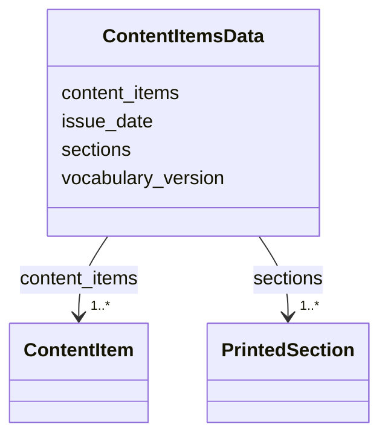

---
search:
  boost: 10.0
---

# Class: ContentItemsData 


_One issue's content items document: the issue's date, the vocabulary version its values are from, its content items and its printed sections._


<div data-search-exclude markdown="1">


URI: [pc:ContentItemsData](https://pruzhany.org/ns/sourced-entities#ContentItemsData)





<!-- no inheritance hierarchy -->

## Class Properties

| Property | Value |
| --- | --- |
| Tree Root | Yes |


## Slots

| Name | Cardinality and Range | Description | Inheritance |
| ---  | --- | --- | --- |
| [issue_date](issue_date.md) | 1 <br/> [IsoDay](IsoDay.md) | The issue's date, written YYYY-MM-DD. | direct |
| [vocabulary_version](vocabulary_version.md) | 1 <br/> [String](String.md) | The version of the site-content vocabulary whose values the document uses: one of the versions the current vocabulary accepts as compatible. | direct |
| [content_items](content_items.md) | 1..* <br/> [ContentItem](ContentItem.md) | The issue's content items. | direct |
| [sections](sections.md) | 1..* <br/> [PrintedSection](PrintedSection.md) | The issue's printed sections. | direct |


## Identifier and Mapping Information


### Annotations

| property | value |
| --- | --- |
| impresso | The content item files of one issue (paper_contentitem.schema.json), and the issue file's list of its items (issue.schema.json i). |


### Schema Source


* from schema: https://pruzhany.org/ns/content_items


## Mappings

| Mapping Type | Mapped Value |
| ---  | ---  |
| self | pc:ContentItemsData |
| native | pc:ContentItemsData |


## LinkML Source

<!-- TODO: investigate https://stackoverflow.com/questions/37606292/how-to-create-tabbed-code-blocks-in-mkdocs-or-sphinx -->

### Direct

<details>
```yaml
name: ContentItemsData
annotations:
  impresso:
    tag: impresso
    value: The content item files of one issue (paper_contentitem.schema.json), and
      the issue file's list of its items (issue.schema.json i).
description: 'One issue''s content items document: the issue''s date, the vocabulary
  version its values are from, its content items and its printed sections.'
from_schema: https://pruzhany.org/ns/content_items
rank: 1000
attributes:
  issue_date:
    name: issue_date
    description: The issue's date, written YYYY-MM-DD.
    from_schema: https://pruzhany.org/ns/content_items
    rank: 1000
    domain_of:
    - ContentItemsData
    range: IsoDay
    required: true
  vocabulary_version:
    name: vocabulary_version
    description: 'The version of the site-content vocabulary whose values the document
      uses: one of the versions the current vocabulary accepts as compatible.'
    from_schema: https://pruzhany.org/ns/content_items
    rank: 1000
    domain_of:
    - ContentItemsData
    required: true
    pattern: ^(0\.1\.0|1\.0\.0|1\.1\.0)$(?![\s\S])
  content_items:
    name: content_items
    description: The issue's content items.
    from_schema: https://pruzhany.org/ns/content_items
    rank: 1000
    domain_of:
    - ContentItemsData
    range: ContentItem
    required: true
    multivalued: true
    inlined_as_list: true
  sections:
    name: sections
    description: The issue's printed sections.
    from_schema: https://pruzhany.org/ns/content_items
    rank: 1000
    domain_of:
    - ContentItemsData
    range: PrintedSection
    required: true
    multivalued: true
    inlined_as_list: true
tree_root: true

```
</details>

### Induced

<details>
```yaml
name: ContentItemsData
annotations:
  impresso:
    tag: impresso
    value: The content item files of one issue (paper_contentitem.schema.json), and
      the issue file's list of its items (issue.schema.json i).
description: 'One issue''s content items document: the issue''s date, the vocabulary
  version its values are from, its content items and its printed sections.'
from_schema: https://pruzhany.org/ns/content_items
rank: 1000
attributes:
  issue_date:
    name: issue_date
    description: The issue's date, written YYYY-MM-DD.
    from_schema: https://pruzhany.org/ns/content_items
    rank: 1000
    owner: ContentItemsData
    domain_of:
    - ContentItemsData
    range: IsoDay
    required: true
  vocabulary_version:
    name: vocabulary_version
    description: 'The version of the site-content vocabulary whose values the document
      uses: one of the versions the current vocabulary accepts as compatible.'
    from_schema: https://pruzhany.org/ns/content_items
    rank: 1000
    owner: ContentItemsData
    domain_of:
    - ContentItemsData
    range: string
    required: true
    pattern: ^(0\.1\.0|1\.0\.0|1\.1\.0)$(?![\s\S])
  content_items:
    name: content_items
    description: The issue's content items.
    from_schema: https://pruzhany.org/ns/content_items
    rank: 1000
    owner: ContentItemsData
    domain_of:
    - ContentItemsData
    range: ContentItem
    required: true
    multivalued: true
    inlined: true
    inlined_as_list: true
  sections:
    name: sections
    description: The issue's printed sections.
    from_schema: https://pruzhany.org/ns/content_items
    rank: 1000
    owner: ContentItemsData
    domain_of:
    - ContentItemsData
    range: PrintedSection
    required: true
    multivalued: true
    inlined: true
    inlined_as_list: true
tree_root: true

```
</details></div>
