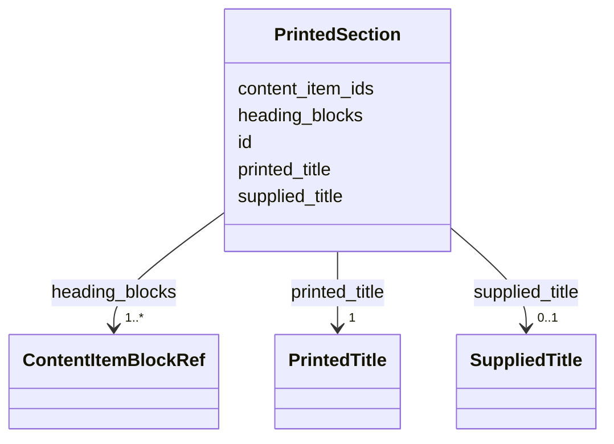

---
search:
  boost: 10.0
---

# Class: PrintedSection 


_A printed heading and the content items that stand beneath it, such as the title "What is heard in town?" over the town's news._


<div data-search-exclude markdown="1">


URI: [ehri:RecordSet](http://lod.ehri-project-test.eu/ontology#RecordSet)





<!-- no inheritance hierarchy -->

## Class Properties

| Property | Value |
| --- | --- |
| Class URI | [ehri:RecordSet](http://lod.ehri-project-test.eu/ontology#RecordSet) |


## Slots

| Name | Cardinality and Range | Description | Inheritance |
| ---  | --- | --- | --- |
| [id](id.md) | 1 <br/> [NonBlankText](NonBlankText.md) | The section's id within the issue. | direct |
| [printed_title](printed_title.md) | 1 <br/> [PrintedTitle](PrintedTitle.md) | The heading as printed. | direct |
| [supplied_title](supplied_title.md) | 0..1 <br/> [SuppliedTitle](SuppliedTitle.md) | A title in English supplied for the heading, where one was made. | direct |
| [content_item_ids](content_item_ids.md) | 1..* <br/> [NonBlankText](NonBlankText.md) | The content items beneath the heading, by their ids. | direct |
| [heading_blocks](heading_blocks.md) | 1..* <br/> [ContentItemBlockRef](ContentItemBlockRef.md) | The regions the heading is printed in, page by page. | direct |


## Usages

| used by | used in | type | used |
| ---  | --- | --- | --- |
| [ContentItemsData](ContentItemsData.md) | [sections](sections.md) | range | [PrintedSection](PrintedSection.md) |


## Identifier and Mapping Information


### Annotations

| property | value |
| --- | --- |
| impresso | A section title (section_title in the issue and content item files). |


### Schema Source


* from schema: https://pruzhany.org/ns/content_items


## Mappings

| Mapping Type | Mapped Value |
| ---  | ---  |
| self | ehri:RecordSet |
| native | pc:PrintedSection |


## LinkML Source

<!-- TODO: investigate https://stackoverflow.com/questions/37606292/how-to-create-tabbed-code-blocks-in-mkdocs-or-sphinx -->

### Direct

<details>
```yaml
name: PrintedSection
annotations:
  impresso:
    tag: impresso
    value: A section title (section_title in the issue and content item files).
description: A printed heading and the content items that stand beneath it, such as
  the title "What is heard in town?" over the town's news.
from_schema: https://pruzhany.org/ns/content_items
rank: 1000
attributes:
  id:
    name: id
    annotations:
      impresso:
        tag: impresso
        value: The section's id (section_title.section_id).
    description: The section's id within the issue.
    from_schema: https://pruzhany.org/ns/content_items
    domain_of:
    - ContentItem
    - PrintedSection
    range: NonBlankText
    required: true
  printed_title:
    name: printed_title
    annotations:
      impresso:
        tag: impresso
        value: The section's heading text (section_title.title_text).
    description: The heading as printed.
    from_schema: https://pruzhany.org/ns/content_items
    slot_uri: rico:hasOrHadTitle
    domain_of:
    - ContentItem
    - PrintedSection
    range: PrintedTitle
    required: true
    inlined: true
  supplied_title:
    name: supplied_title
    description: A title in English supplied for the heading, where one was made.
    from_schema: https://pruzhany.org/ns/content_items
    slot_uri: rico:hasOrHadTitle
    domain_of:
    - ContentItem
    - PrintedSection
    range: SuppliedTitle
    inlined: true
  content_item_ids:
    name: content_item_ids
    annotations:
      impresso:
        tag: impresso
        value: The content items that make up the section (section_title.composing_ci_ids).
    description: The content items beneath the heading, by their ids.
    from_schema: https://pruzhany.org/ns/content_items
    rank: 1000
    slot_uri: rico:includesOrIncluded
    domain_of:
    - PrintedSection
    range: NonBlankText
    required: true
    multivalued: true
    minimum_cardinality: 1
  heading_blocks:
    name: heading_blocks
    description: The regions the heading is printed in, page by page.
    from_schema: https://pruzhany.org/ns/content_items
    rank: 1000
    domain_of:
    - PrintedSection
    range: ContentItemBlockRef
    required: true
    multivalued: true
    inlined_as_list: true
    minimum_cardinality: 1
class_uri: ehri:RecordSet

```
</details>

### Induced

<details>
```yaml
name: PrintedSection
annotations:
  impresso:
    tag: impresso
    value: A section title (section_title in the issue and content item files).
description: A printed heading and the content items that stand beneath it, such as
  the title "What is heard in town?" over the town's news.
from_schema: https://pruzhany.org/ns/content_items
rank: 1000
attributes:
  id:
    name: id
    annotations:
      impresso:
        tag: impresso
        value: The section's id (section_title.section_id).
    description: The section's id within the issue.
    from_schema: https://pruzhany.org/ns/content_items
    owner: PrintedSection
    domain_of:
    - ContentItem
    - PrintedSection
    range: NonBlankText
    required: true
  printed_title:
    name: printed_title
    annotations:
      impresso:
        tag: impresso
        value: The section's heading text (section_title.title_text).
    description: The heading as printed.
    from_schema: https://pruzhany.org/ns/content_items
    slot_uri: rico:hasOrHadTitle
    owner: PrintedSection
    domain_of:
    - ContentItem
    - PrintedSection
    range: PrintedTitle
    required: true
    inlined: true
  supplied_title:
    name: supplied_title
    description: A title in English supplied for the heading, where one was made.
    from_schema: https://pruzhany.org/ns/content_items
    slot_uri: rico:hasOrHadTitle
    owner: PrintedSection
    domain_of:
    - ContentItem
    - PrintedSection
    range: SuppliedTitle
    inlined: true
  content_item_ids:
    name: content_item_ids
    annotations:
      impresso:
        tag: impresso
        value: The content items that make up the section (section_title.composing_ci_ids).
    description: The content items beneath the heading, by their ids.
    from_schema: https://pruzhany.org/ns/content_items
    rank: 1000
    slot_uri: rico:includesOrIncluded
    owner: PrintedSection
    domain_of:
    - PrintedSection
    range: NonBlankText
    required: true
    multivalued: true
    minimum_cardinality: 1
  heading_blocks:
    name: heading_blocks
    description: The regions the heading is printed in, page by page.
    from_schema: https://pruzhany.org/ns/content_items
    rank: 1000
    owner: PrintedSection
    domain_of:
    - PrintedSection
    range: ContentItemBlockRef
    required: true
    multivalued: true
    inlined: true
    inlined_as_list: true
    minimum_cardinality: 1
class_uri: ehri:RecordSet

```
</details></div>
