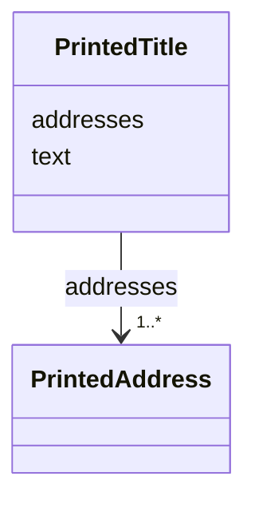

---
search:
  boost: 10.0
---

# Class: PrintedTitle 


_A title as printed in the paper: its words and where each line of them stands._


<div data-search-exclude markdown="1">


URI: [rico:Title](https://www.ica.org/standards/RiC/ontology#Title)





<!-- no inheritance hierarchy -->

## Class Properties

| Property | Value |
| --- | --- |
| Class URI | [rico:Title](https://www.ica.org/standards/RiC/ontology#Title) |


## Slots

| Name | Cardinality and Range | Description | Inheritance |
| ---  | --- | --- | --- |
| [text](text.md) | 1 <br/> [NonBlankText](NonBlankText.md) | The printed words, its lines joined by line breaks. | direct |
| [addresses](addresses.md) | 1..* <br/> [PrintedAddress](PrintedAddress.md) | Where each line of the title is printed, in order. | direct |


## Usages

| used by | used in | type | used |
| ---  | --- | --- | --- |
| [ContentItem](ContentItem.md) | [printed_title](printed_title.md) | range | [PrintedTitle](PrintedTitle.md) |
| [PrintedSection](PrintedSection.md) | [printed_title](printed_title.md) | range | [PrintedTitle](PrintedTitle.md) |


## Identifier and Mapping Information


### Annotations

| property | value |
| --- | --- |
| impresso | A content item's title (paper_contentitem.schema.json title), or a section's printed heading (section_title.title_text). |


### Schema Source


* from schema: https://pruzhany.org/ns/content_items


## Mappings

| Mapping Type | Mapped Value |
| ---  | ---  |
| self | rico:Title |
| native | pc:PrintedTitle |


## LinkML Source

<!-- TODO: investigate https://stackoverflow.com/questions/37606292/how-to-create-tabbed-code-blocks-in-mkdocs-or-sphinx -->

### Direct

<details>
```yaml
name: PrintedTitle
annotations:
  impresso:
    tag: impresso
    value: A content item's title (paper_contentitem.schema.json title), or a section's
      printed heading (section_title.title_text).
description: 'A title as printed in the paper: its words and where each line of them
  stands.'
from_schema: https://pruzhany.org/ns/content_items
rank: 1000
attributes:
  text:
    name: text
    description: The printed words, its lines joined by line breaks.
    from_schema: https://pruzhany.org/ns/site_common
    slot_uri: rico:textualValue
    domain_of:
    - ReadingStatus
    - PrintedAddress
    - PrintedTitle
    - SuppliedTitle
    - Translation
    range: NonBlankText
    required: true
  addresses:
    name: addresses
    description: Where each line of the title is printed, in order.
    from_schema: https://pruzhany.org/ns/site_common
    domain_of:
    - TextBasis
    - PrintedTitle
    range: PrintedAddress
    required: true
    multivalued: true
    inlined_as_list: true
    minimum_cardinality: 1
class_uri: rico:Title

```
</details>

### Induced

<details>
```yaml
name: PrintedTitle
annotations:
  impresso:
    tag: impresso
    value: A content item's title (paper_contentitem.schema.json title), or a section's
      printed heading (section_title.title_text).
description: 'A title as printed in the paper: its words and where each line of them
  stands.'
from_schema: https://pruzhany.org/ns/content_items
rank: 1000
attributes:
  text:
    name: text
    description: The printed words, its lines joined by line breaks.
    from_schema: https://pruzhany.org/ns/site_common
    slot_uri: rico:textualValue
    owner: PrintedTitle
    domain_of:
    - ReadingStatus
    - PrintedAddress
    - PrintedTitle
    - SuppliedTitle
    - Translation
    range: NonBlankText
    required: true
  addresses:
    name: addresses
    description: Where each line of the title is printed, in order.
    from_schema: https://pruzhany.org/ns/site_common
    owner: PrintedTitle
    domain_of:
    - TextBasis
    - PrintedTitle
    range: PrintedAddress
    required: true
    multivalued: true
    inlined: true
    inlined_as_list: true
    minimum_cardinality: 1
class_uri: rico:Title

```
</details></div>
