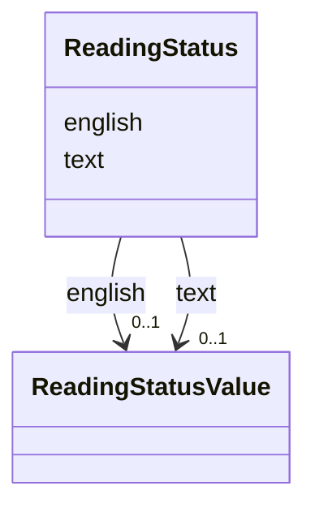

---
search:
  boost: 10.0
---

# Class: ReadingStatus 


_How far a content item's text and its English have been checked, each recorded on its own; null for either means it is not recorded, not that it was reviewed._


<div data-search-exclude markdown="1">


URI: [pc:ReadingStatus](https://pruzhany.org/ns/sourced-entities#ReadingStatus)





<!-- no inheritance hierarchy -->

## Slots

| Name | Cardinality and Range | Description | Inheritance |
| ---  | --- | --- | --- |
| [text](text.md) | 0..1 <br/> [ReadingStatusValue](ReadingStatusValue.md) | How far the printed text has been checked; null where not recorded. | direct |
| [english](english.md) | 0..1 <br/> [ReadingStatusValue](ReadingStatusValue.md) | How far the English has been checked; null where not recorded. | direct |


## Usages

| used by | used in | type | used |
| ---  | --- | --- | --- |
| [ContentItem](ContentItem.md) | [reading_status](reading_status.md) | range | [ReadingStatus](ReadingStatus.md) |


## Identifier and Mapping Information


### Schema Source


* from schema: https://pruzhany.org/ns/content_items


## Mappings

| Mapping Type | Mapped Value |
| ---  | ---  |
| self | pc:ReadingStatus |
| native | pc:ReadingStatus |
| exact | pc:site_reading_status |


## LinkML Source

<!-- TODO: investigate https://stackoverflow.com/questions/37606292/how-to-create-tabbed-code-blocks-in-mkdocs-or-sphinx -->

### Direct

<details>
```yaml
name: ReadingStatus
description: How far a content item's text and its English have been checked, each
  recorded on its own; null for either means it is not recorded, not that it was reviewed.
from_schema: https://pruzhany.org/ns/content_items
exact_mappings:
- pc:site_reading_status
rank: 1000
attributes:
  text:
    name: text
    description: How far the printed text has been checked; null where not recorded.
    from_schema: https://pruzhany.org/ns/content_items
    rank: 1000
    domain_of:
    - ReadingStatus
    - PrintedAddress
    - PrintedTitle
    - SuppliedTitle
    - Translation
    range: ReadingStatusValue
  english:
    name: english
    description: How far the English has been checked; null where not recorded.
    from_schema: https://pruzhany.org/ns/content_items
    rank: 1000
    domain_of:
    - ReadingStatus
    range: ReadingStatusValue

```
</details>

### Induced

<details>
```yaml
name: ReadingStatus
description: How far a content item's text and its English have been checked, each
  recorded on its own; null for either means it is not recorded, not that it was reviewed.
from_schema: https://pruzhany.org/ns/content_items
exact_mappings:
- pc:site_reading_status
rank: 1000
attributes:
  text:
    name: text
    description: How far the printed text has been checked; null where not recorded.
    from_schema: https://pruzhany.org/ns/content_items
    rank: 1000
    owner: ReadingStatus
    domain_of:
    - ReadingStatus
    - PrintedAddress
    - PrintedTitle
    - SuppliedTitle
    - Translation
    range: ReadingStatusValue
  english:
    name: english
    description: How far the English has been checked; null where not recorded.
    from_schema: https://pruzhany.org/ns/content_items
    rank: 1000
    owner: ReadingStatus
    domain_of:
    - ReadingStatus
    range: ReadingStatusValue

```
</details></div>
