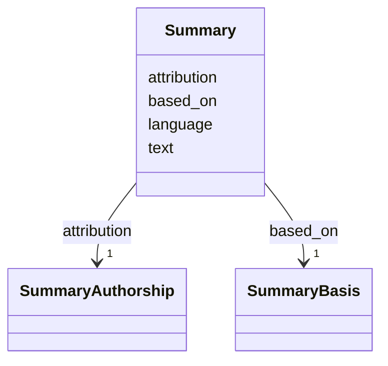

---
search:
  boost: 10.0
---

# Class: Summary 


_A short summary in English of a content item, written from its English translation, with the digest of the exact English it was written from and who wrote it._


<div data-search-exclude markdown="1">


URI: [pc:Summary](https://pruzhany.org/ns/sourced-entities#Summary)





<!-- no inheritance hierarchy -->

## Slots

| Name | Cardinality and Range | Description | Inheritance |
| ---  | --- | --- | --- |
| [text](text.md) | 1 <br/> [NonBlankText](NonBlankText.md) | The summary's English. | direct |
| [language](language.md) | 1 <br/> [String](String.md) | The summary's language, always English (en). | direct |
| [based_on](based_on.md) | 1 <br/> [SummaryBasis](SummaryBasis.md) | The exact English the summary was written from, by its digest. | direct |
| [attribution](attribution.md) | 1 <br/> [SummaryAuthorship](SummaryAuthorship.md) | The model that wrote the summary, how hard it was told to think, on which day, and whether a person has checked it. | direct |


## Usages

| used by | used in | type | used |
| ---  | --- | --- | --- |
| [ContentItem](ContentItem.md) | [summary](summary.md) | range | [Summary](Summary.md) |


## Identifier and Mapping Information


### Schema Source


* from schema: https://pruzhany.org/ns/content_items


## Mappings

| Mapping Type | Mapped Value |
| ---  | ---  |
| self | pc:Summary |
| native | pc:Summary |


## LinkML Source

<!-- TODO: investigate https://stackoverflow.com/questions/37606292/how-to-create-tabbed-code-blocks-in-mkdocs-or-sphinx -->

### Direct

<details>
```yaml
name: Summary
description: A short summary in English of a content item, written from its English
  translation, with the digest of the exact English it was written from and who wrote
  it.
from_schema: https://pruzhany.org/ns/content_items
rank: 1000
attributes:
  text:
    name: text
    description: The summary's English.
    from_schema: https://pruzhany.org/ns/content_items
    rank: 1000
    domain_of:
    - Summary
    - ReadingStatus
    - PrintedAddress
    - PrintedTitle
    - SuppliedTitle
    - Translation
    range: NonBlankText
    required: true
  language:
    name: language
    description: The summary's language, always English (en).
    from_schema: https://pruzhany.org/ns/content_items
    domain_of:
    - ContentItem
    - Summary
    - SuppliedTitle
    - Translation
    required: true
    equals_string: en
  based_on:
    name: based_on
    description: The exact English the summary was written from, by its digest.
    from_schema: https://pruzhany.org/ns/content_items
    rank: 1000
    domain_of:
    - Summary
    - SuppliedTitle
    - Translation
    range: SummaryBasis
    required: true
    inlined: true
  attribution:
    name: attribution
    description: The model that wrote the summary, how hard it was told to think,
      on which day, and whether a person has checked it.
    from_schema: https://pruzhany.org/ns/content_items
    rank: 1000
    domain_of:
    - Summary
    - EnglishCheck
    - SuppliedTitle
    - Translation
    range: SummaryAuthorship
    required: true
    inlined: true

```
</details>

### Induced

<details>
```yaml
name: Summary
description: A short summary in English of a content item, written from its English
  translation, with the digest of the exact English it was written from and who wrote
  it.
from_schema: https://pruzhany.org/ns/content_items
rank: 1000
attributes:
  text:
    name: text
    description: The summary's English.
    from_schema: https://pruzhany.org/ns/content_items
    rank: 1000
    owner: Summary
    domain_of:
    - Summary
    - ReadingStatus
    - PrintedAddress
    - PrintedTitle
    - SuppliedTitle
    - Translation
    range: NonBlankText
    required: true
  language:
    name: language
    description: The summary's language, always English (en).
    from_schema: https://pruzhany.org/ns/content_items
    owner: Summary
    domain_of:
    - ContentItem
    - Summary
    - SuppliedTitle
    - Translation
    range: string
    required: true
    equals_string: en
  based_on:
    name: based_on
    description: The exact English the summary was written from, by its digest.
    from_schema: https://pruzhany.org/ns/content_items
    rank: 1000
    owner: Summary
    domain_of:
    - Summary
    - SuppliedTitle
    - Translation
    range: SummaryBasis
    required: true
    inlined: true
  attribution:
    name: attribution
    description: The model that wrote the summary, how hard it was told to think,
      on which day, and whether a person has checked it.
    from_schema: https://pruzhany.org/ns/content_items
    rank: 1000
    owner: Summary
    domain_of:
    - Summary
    - EnglishCheck
    - SuppliedTitle
    - Translation
    range: SummaryAuthorship
    required: true
    inlined: true

```
</details></div>
