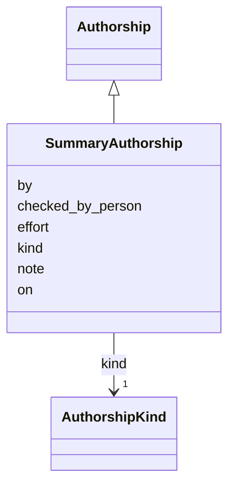

---
search:
  boost: 10.0
---

# Class: SummaryAuthorship 


_Who wrote a summary, always a model, on which day, how hard it was told to think, and whether a person has checked the summary against the English._


<div data-search-exclude markdown="1">


URI: [pc:SummaryAuthorship](https://pruzhany.org/ns/sourced-entities#SummaryAuthorship)





## Inheritance
* [Attribution](Attribution.md)
    * [Authorship](Authorship.md)
        * **SummaryAuthorship**


## Slots

| Name | Cardinality and Range | Description | Inheritance |
| ---  | --- | --- | --- |
| [effort](effort.md) | 1 <br/> [NonBlankText](NonBlankText.md) | How hard the model was told to think, in its service's own word, such as low. | direct |
| [checked_by_person](checked_by_person.md) | 1 <br/> [Boolean](Boolean.md) | Whether a person has checked the summary against the English; false until one has. | direct |
| [kind](kind.md) | 1 <br/> [AuthorshipKind](AuthorshipKind.md) | Always a model (model). | [Authorship](Authorship.md) |
| [by](by.md) | 1 <br/> [NonBlankText](NonBlankText.md) | Who made it or allowed it: a person, a session or a program. | [Attribution](Attribution.md) |
| [on](on.md) | 1 <br/> [IsoDay](IsoDay.md) | The day it was made or allowed. | [Attribution](Attribution.md) |
| [note](note.md) | 0..1 <br/> [String](String.md) | A note on how or why. | [Attribution](Attribution.md) |


## Usages

| used by | used in | type | used |
| ---  | --- | --- | --- |
| [Summary](Summary.md) | [attribution](attribution.md) | range | [SummaryAuthorship](SummaryAuthorship.md) |


## Identifier and Mapping Information


### Schema Source


* from schema: https://pruzhany.org/ns/content_items


## Mappings

| Mapping Type | Mapped Value |
| ---  | ---  |
| self | pc:SummaryAuthorship |
| native | pc:SummaryAuthorship |


## LinkML Source

<!-- TODO: investigate https://stackoverflow.com/questions/37606292/how-to-create-tabbed-code-blocks-in-mkdocs-or-sphinx -->

### Direct

<details>
```yaml
name: SummaryAuthorship
description: Who wrote a summary, always a model, on which day, how hard it was told
  to think, and whether a person has checked the summary against the English.
from_schema: https://pruzhany.org/ns/content_items
rank: 1000
is_a: Authorship
slot_usage:
  kind:
    name: kind
    description: Always a model (model).
    equals_string_in:
    - model
attributes:
  effort:
    name: effort
    description: How hard the model was told to think, in its service's own word,
      such as low.
    from_schema: https://pruzhany.org/ns/content_items
    rank: 1000
    domain_of:
    - SummaryAuthorship
    range: NonBlankText
    required: true
  checked_by_person:
    name: checked_by_person
    description: Whether a person has checked the summary against the English; false
      until one has.
    from_schema: https://pruzhany.org/ns/content_items
    rank: 1000
    domain_of:
    - SummaryAuthorship
    range: boolean
    required: true

```
</details>

### Induced

<details>
```yaml
name: SummaryAuthorship
description: Who wrote a summary, always a model, on which day, how hard it was told
  to think, and whether a person has checked the summary against the English.
from_schema: https://pruzhany.org/ns/content_items
rank: 1000
is_a: Authorship
slot_usage:
  kind:
    name: kind
    description: Always a model (model).
    equals_string_in:
    - model
attributes:
  effort:
    name: effort
    description: How hard the model was told to think, in its service's own word,
      such as low.
    from_schema: https://pruzhany.org/ns/content_items
    rank: 1000
    owner: SummaryAuthorship
    domain_of:
    - SummaryAuthorship
    range: NonBlankText
    required: true
  checked_by_person:
    name: checked_by_person
    description: Whether a person has checked the summary against the English; false
      until one has.
    from_schema: https://pruzhany.org/ns/content_items
    rank: 1000
    owner: SummaryAuthorship
    domain_of:
    - SummaryAuthorship
    range: boolean
    required: true
  kind:
    name: kind
    description: Always a model (model).
    from_schema: https://pruzhany.org/ns/content_items
    rank: 1000
    owner: SummaryAuthorship
    domain_of:
    - Authorship
    range: AuthorshipKind
    required: true
    equals_string_in:
    - model
  by:
    name: by
    description: 'Who made it or allowed it: a person, a session or a program.'
    from_schema: https://pruzhany.org/ns/site_common
    rank: 1000
    owner: SummaryAuthorship
    domain_of:
    - Attribution
    range: NonBlankText
    required: true
  'on':
    name: 'on'
    description: The day it was made or allowed.
    from_schema: https://pruzhany.org/ns/site_common
    rank: 1000
    owner: SummaryAuthorship
    domain_of:
    - Attribution
    range: IsoDay
    required: true
  note:
    name: note
    description: A note on how or why.
    from_schema: https://pruzhany.org/ns/site_common
    rank: 1000
    owner: SummaryAuthorship
    domain_of:
    - Attribution
    range: string

```
</details></div>
