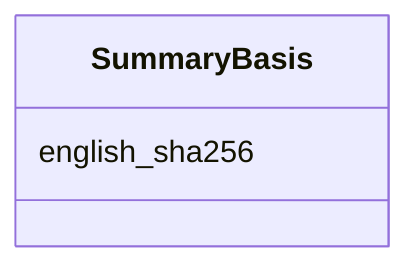

---
search:
  boost: 10.0
---

# Class: SummaryBasis 


_The exact English a summary was written from, by its digest, so that a summary of an English since changed can be told apart from a current one._


<div data-search-exclude markdown="1">


URI: [pc:SummaryBasis](https://pruzhany.org/ns/sourced-entities#SummaryBasis)





<!-- no inheritance hierarchy -->

## Slots

| Name | Cardinality and Range | Description | Inheritance |
| ---  | --- | --- | --- |
| [english_sha256](english_sha256.md) | 1 <br/> [Sha256Hex](Sha256Hex.md) | The SHA-256 digest of the exact UTF-8 bytes of the content item's translation text that the summary was written from. | direct |


## Usages

| used by | used in | type | used |
| ---  | --- | --- | --- |
| [Summary](Summary.md) | [based_on](based_on.md) | range | [SummaryBasis](SummaryBasis.md) |


## Identifier and Mapping Information


### Schema Source


* from schema: https://pruzhany.org/ns/content_items


## Mappings

| Mapping Type | Mapped Value |
| ---  | ---  |
| self | pc:SummaryBasis |
| native | pc:SummaryBasis |


## LinkML Source

<!-- TODO: investigate https://stackoverflow.com/questions/37606292/how-to-create-tabbed-code-blocks-in-mkdocs-or-sphinx -->

### Direct

<details>
```yaml
name: SummaryBasis
description: The exact English a summary was written from, by its digest, so that
  a summary of an English since changed can be told apart from a current one.
from_schema: https://pruzhany.org/ns/content_items
rank: 1000
attributes:
  english_sha256:
    name: english_sha256
    description: The SHA-256 digest of the exact UTF-8 bytes of the content item's
      translation text that the summary was written from.
    from_schema: https://pruzhany.org/ns/content_items
    rank: 1000
    slot_uri: pc:site_english_sha256
    domain_of:
    - SummaryBasis
    - EnglishCheck
    range: Sha256Hex
    required: true

```
</details>

### Induced

<details>
```yaml
name: SummaryBasis
description: The exact English a summary was written from, by its digest, so that
  a summary of an English since changed can be told apart from a current one.
from_schema: https://pruzhany.org/ns/content_items
rank: 1000
attributes:
  english_sha256:
    name: english_sha256
    description: The SHA-256 digest of the exact UTF-8 bytes of the content item's
      translation text that the summary was written from.
    from_schema: https://pruzhany.org/ns/content_items
    rank: 1000
    slot_uri: pc:site_english_sha256
    owner: SummaryBasis
    domain_of:
    - SummaryBasis
    - EnglishCheck
    range: Sha256Hex
    required: true

```
</details></div>
