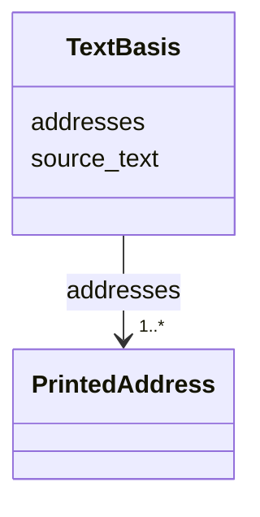

---
search:
  boost: 10.0
---

# Class: TextBasis 


_The exact text a translation or supplied title was made from, and where it is printed, kept even after the text is read again._


<div data-search-exclude markdown="1">


URI: [pc:TextBasis](https://pruzhany.org/ns/sourced-entities#TextBasis)





<!-- no inheritance hierarchy -->

## Slots

| Name | Cardinality and Range | Description | Inheritance |
| ---  | --- | --- | --- |
| [source_text](source_text.md) | 1 <br/> [String](String.md) | The text used, exactly, never normalised or replaced by a later reading. | direct |
| [addresses](addresses.md) | 1..* <br/> [PrintedAddress](PrintedAddress.md) | Where that text is printed, one address a line or patch. | direct |


## Usages

| used by | used in | type | used |
| ---  | --- | --- | --- |
| [SuppliedTitle](SuppliedTitle.md) | [based_on](based_on.md) | range | [TextBasis](TextBasis.md) |
| [Translation](Translation.md) | [based_on](based_on.md) | range | [TextBasis](TextBasis.md) |


## Identifier and Mapping Information


### Schema Source


* from schema: https://pruzhany.org/ns/content_items


## Mappings

| Mapping Type | Mapped Value |
| ---  | ---  |
| self | pc:TextBasis |
| native | pc:TextBasis |
| exact | pc:site_text_basis |


## LinkML Source

<!-- TODO: investigate https://stackoverflow.com/questions/37606292/how-to-create-tabbed-code-blocks-in-mkdocs-or-sphinx -->

### Direct

<details>
```yaml
name: TextBasis
description: The exact text a translation or supplied title was made from, and where
  it is printed, kept even after the text is read again.
from_schema: https://pruzhany.org/ns/content_items
exact_mappings:
- pc:site_text_basis
rank: 1000
attributes:
  source_text:
    name: source_text
    description: The text used, exactly, never normalised or replaced by a later reading.
    from_schema: https://pruzhany.org/ns/site_common
    rank: 1000
    domain_of:
    - TextBasis
    required: true
  addresses:
    name: addresses
    description: Where that text is printed, one address a line or patch.
    from_schema: https://pruzhany.org/ns/site_common
    rank: 1000
    domain_of:
    - TextBasis
    - PrintedTitle
    range: PrintedAddress
    required: true
    multivalued: true
    inlined_as_list: true
    minimum_cardinality: 1

```
</details>

### Induced

<details>
```yaml
name: TextBasis
description: The exact text a translation or supplied title was made from, and where
  it is printed, kept even after the text is read again.
from_schema: https://pruzhany.org/ns/content_items
exact_mappings:
- pc:site_text_basis
rank: 1000
attributes:
  source_text:
    name: source_text
    description: The text used, exactly, never normalised or replaced by a later reading.
    from_schema: https://pruzhany.org/ns/site_common
    rank: 1000
    owner: TextBasis
    domain_of:
    - TextBasis
    range: string
    required: true
  addresses:
    name: addresses
    description: Where that text is printed, one address a line or patch.
    from_schema: https://pruzhany.org/ns/site_common
    rank: 1000
    owner: TextBasis
    domain_of:
    - TextBasis
    - PrintedTitle
    range: PrintedAddress
    required: true
    multivalued: true
    inlined: true
    inlined_as_list: true
    minimum_cardinality: 1

```
</details></div>
