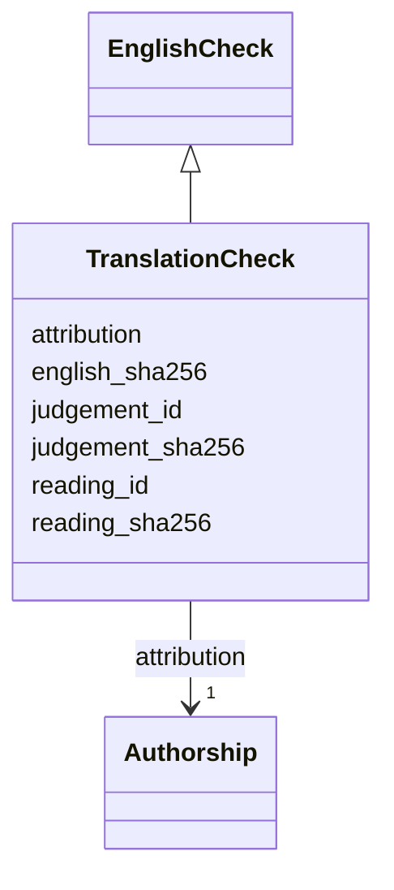

---
search:
  boost: 10.0
---

# Class: TranslationCheck 


_A check of a translation's English._


<div data-search-exclude markdown="1">


URI: [pc:TranslationCheck](https://pruzhany.org/ns/sourced-entities#TranslationCheck)





## Inheritance
* [EnglishCheck](EnglishCheck.md)
    * **TranslationCheck**


## Slots

| Name | Cardinality and Range | Description | Inheritance |
| ---  | --- | --- | --- |
| [reading_id](reading_id.md) | 1 <br/> [NonBlankText](NonBlankText.md) | The reading of the printed text that the English was checked against. | [EnglishCheck](EnglishCheck.md) |
| [reading_sha256](reading_sha256.md) | 1 <br/> [Sha256Hex](Sha256Hex.md) | The SHA-256 digest of that reading's exact UTF-8 bytes. | [EnglishCheck](EnglishCheck.md) |
| [english_sha256](english_sha256.md) | 1 <br/> [Sha256Hex](Sha256Hex.md) | The SHA-256 digest of the checked English field's exact UTF-8 bytes. | [EnglishCheck](EnglishCheck.md) |
| [judgement_id](judgement_id.md) | 1 <br/> [String](String.md) | The kept judgement, by an id without spaces followed by the field it judged, :title or :text. | [EnglishCheck](EnglishCheck.md) |
| [judgement_sha256](judgement_sha256.md) | 1 <br/> [Sha256Hex](Sha256Hex.md) | The SHA-256 digest of the kept judgement file's exact bytes. | [EnglishCheck](EnglishCheck.md) |
| [attribution](attribution.md) | 1 <br/> [Authorship](Authorship.md) | Who checked it, and on which day. | [EnglishCheck](EnglishCheck.md) |


## Usages

| used by | used in | type | used |
| ---  | --- | --- | --- |
| [Translation](Translation.md) | [checked_against](checked_against.md) | range | [TranslationCheck](TranslationCheck.md) |


## Identifier and Mapping Information


### Schema Source


* from schema: https://pruzhany.org/ns/content_items


## Mappings

| Mapping Type | Mapped Value |
| ---  | ---  |
| self | pc:TranslationCheck |
| native | pc:TranslationCheck |


## LinkML Source

<!-- TODO: investigate https://stackoverflow.com/questions/37606292/how-to-create-tabbed-code-blocks-in-mkdocs-or-sphinx -->

### Direct

<details>
```yaml
name: TranslationCheck
description: A check of a translation's English.
from_schema: https://pruzhany.org/ns/content_items
rank: 1000
is_a: EnglishCheck
slot_usage:
  judgement_id:
    name: judgement_id
    pattern: ^[^\s\u0085\uFEFF]+:text$(?![\s\S])

```
</details>

### Induced

<details>
```yaml
name: TranslationCheck
description: A check of a translation's English.
from_schema: https://pruzhany.org/ns/content_items
rank: 1000
is_a: EnglishCheck
slot_usage:
  judgement_id:
    name: judgement_id
    pattern: ^[^\s\u0085\uFEFF]+:text$(?![\s\S])
attributes:
  reading_id:
    name: reading_id
    description: The reading of the printed text that the English was checked against.
    from_schema: https://pruzhany.org/ns/site_common
    rank: 1000
    owner: TranslationCheck
    domain_of:
    - EnglishCheck
    range: NonBlankText
    required: true
  reading_sha256:
    name: reading_sha256
    description: The SHA-256 digest of that reading's exact UTF-8 bytes.
    from_schema: https://pruzhany.org/ns/site_common
    rank: 1000
    slot_uri: pc:site_reading_sha256
    owner: TranslationCheck
    domain_of:
    - EnglishCheck
    range: Sha256Hex
    required: true
  english_sha256:
    name: english_sha256
    description: The SHA-256 digest of the checked English field's exact UTF-8 bytes.
    from_schema: https://pruzhany.org/ns/site_common
    rank: 1000
    slot_uri: pc:site_english_sha256
    owner: TranslationCheck
    domain_of:
    - EnglishCheck
    range: Sha256Hex
    required: true
  judgement_id:
    name: judgement_id
    description: The kept judgement, by an id without spaces followed by the field
      it judged, :title or :text.
    from_schema: https://pruzhany.org/ns/content_items
    rank: 1000
    owner: TranslationCheck
    domain_of:
    - EnglishCheck
    range: string
    required: true
    pattern: ^[^\s\u0085\uFEFF]+:text$(?![\s\S])
  judgement_sha256:
    name: judgement_sha256
    description: The SHA-256 digest of the kept judgement file's exact bytes.
    from_schema: https://pruzhany.org/ns/site_common
    rank: 1000
    slot_uri: pc:site_judgement_sha256
    owner: TranslationCheck
    domain_of:
    - EnglishCheck
    range: Sha256Hex
    required: true
  attribution:
    name: attribution
    description: Who checked it, and on which day.
    from_schema: https://pruzhany.org/ns/site_common
    owner: TranslationCheck
    domain_of:
    - Fact
    - Name
    - EnglishCheck
    - SuppliedTitle
    - Translation
    range: Authorship
    required: true
    inlined: true

```
</details></div>
