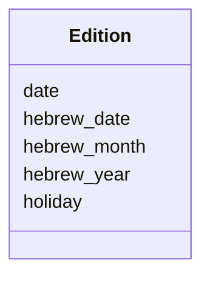

---
search:
  boost: 10.0
---

# Class: Edition 


_One edition of the paper: its date in the common calendar and in the Hebrew one, and the holiday it falls on, if any._


<div data-search-exclude markdown="1">


URI: [pc:Edition](https://pruzhany.org/ns/sourced-entities#Edition)





<!-- no inheritance hierarchy -->

## Slots

| Name | Cardinality and Range | Description | Inheritance |
| ---  | --- | --- | --- |
| [date](date.md) | 1 <br/> [IsoDay](IsoDay.md) | The edition's date, written YYYY-MM-DD. | direct |
| [hebrew_date](hebrew_date.md) | 1 <br/> [String](String.md) | The edition's date in the Hebrew calendar, written in Hebrew letters. | direct |
| [hebrew_month](hebrew_month.md) | 1 <br/> [Integer](Integer.md) | The Hebrew month, by its number from 1 to 13, counted from Nisan. | direct |
| [hebrew_year](hebrew_year.md) | 1 <br/> [Integer](Integer.md) | The Hebrew year, such as 5699. | direct |
| [holiday](holiday.md) | 0..1 <br/> [String](String.md) | The holiday the edition falls on or near, where there is one. | direct |


## Usages

| used by | used in | type | used |
| ---  | --- | --- | --- |
| [EditionsCatalog](EditionsCatalog.md) | [editions](editions.md) | range | [Edition](Edition.md) |


## Identifier and Mapping Information


### Schema Source


* from schema: https://pruzhany.org/ns/editions


## Mappings

| Mapping Type | Mapped Value |
| ---  | ---  |
| self | pc:Edition |
| native | pc:Edition |
| close | schema:PublicationIssue |


## LinkML Source

<!-- TODO: investigate https://stackoverflow.com/questions/37606292/how-to-create-tabbed-code-blocks-in-mkdocs-or-sphinx -->

### Direct

<details>
```yaml
name: Edition
description: 'One edition of the paper: its date in the common calendar and in the
  Hebrew one, and the holiday it falls on, if any.'
from_schema: https://pruzhany.org/ns/editions
close_mappings:
- schema:PublicationIssue
rank: 1000
attributes:
  date:
    name: date
    description: The edition's date, written YYYY-MM-DD.
    from_schema: https://pruzhany.org/ns/editions
    rank: 1000
    domain_of:
    - Edition
    - Holiday
    - HistoricalEvent
    range: IsoDay
    required: true
  hebrew_date:
    name: hebrew_date
    description: The edition's date in the Hebrew calendar, written in Hebrew letters.
    from_schema: https://pruzhany.org/ns/editions
    rank: 1000
    alias: hebrewDate
    domain_of:
    - Edition
    required: true
  hebrew_month:
    name: hebrew_month
    description: The Hebrew month, by its number from 1 to 13, counted from Nisan.
    from_schema: https://pruzhany.org/ns/editions
    rank: 1000
    alias: hebrewMonth
    domain_of:
    - Edition
    range: integer
    required: true
    minimum_value: 1
    maximum_value: 13
  hebrew_year:
    name: hebrew_year
    description: The Hebrew year, such as 5699.
    from_schema: https://pruzhany.org/ns/editions
    rank: 1000
    alias: hebrewYear
    domain_of:
    - Edition
    range: integer
    required: true
    minimum_value: -9007199254740991
    maximum_value: 9007199254740991
  holiday:
    name: holiday
    description: The holiday the edition falls on or near, where there is one.
    from_schema: https://pruzhany.org/ns/editions
    rank: 1000
    domain_of:
    - Edition

```
</details>

### Induced

<details>
```yaml
name: Edition
description: 'One edition of the paper: its date in the common calendar and in the
  Hebrew one, and the holiday it falls on, if any.'
from_schema: https://pruzhany.org/ns/editions
close_mappings:
- schema:PublicationIssue
rank: 1000
attributes:
  date:
    name: date
    description: The edition's date, written YYYY-MM-DD.
    from_schema: https://pruzhany.org/ns/editions
    rank: 1000
    owner: Edition
    domain_of:
    - Edition
    - Holiday
    - HistoricalEvent
    range: IsoDay
    required: true
  hebrew_date:
    name: hebrew_date
    description: The edition's date in the Hebrew calendar, written in Hebrew letters.
    from_schema: https://pruzhany.org/ns/editions
    rank: 1000
    alias: hebrewDate
    owner: Edition
    domain_of:
    - Edition
    range: string
    required: true
  hebrew_month:
    name: hebrew_month
    description: The Hebrew month, by its number from 1 to 13, counted from Nisan.
    from_schema: https://pruzhany.org/ns/editions
    rank: 1000
    alias: hebrewMonth
    owner: Edition
    domain_of:
    - Edition
    range: integer
    required: true
    minimum_value: 1
    maximum_value: 13
  hebrew_year:
    name: hebrew_year
    description: The Hebrew year, such as 5699.
    from_schema: https://pruzhany.org/ns/editions
    rank: 1000
    alias: hebrewYear
    owner: Edition
    domain_of:
    - Edition
    range: integer
    required: true
    minimum_value: -9007199254740991
    maximum_value: 9007199254740991
  holiday:
    name: holiday
    description: The holiday the edition falls on or near, where there is one.
    from_schema: https://pruzhany.org/ns/editions
    rank: 1000
    owner: Edition
    domain_of:
    - Edition
    range: string

```
</details></div>
