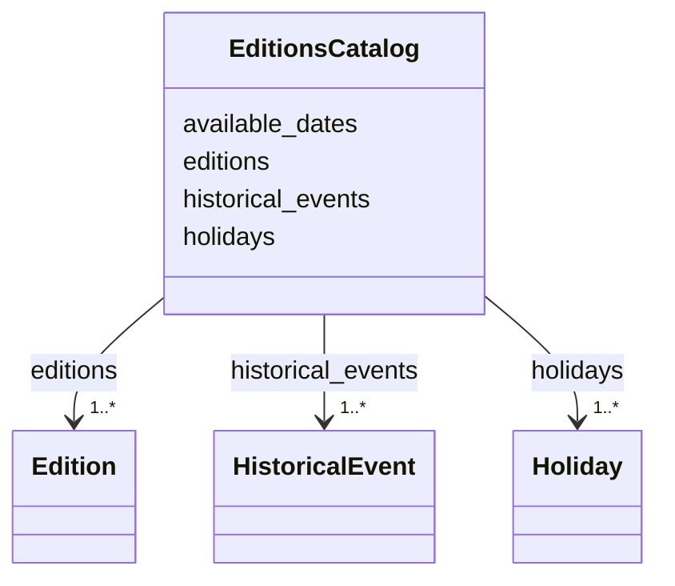

---
search:
  boost: 10.0
---

# Class: EditionsCatalog 


_The catalog of editions: every edition, the holidays and historical events beside them, and the dates available on the site._


<div data-search-exclude markdown="1">


URI: [pc:EditionsCatalog](https://pruzhany.org/ns/sourced-entities#EditionsCatalog)





<!-- no inheritance hierarchy -->

## Class Properties

| Property | Value |
| --- | --- |
| Tree Root | Yes |


## Slots

| Name | Cardinality and Range | Description | Inheritance |
| ---  | --- | --- | --- |
| [editions](editions.md) | 1..* <br/> [Edition](Edition.md) | Every edition of the paper, with its Hebrew date. | direct |
| [holidays](holidays.md) | 1..* <br/> [Holiday](Holiday.md) | The Jewish holidays of the paper's years. | direct |
| [historical_events](historical_events.md) | 1..* <br/> [HistoricalEvent](HistoricalEvent.md) | Events in the world outside the town that the calendar marks. | direct |
| [available_dates](available_dates.md) | 1..* <br/> [IsoDay](IsoDay.md) | The dates of the editions whose pages are on the site. | direct |


## Identifier and Mapping Information


### Schema Source


* from schema: https://pruzhany.org/ns/editions


## Mappings

| Mapping Type | Mapped Value |
| ---  | ---  |
| self | pc:EditionsCatalog |
| native | pc:EditionsCatalog |


## LinkML Source

<!-- TODO: investigate https://stackoverflow.com/questions/37606292/how-to-create-tabbed-code-blocks-in-mkdocs-or-sphinx -->

### Direct

<details>
```yaml
name: EditionsCatalog
description: 'The catalog of editions: every edition, the holidays and historical
  events beside them, and the dates available on the site.'
from_schema: https://pruzhany.org/ns/editions
rank: 1000
attributes:
  editions:
    name: editions
    description: Every edition of the paper, with its Hebrew date.
    from_schema: https://pruzhany.org/ns/editions
    rank: 1000
    domain_of:
    - EditionsCatalog
    range: Edition
    required: true
    multivalued: true
    inlined_as_list: true
  holidays:
    name: holidays
    description: The Jewish holidays of the paper's years.
    from_schema: https://pruzhany.org/ns/editions
    rank: 1000
    domain_of:
    - EditionsCatalog
    range: Holiday
    required: true
    multivalued: true
    inlined_as_list: true
  historical_events:
    name: historical_events
    description: Events in the world outside the town that the calendar marks.
    from_schema: https://pruzhany.org/ns/editions
    rank: 1000
    alias: historicalEvents
    domain_of:
    - EditionsCatalog
    range: HistoricalEvent
    required: true
    multivalued: true
    inlined_as_list: true
  available_dates:
    name: available_dates
    description: The dates of the editions whose pages are on the site.
    from_schema: https://pruzhany.org/ns/editions
    rank: 1000
    alias: availableDates
    domain_of:
    - EditionsCatalog
    range: IsoDay
    required: true
    multivalued: true
tree_root: true

```
</details>

### Induced

<details>
```yaml
name: EditionsCatalog
description: 'The catalog of editions: every edition, the holidays and historical
  events beside them, and the dates available on the site.'
from_schema: https://pruzhany.org/ns/editions
rank: 1000
attributes:
  editions:
    name: editions
    description: Every edition of the paper, with its Hebrew date.
    from_schema: https://pruzhany.org/ns/editions
    rank: 1000
    owner: EditionsCatalog
    domain_of:
    - EditionsCatalog
    range: Edition
    required: true
    multivalued: true
    inlined: true
    inlined_as_list: true
  holidays:
    name: holidays
    description: The Jewish holidays of the paper's years.
    from_schema: https://pruzhany.org/ns/editions
    rank: 1000
    owner: EditionsCatalog
    domain_of:
    - EditionsCatalog
    range: Holiday
    required: true
    multivalued: true
    inlined: true
    inlined_as_list: true
  historical_events:
    name: historical_events
    description: Events in the world outside the town that the calendar marks.
    from_schema: https://pruzhany.org/ns/editions
    rank: 1000
    alias: historicalEvents
    owner: EditionsCatalog
    domain_of:
    - EditionsCatalog
    range: HistoricalEvent
    required: true
    multivalued: true
    inlined: true
    inlined_as_list: true
  available_dates:
    name: available_dates
    description: The dates of the editions whose pages are on the site.
    from_schema: https://pruzhany.org/ns/editions
    rank: 1000
    alias: availableDates
    owner: EditionsCatalog
    domain_of:
    - EditionsCatalog
    range: IsoDay
    required: true
    multivalued: true
tree_root: true

```
</details></div>
