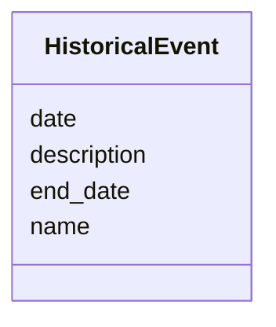

---
search:
  boost: 10.0
---

# Class: HistoricalEvent 


_An event in the world outside the town, such as Kristallnacht, on a day or over a span of days._


<div data-search-exclude markdown="1">


URI: [pc:HistoricalEvent](https://pruzhany.org/ns/sourced-entities#HistoricalEvent)





<!-- no inheritance hierarchy -->

## Slots

| Name | Cardinality and Range | Description | Inheritance |
| ---  | --- | --- | --- |
| [date](date.md) | 1 <br/> [IsoDay](IsoDay.md) | The day the event began, written YYYY-MM-DD. | direct |
| [end_date](end_date.md) | 0..1 <br/> [IsoDay](IsoDay.md) | The day the event ended, where it lasted more than a day. | direct |
| [name](name.md) | 1 <br/> [String](String.md) | The event's name in English. | direct |
| [description](description.md) | 1 <br/> [String](String.md) | What happened, in a sentence or two. | direct |


## Usages

| used by | used in | type | used |
| ---  | --- | --- | --- |
| [EditionsCatalog](EditionsCatalog.md) | [historical_events](historical_events.md) | range | [HistoricalEvent](HistoricalEvent.md) |


## Identifier and Mapping Information


### Schema Source


* from schema: https://pruzhany.org/ns/editions


## Mappings

| Mapping Type | Mapped Value |
| ---  | ---  |
| self | pc:HistoricalEvent |
| native | pc:HistoricalEvent |
| close | rico:Event |


## LinkML Source

<!-- TODO: investigate https://stackoverflow.com/questions/37606292/how-to-create-tabbed-code-blocks-in-mkdocs-or-sphinx -->

### Direct

<details>
```yaml
name: HistoricalEvent
description: An event in the world outside the town, such as Kristallnacht, on a day
  or over a span of days.
from_schema: https://pruzhany.org/ns/editions
close_mappings:
- rico:Event
rank: 1000
attributes:
  date:
    name: date
    description: The day the event began, written YYYY-MM-DD.
    from_schema: https://pruzhany.org/ns/editions
    domain_of:
    - Edition
    - Holiday
    - HistoricalEvent
    range: IsoDay
    required: true
  end_date:
    name: end_date
    description: The day the event ended, where it lasted more than a day.
    from_schema: https://pruzhany.org/ns/editions
    rank: 1000
    alias: endDate
    domain_of:
    - HistoricalEvent
    range: IsoDay
  name:
    name: name
    description: The event's name in English.
    from_schema: https://pruzhany.org/ns/editions
    domain_of:
    - Holiday
    - HistoricalEvent
    required: true
  description:
    name: description
    description: What happened, in a sentence or two.
    from_schema: https://pruzhany.org/ns/editions
    rank: 1000
    domain_of:
    - HistoricalEvent
    required: true

```
</details>

### Induced

<details>
```yaml
name: HistoricalEvent
description: An event in the world outside the town, such as Kristallnacht, on a day
  or over a span of days.
from_schema: https://pruzhany.org/ns/editions
close_mappings:
- rico:Event
rank: 1000
attributes:
  date:
    name: date
    description: The day the event began, written YYYY-MM-DD.
    from_schema: https://pruzhany.org/ns/editions
    owner: HistoricalEvent
    domain_of:
    - Edition
    - Holiday
    - HistoricalEvent
    range: IsoDay
    required: true
  end_date:
    name: end_date
    description: The day the event ended, where it lasted more than a day.
    from_schema: https://pruzhany.org/ns/editions
    rank: 1000
    alias: endDate
    owner: HistoricalEvent
    domain_of:
    - HistoricalEvent
    range: IsoDay
  name:
    name: name
    description: The event's name in English.
    from_schema: https://pruzhany.org/ns/editions
    owner: HistoricalEvent
    domain_of:
    - Holiday
    - HistoricalEvent
    range: string
    required: true
  description:
    name: description
    description: What happened, in a sentence or two.
    from_schema: https://pruzhany.org/ns/editions
    rank: 1000
    owner: HistoricalEvent
    domain_of:
    - HistoricalEvent
    range: string
    required: true

```
</details></div>
