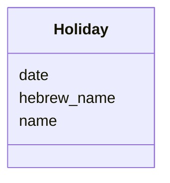

---
search:
  boost: 10.0
---

# Class: Holiday 


_A Jewish holiday on a given day._


<div data-search-exclude markdown="1">


URI: [pc:Holiday](https://pruzhany.org/ns/sourced-entities#Holiday)





<!-- no inheritance hierarchy -->

## Slots

| Name | Cardinality and Range | Description | Inheritance |
| ---  | --- | --- | --- |
| [date](date.md) | 1 <br/> [IsoDay](IsoDay.md) | The holiday's day, written YYYY-MM-DD. | direct |
| [name](name.md) | 1 <br/> [String](String.md) | The holiday's name in Latin letters, such as Purim or Pesach. | direct |
| [hebrew_name](hebrew_name.md) | 0..1 <br/> [String](String.md) | The holiday's name in Hebrew letters, where it is given. | direct |


## Usages

| used by | used in | type | used |
| ---  | --- | --- | --- |
| [EditionsCatalog](EditionsCatalog.md) | [holidays](holidays.md) | range | [Holiday](Holiday.md) |


## Identifier and Mapping Information


### Schema Source


* from schema: https://pruzhany.org/ns/editions


## Mappings

| Mapping Type | Mapped Value |
| ---  | ---  |
| self | pc:Holiday |
| native | pc:Holiday |


## LinkML Source

<!-- TODO: investigate https://stackoverflow.com/questions/37606292/how-to-create-tabbed-code-blocks-in-mkdocs-or-sphinx -->

### Direct

<details>
```yaml
name: Holiday
description: A Jewish holiday on a given day.
from_schema: https://pruzhany.org/ns/editions
rank: 1000
attributes:
  date:
    name: date
    description: The holiday's day, written YYYY-MM-DD.
    from_schema: https://pruzhany.org/ns/editions
    domain_of:
    - Edition
    - Holiday
    - HistoricalEvent
    range: IsoDay
    required: true
  name:
    name: name
    description: The holiday's name in Latin letters, such as Purim or Pesach.
    from_schema: https://pruzhany.org/ns/editions
    rank: 1000
    domain_of:
    - Holiday
    - HistoricalEvent
    required: true
  hebrew_name:
    name: hebrew_name
    description: The holiday's name in Hebrew letters, where it is given.
    from_schema: https://pruzhany.org/ns/editions
    rank: 1000
    alias: hebrewName
    domain_of:
    - Holiday

```
</details>

### Induced

<details>
```yaml
name: Holiday
description: A Jewish holiday on a given day.
from_schema: https://pruzhany.org/ns/editions
rank: 1000
attributes:
  date:
    name: date
    description: The holiday's day, written YYYY-MM-DD.
    from_schema: https://pruzhany.org/ns/editions
    owner: Holiday
    domain_of:
    - Edition
    - Holiday
    - HistoricalEvent
    range: IsoDay
    required: true
  name:
    name: name
    description: The holiday's name in Latin letters, such as Purim or Pesach.
    from_schema: https://pruzhany.org/ns/editions
    rank: 1000
    owner: Holiday
    domain_of:
    - Holiday
    - HistoricalEvent
    range: string
    required: true
  hebrew_name:
    name: hebrew_name
    description: The holiday's name in Hebrew letters, where it is given.
    from_schema: https://pruzhany.org/ns/editions
    rank: 1000
    alias: hebrewName
    owner: Holiday
    domain_of:
    - Holiday
    range: string

```
</details></div>
