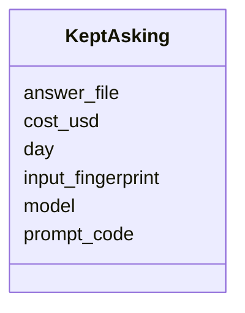

---
search:
  boost: 10.0
---

# Class: KeptAsking 


_A reference to a kept answer file or an identified input within an accumulated file. Model and prompt metadata can come from a companion trial setting or history; fields absent from storage are not invented. This is not a promise that one file is one paid call. Payloads retain their existing steps formats._


<div data-search-exclude markdown="1">


URI: [pc:KeptAsking](https://pruzhany.org/ns/sourced-entities#KeptAsking)





<!-- no inheritance hierarchy -->

## Slots

| Name | Cardinality and Range | Description | Inheritance |
| ---  | --- | --- | --- |
| [prompt_code](prompt_code.md) | 1 <br/> [ExchangeCode](ExchangeCode.md) | The associated PromptVersion.code, resolved by steps from the stored prompt code, companion setting or recovered history. English stores the code as prompt and Latin as request. Structure and joining request values include inputs; their association requires recovery, not an assumption that they hash only instructions. A recovered version may retain a whole-request code. | direct |
| [model](model.md) | 1 <br/> [NonBlankText](NonBlankText.md) | The stored model selector, or the companion setting's model for trial rows. | direct |
| [day](day.md) | 0..1 <br/> [ExchangeDay](ExchangeDay.md) | An asking day where actually kept: English answered_on for the indexed input or the trial directory's day. Omit when unknown; a first committed day is not an observed asking day and must not be silently substituted. | direct |
| [input_fingerprint](input_fingerprint.md) | 0..1 <br/> [ExchangeCode](ExchangeCode.md) | An input fingerprint where kept: English pieces keys are xxh3_64 text digests; structure and joining request values are truncated SHA-256 fingerprints of whole requests. Structure trials also keep request and sent fingerprints with different scopes; an index must choose and document its input scope. Latin request is a prompt code, not an input fingerprint. Omit when no input fingerprint was kept, including trial rows. | direct |
| [answer_file](answer_file.md) | 1 <br/> [NonBlankText](NonBlankText.md) | The kept answer's file path relative to the steps repository. The path locates an existing payload; it is not that payload or a public download URI. | direct |
| [cost_usd](cost_usd.md) | 0..1 <br/> [NonNegativeNumber](NonNegativeNumber.md) | The cost in US dollars where kept, including zero. It retains the stored file's accounting scope: English and Latin accumulate calls, and structure may include retries. Do not sum the same file's cost again for every input or interpret it as a measured per-call cost. Omit when unavailable. | direct |


## Comments

* PROV-O Activity corresponds to the asking described, and Entity to the kept file. Accumulated files need their own usage and generation history.

## See Also

* [https://www.w3.org/TR/prov-o/#Activity](https://www.w3.org/TR/prov-o/#Activity)
* [https://www.w3.org/TR/prov-o/#Entity](https://www.w3.org/TR/prov-o/#Entity)


## Identifier and Mapping Information


### Schema Source


* from schema: https://pruzhany.org/ns/exchanges


## Mappings

| Mapping Type | Mapped Value |
| ---  | ---  |
| self | pc:KeptAsking |
| native | pc:KeptAsking |


## LinkML Source

<!-- TODO: investigate https://stackoverflow.com/questions/37606292/how-to-create-tabbed-code-blocks-in-mkdocs-or-sphinx -->

### Direct

<details>
```yaml
name: KeptAsking
description: A reference to a kept answer file or an identified input within an accumulated
  file. Model and prompt metadata can come from a companion trial setting or history;
  fields absent from storage are not invented. This is not a promise that one file
  is one paid call. Payloads retain their existing steps formats.
comments:
- PROV-O Activity corresponds to the asking described, and Entity to the kept file.
  Accumulated files need their own usage and generation history.
from_schema: https://pruzhany.org/ns/exchanges
see_also:
- https://www.w3.org/TR/prov-o/#Activity
- https://www.w3.org/TR/prov-o/#Entity
rank: 1000
attributes:
  prompt_code:
    name: prompt_code
    annotations:
      references:
        tag: references
        value: PromptVersion.code
    description: The associated PromptVersion.code, resolved by steps from the stored
      prompt code, companion setting or recovered history. English stores the code
      as prompt and Latin as request. Structure and joining request values include
      inputs; their association requires recovery, not an assumption that they hash
      only instructions. A recovered version may retain a whole-request code.
    comments:
    - A PROV-O plan link would pass through the asking's qualified association; hadPlan
      is not a direct Activity property.
    from_schema: https://pruzhany.org/ns/exchanges
    see_also:
    - https://www.w3.org/TR/prov-o/#hadPlan
    rank: 1000
    domain_of:
    - KeptAsking
    range: ExchangeCode
    required: true
  model:
    name: model
    description: The stored model selector, or the companion setting's model for trial
      rows.
    from_schema: https://pruzhany.org/ns/exchanges
    see_also:
    - https://www.w3.org/TR/prov-o/#SoftwareAgent
    - https://www.w3.org/TR/prov-o/#wasAssociatedWith
    domain_of:
    - PromptVersion
    - KeptAsking
    range: NonBlankText
    required: true
  day:
    name: day
    description: 'An asking day where actually kept: English answered_on for the indexed
      input or the trial directory''s day. Omit when unknown; a first committed day
      is not an observed asking day and must not be silently substituted.'
    comments:
    - This day has less precision than the PROV-O timestamp property.
    from_schema: https://pruzhany.org/ns/exchanges
    see_also:
    - https://www.w3.org/TR/prov-o/#endedAtTime
    rank: 1000
    domain_of:
    - KeptAsking
    range: ExchangeDay
  input_fingerprint:
    name: input_fingerprint
    description: 'An input fingerprint where kept: English pieces keys are xxh3_64
      text digests; structure and joining request values are truncated SHA-256 fingerprints
      of whole requests. Structure trials also keep request and sent fingerprints
      with different scopes; an index must choose and document its input scope. Latin
      request is a prompt code, not an input fingerprint. Omit when no input fingerprint
      was kept, including trial rows.'
    from_schema: https://pruzhany.org/ns/exchanges
    see_also:
    - https://www.w3.org/TR/prov-o/#used
    rank: 1000
    domain_of:
    - KeptAsking
    range: ExchangeCode
  answer_file:
    name: answer_file
    description: The kept answer's file path relative to the steps repository. The
      path locates an existing payload; it is not that payload or a public download
      URI.
    from_schema: https://pruzhany.org/ns/exchanges
    see_also:
    - https://www.w3.org/TR/prov-o/#generated
    rank: 1000
    domain_of:
    - KeptAsking
    range: NonBlankText
    required: true
  cost_usd:
    name: cost_usd
    description: 'The cost in US dollars where kept, including zero. It retains the
      stored file''s accounting scope: English and Latin accumulate calls, and structure
      may include retries. Do not sum the same file''s cost again for every input
      or interpret it as a measured per-call cost. Omit when unavailable.'
    from_schema: https://pruzhany.org/ns/exchanges
    rank: 1000
    domain_of:
    - KeptAsking
    range: NonNegativeNumber

```
</details>

### Induced

<details>
```yaml
name: KeptAsking
description: A reference to a kept answer file or an identified input within an accumulated
  file. Model and prompt metadata can come from a companion trial setting or history;
  fields absent from storage are not invented. This is not a promise that one file
  is one paid call. Payloads retain their existing steps formats.
comments:
- PROV-O Activity corresponds to the asking described, and Entity to the kept file.
  Accumulated files need their own usage and generation history.
from_schema: https://pruzhany.org/ns/exchanges
see_also:
- https://www.w3.org/TR/prov-o/#Activity
- https://www.w3.org/TR/prov-o/#Entity
rank: 1000
attributes:
  prompt_code:
    name: prompt_code
    annotations:
      references:
        tag: references
        value: PromptVersion.code
    description: The associated PromptVersion.code, resolved by steps from the stored
      prompt code, companion setting or recovered history. English stores the code
      as prompt and Latin as request. Structure and joining request values include
      inputs; their association requires recovery, not an assumption that they hash
      only instructions. A recovered version may retain a whole-request code.
    comments:
    - A PROV-O plan link would pass through the asking's qualified association; hadPlan
      is not a direct Activity property.
    from_schema: https://pruzhany.org/ns/exchanges
    see_also:
    - https://www.w3.org/TR/prov-o/#hadPlan
    rank: 1000
    owner: KeptAsking
    domain_of:
    - KeptAsking
    range: ExchangeCode
    required: true
  model:
    name: model
    description: The stored model selector, or the companion setting's model for trial
      rows.
    from_schema: https://pruzhany.org/ns/exchanges
    see_also:
    - https://www.w3.org/TR/prov-o/#SoftwareAgent
    - https://www.w3.org/TR/prov-o/#wasAssociatedWith
    owner: KeptAsking
    domain_of:
    - PromptVersion
    - KeptAsking
    range: NonBlankText
    required: true
  day:
    name: day
    description: 'An asking day where actually kept: English answered_on for the indexed
      input or the trial directory''s day. Omit when unknown; a first committed day
      is not an observed asking day and must not be silently substituted.'
    comments:
    - This day has less precision than the PROV-O timestamp property.
    from_schema: https://pruzhany.org/ns/exchanges
    see_also:
    - https://www.w3.org/TR/prov-o/#endedAtTime
    rank: 1000
    owner: KeptAsking
    domain_of:
    - KeptAsking
    range: ExchangeDay
  input_fingerprint:
    name: input_fingerprint
    description: 'An input fingerprint where kept: English pieces keys are xxh3_64
      text digests; structure and joining request values are truncated SHA-256 fingerprints
      of whole requests. Structure trials also keep request and sent fingerprints
      with different scopes; an index must choose and document its input scope. Latin
      request is a prompt code, not an input fingerprint. Omit when no input fingerprint
      was kept, including trial rows.'
    from_schema: https://pruzhany.org/ns/exchanges
    see_also:
    - https://www.w3.org/TR/prov-o/#used
    rank: 1000
    owner: KeptAsking
    domain_of:
    - KeptAsking
    range: ExchangeCode
  answer_file:
    name: answer_file
    description: The kept answer's file path relative to the steps repository. The
      path locates an existing payload; it is not that payload or a public download
      URI.
    from_schema: https://pruzhany.org/ns/exchanges
    see_also:
    - https://www.w3.org/TR/prov-o/#generated
    rank: 1000
    owner: KeptAsking
    domain_of:
    - KeptAsking
    range: NonBlankText
    required: true
  cost_usd:
    name: cost_usd
    description: 'The cost in US dollars where kept, including zero. It retains the
      stored file''s accounting scope: English and Latin accumulate calls, and structure
      may include retries. Do not sum the same file''s cost again for every input
      or interpret it as a measured per-call cost. Omit when unavailable.'
    from_schema: https://pruzhany.org/ns/exchanges
    rank: 1000
    owner: KeptAsking
    domain_of:
    - KeptAsking
    range: NonNegativeNumber

```
</details></div>
