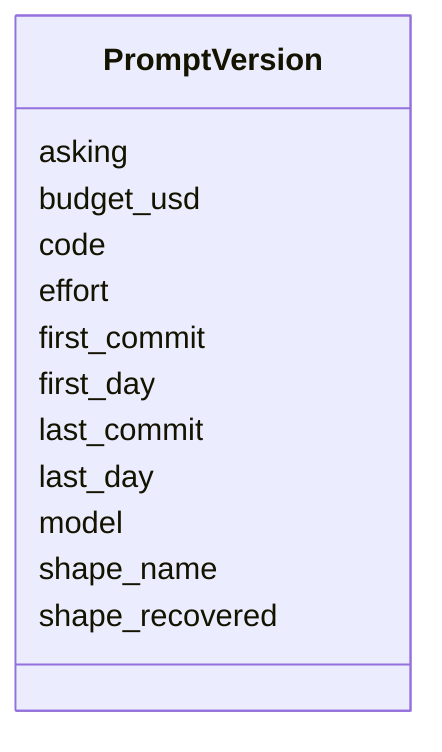

---
search:
  boost: 10.0
---

# Class: PromptVersion 


_One prompt version's metadata, kept beside its exact text and recovered answer shape. First and last refer to its presence in code history, not paid-call dates. A shape may be unrecoverable even when the prompt text and its history are known._


<div data-search-exclude markdown="1">


URI: [pc:PromptVersion](https://pruzhany.org/ns/sourced-entities#PromptVersion)





<!-- no inheritance hierarchy -->

## Class Properties

| Property | Value |
| --- | --- |
| Tree Root | Yes |


## Slots

| Name | Cardinality and Range | Description | Inheritance |
| ---  | --- | --- | --- |
| [code](code.md) | 1 <br/> [ExchangeCode](ExchangeCode.md) | The sixteen-character code naming this stored version and its directory. Some historical codes cover an expanded whole request rather than only instructions; the steps registry must establish the recipe and scope. | direct |
| [asking](asking.md) | 1 <br/> [NonBlankText](NonBlankText.md) | The asking served by these instructions, such as find_items, read_latin, write_english or join_people. Trial variants are registered by steps; this field is not a new controlled vocabulary. | direct |
| [model](model.md) | 1 <br/> [NonBlankText](NonBlankText.md) | The model selector used with this version. It is recorded configuration, not an assertion that two selectors denote the same model release. | direct |
| [effort](effort.md) | 0..1 <br/> [NonBlankText](NonBlankText.md) | The explicit effort setting when known; omit when no setting was supplied or recovered. Model-dependent effort values are not enumerated here. | direct |
| [budget_usd](budget_usd.md) | 1 <br/> [NonNegativeNumber](NonNegativeNumber.md) | The configured maximum budget in US dollars, separate from an answer's recorded cost. Zero is allowed; no undocumented upper bound is imposed. | direct |
| [shape_name](shape_name.md) | 1 <br/> [NonBlankText](NonBlankText.md) | The answer shape's name, qualified by its module when needed. Knowing this name does not imply that the exact schema bytes were recovered. | direct |
| [first_commit](first_commit.md) | 1 <br/> [ExchangeCommit](ExchangeCommit.md) | The first steps commit known to contain this prompt version in code. | direct |
| [first_day](first_day.md) | 1 <br/> [ExchangeDay](ExchangeDay.md) | The day of first_commit, as established by steps' history recovery. | direct |
| [last_commit](last_commit.md) | 1 <br/> [ExchangeCommit](ExchangeCommit.md) | The last steps commit known to contain this prompt version in code, not necessarily the latest kept answer or the commit removing the version. | direct |
| [last_day](last_day.md) | 1 <br/> [ExchangeDay](ExchangeDay.md) | The day of last_commit. Agreement with history and first_day ordering are checked in steps, not by this single-document shape. | direct |
| [shape_recovered](shape_recovered.md) | 1 <br/> [Boolean](Boolean.md) | Whether the exact answer JSON Schema was recovered reproducibly and kept beside the prompt. False explicitly records the limit on answer validation; a shape name by itself is not recovery. | direct |


## Comments

* PROV-O Plan is a useful correspondence for versioned instructions. These metadata do not assert an RDF type or establish a plan's execution.

## See Also

* [https://www.w3.org/TR/prov-o/#Plan](https://www.w3.org/TR/prov-o/#Plan)


## Identifier and Mapping Information


### Schema Source


* from schema: https://pruzhany.org/ns/exchanges


## Mappings

| Mapping Type | Mapped Value |
| ---  | ---  |
| self | pc:PromptVersion |
| native | pc:PromptVersion |


## LinkML Source

<!-- TODO: investigate https://stackoverflow.com/questions/37606292/how-to-create-tabbed-code-blocks-in-mkdocs-or-sphinx -->

### Direct

<details>
```yaml
name: PromptVersion
description: One prompt version's metadata, kept beside its exact text and recovered
  answer shape. First and last refer to its presence in code history, not paid-call
  dates. A shape may be unrecoverable even when the prompt text and its history are
  known.
comments:
- PROV-O Plan is a useful correspondence for versioned instructions. These metadata
  do not assert an RDF type or establish a plan's execution.
from_schema: https://pruzhany.org/ns/exchanges
see_also:
- https://www.w3.org/TR/prov-o/#Plan
rank: 1000
attributes:
  code:
    name: code
    description: The sixteen-character code naming this stored version and its directory.
      Some historical codes cover an expanded whole request rather than only instructions;
      the steps registry must establish the recipe and scope.
    from_schema: https://pruzhany.org/ns/exchanges
    rank: 1000
    domain_of:
    - PromptVersion
    range: ExchangeCode
    required: true
  asking:
    name: asking
    description: The asking served by these instructions, such as find_items, read_latin,
      write_english or join_people. Trial variants are registered by steps; this field
      is not a new controlled vocabulary.
    from_schema: https://pruzhany.org/ns/exchanges
    rank: 1000
    domain_of:
    - PromptVersion
    range: NonBlankText
    required: true
  model:
    name: model
    description: The model selector used with this version. It is recorded configuration,
      not an assertion that two selectors denote the same model release.
    from_schema: https://pruzhany.org/ns/exchanges
    rank: 1000
    domain_of:
    - PromptVersion
    - KeptAsking
    range: NonBlankText
    required: true
  effort:
    name: effort
    description: The explicit effort setting when known; omit when no setting was
      supplied or recovered. Model-dependent effort values are not enumerated here.
    from_schema: https://pruzhany.org/ns/exchanges
    rank: 1000
    domain_of:
    - PromptVersion
    range: NonBlankText
  budget_usd:
    name: budget_usd
    description: The configured maximum budget in US dollars, separate from an answer's
      recorded cost. Zero is allowed; no undocumented upper bound is imposed.
    from_schema: https://pruzhany.org/ns/exchanges
    rank: 1000
    domain_of:
    - PromptVersion
    range: NonNegativeNumber
    required: true
  shape_name:
    name: shape_name
    description: The answer shape's name, qualified by its module when needed. Knowing
      this name does not imply that the exact schema bytes were recovered.
    from_schema: https://pruzhany.org/ns/exchanges
    rank: 1000
    domain_of:
    - PromptVersion
    range: NonBlankText
    required: true
  first_commit:
    name: first_commit
    description: The first steps commit known to contain this prompt version in code.
    from_schema: https://pruzhany.org/ns/exchanges
    rank: 1000
    domain_of:
    - PromptVersion
    range: ExchangeCommit
    required: true
  first_day:
    name: first_day
    description: The day of first_commit, as established by steps' history recovery.
    from_schema: https://pruzhany.org/ns/exchanges
    rank: 1000
    domain_of:
    - PromptVersion
    range: ExchangeDay
    required: true
  last_commit:
    name: last_commit
    description: The last steps commit known to contain this prompt version in code,
      not necessarily the latest kept answer or the commit removing the version.
    from_schema: https://pruzhany.org/ns/exchanges
    rank: 1000
    domain_of:
    - PromptVersion
    range: ExchangeCommit
    required: true
  last_day:
    name: last_day
    description: The day of last_commit. Agreement with history and first_day ordering
      are checked in steps, not by this single-document shape.
    from_schema: https://pruzhany.org/ns/exchanges
    rank: 1000
    domain_of:
    - PromptVersion
    range: ExchangeDay
    required: true
  shape_recovered:
    name: shape_recovered
    description: Whether the exact answer JSON Schema was recovered reproducibly and
      kept beside the prompt. False explicitly records the limit on answer validation;
      a shape name by itself is not recovery.
    from_schema: https://pruzhany.org/ns/exchanges
    rank: 1000
    domain_of:
    - PromptVersion
    range: boolean
    required: true
tree_root: true

```
</details>

### Induced

<details>
```yaml
name: PromptVersion
description: One prompt version's metadata, kept beside its exact text and recovered
  answer shape. First and last refer to its presence in code history, not paid-call
  dates. A shape may be unrecoverable even when the prompt text and its history are
  known.
comments:
- PROV-O Plan is a useful correspondence for versioned instructions. These metadata
  do not assert an RDF type or establish a plan's execution.
from_schema: https://pruzhany.org/ns/exchanges
see_also:
- https://www.w3.org/TR/prov-o/#Plan
rank: 1000
attributes:
  code:
    name: code
    description: The sixteen-character code naming this stored version and its directory.
      Some historical codes cover an expanded whole request rather than only instructions;
      the steps registry must establish the recipe and scope.
    from_schema: https://pruzhany.org/ns/exchanges
    rank: 1000
    owner: PromptVersion
    domain_of:
    - PromptVersion
    range: ExchangeCode
    required: true
  asking:
    name: asking
    description: The asking served by these instructions, such as find_items, read_latin,
      write_english or join_people. Trial variants are registered by steps; this field
      is not a new controlled vocabulary.
    from_schema: https://pruzhany.org/ns/exchanges
    rank: 1000
    owner: PromptVersion
    domain_of:
    - PromptVersion
    range: NonBlankText
    required: true
  model:
    name: model
    description: The model selector used with this version. It is recorded configuration,
      not an assertion that two selectors denote the same model release.
    from_schema: https://pruzhany.org/ns/exchanges
    rank: 1000
    owner: PromptVersion
    domain_of:
    - PromptVersion
    - KeptAsking
    range: NonBlankText
    required: true
  effort:
    name: effort
    description: The explicit effort setting when known; omit when no setting was
      supplied or recovered. Model-dependent effort values are not enumerated here.
    from_schema: https://pruzhany.org/ns/exchanges
    rank: 1000
    owner: PromptVersion
    domain_of:
    - PromptVersion
    range: NonBlankText
  budget_usd:
    name: budget_usd
    description: The configured maximum budget in US dollars, separate from an answer's
      recorded cost. Zero is allowed; no undocumented upper bound is imposed.
    from_schema: https://pruzhany.org/ns/exchanges
    rank: 1000
    owner: PromptVersion
    domain_of:
    - PromptVersion
    range: NonNegativeNumber
    required: true
  shape_name:
    name: shape_name
    description: The answer shape's name, qualified by its module when needed. Knowing
      this name does not imply that the exact schema bytes were recovered.
    from_schema: https://pruzhany.org/ns/exchanges
    rank: 1000
    owner: PromptVersion
    domain_of:
    - PromptVersion
    range: NonBlankText
    required: true
  first_commit:
    name: first_commit
    description: The first steps commit known to contain this prompt version in code.
    from_schema: https://pruzhany.org/ns/exchanges
    rank: 1000
    owner: PromptVersion
    domain_of:
    - PromptVersion
    range: ExchangeCommit
    required: true
  first_day:
    name: first_day
    description: The day of first_commit, as established by steps' history recovery.
    from_schema: https://pruzhany.org/ns/exchanges
    rank: 1000
    owner: PromptVersion
    domain_of:
    - PromptVersion
    range: ExchangeDay
    required: true
  last_commit:
    name: last_commit
    description: The last steps commit known to contain this prompt version in code,
      not necessarily the latest kept answer or the commit removing the version.
    from_schema: https://pruzhany.org/ns/exchanges
    rank: 1000
    owner: PromptVersion
    domain_of:
    - PromptVersion
    range: ExchangeCommit
    required: true
  last_day:
    name: last_day
    description: The day of last_commit. Agreement with history and first_day ordering
      are checked in steps, not by this single-document shape.
    from_schema: https://pruzhany.org/ns/exchanges
    rank: 1000
    owner: PromptVersion
    domain_of:
    - PromptVersion
    range: ExchangeDay
    required: true
  shape_recovered:
    name: shape_recovered
    description: Whether the exact answer JSON Schema was recovered reproducibly and
      kept beside the prompt. False explicitly records the limit on answer validation;
      a shape name by itself is not recovery.
    from_schema: https://pruzhany.org/ns/exchanges
    rank: 1000
    owner: PromptVersion
    domain_of:
    - PromptVersion
    range: boolean
    required: true
tree_root: true

```
</details></div>
