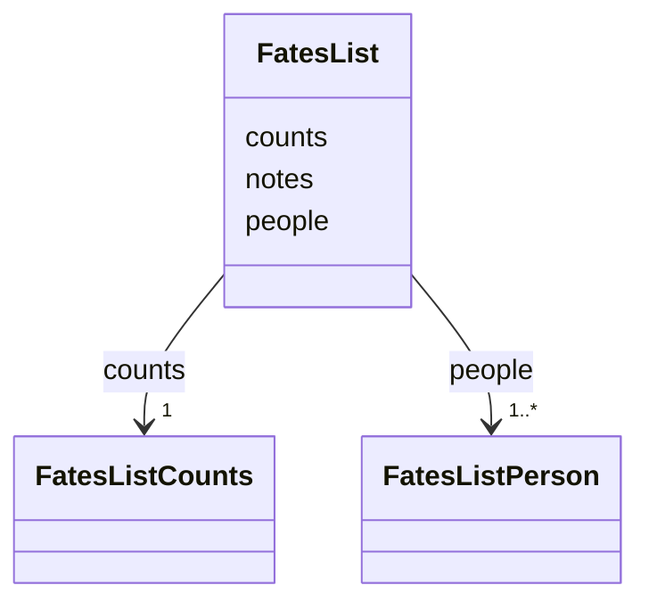

---
search:
  boost: 10.0
---

# Class: FatesList 


_The fates list: its people, its counts and its notes._


<div data-search-exclude markdown="1">


URI: [pc:fates_list](https://pruzhany.org/ns/sourced-entities#fates_list)





<!-- no inheritance hierarchy -->

## Class Properties

| Property | Value |
| --- | --- |
| Class URI | [pc:fates_list](https://pruzhany.org/ns/sourced-entities#fates_list) |
| Tree Root | Yes |


## Slots

| Name | Cardinality and Range | Description | Inheritance |
| ---  | --- | --- | --- |
| [people](people.md) | 1..* <br/> [FatesListPerson](FatesListPerson.md) | Everyone printed in the paper whose fate the record knows, by name as shown. | direct |
| [counts](counts.md) | 1 <br/> [FatesListCounts](FatesListCounts.md) | The list's counts, so that a page never counts for itself. | direct |
| [notes](notes.md) | 1..* <br/> [NonBlankText](NonBlankText.md) | What the counts count, in plain English, the people with no age among them. | direct |


## Identifier and Mapping Information


### Schema Source


* from schema: https://pruzhany.org/ns/fates_list


## Mappings

| Mapping Type | Mapped Value |
| ---  | ---  |
| self | pc:fates_list |
| native | pc:FatesList |


## LinkML Source

<!-- TODO: investigate https://stackoverflow.com/questions/37606292/how-to-create-tabbed-code-blocks-in-mkdocs-or-sphinx -->

### Direct

<details>
```yaml
name: FatesList
description: 'The fates list: its people, its counts and its notes.'
from_schema: https://pruzhany.org/ns/fates_list
rank: 1000
attributes:
  people:
    name: people
    description: Everyone printed in the paper whose fate the record knows, by name
      as shown.
    from_schema: https://pruzhany.org/ns/fates_list
    rank: 1000
    domain_of:
    - FatesList
    - FatesListCounts
    - FatesListArchiveCount
    range: FatesListPerson
    required: true
    multivalued: true
    inlined_as_list: true
  counts:
    name: counts
    description: The list's counts, so that a page never counts for itself.
    from_schema: https://pruzhany.org/ns/fates_list
    rank: 1000
    domain_of:
    - FatesList
    range: FatesListCounts
    required: true
    inlined: true
  notes:
    name: notes
    description: What the counts count, in plain English, the people with no age among
      them.
    from_schema: https://pruzhany.org/ns/fates_list
    rank: 1000
    domain_of:
    - FatesList
    range: NonBlankText
    required: true
    multivalued: true
class_uri: pc:fates_list
tree_root: true

```
</details>

### Induced

<details>
```yaml
name: FatesList
description: 'The fates list: its people, its counts and its notes.'
from_schema: https://pruzhany.org/ns/fates_list
rank: 1000
attributes:
  people:
    name: people
    description: Everyone printed in the paper whose fate the record knows, by name
      as shown.
    from_schema: https://pruzhany.org/ns/fates_list
    rank: 1000
    owner: FatesList
    domain_of:
    - FatesList
    - FatesListCounts
    - FatesListArchiveCount
    range: FatesListPerson
    required: true
    multivalued: true
    inlined: true
    inlined_as_list: true
  counts:
    name: counts
    description: The list's counts, so that a page never counts for itself.
    from_schema: https://pruzhany.org/ns/fates_list
    rank: 1000
    owner: FatesList
    domain_of:
    - FatesList
    range: FatesListCounts
    required: true
    inlined: true
  notes:
    name: notes
    description: What the counts count, in plain English, the people with no age among
      them.
    from_schema: https://pruzhany.org/ns/fates_list
    rank: 1000
    owner: FatesList
    domain_of:
    - FatesList
    range: NonBlankText
    required: true
    multivalued: true
class_uri: pc:fates_list
tree_root: true

```
</details></div>
