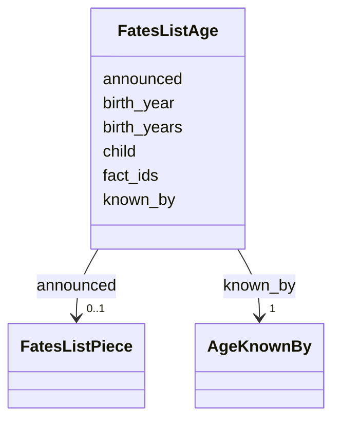

---
search:
  boost: 10.0
---

# Class: FatesListAge 


_How a person's age is known, and whether it marks a child._


<div data-search-exclude markdown="1">


URI: [pc:fates_list_age](https://pruzhany.org/ns/sourced-entities#fates_list_age)





<!-- no inheritance hierarchy -->

## Class Properties

| Property | Value |
| --- | --- |
| Class URI | [pc:fates_list_age](https://pruzhany.org/ns/sourced-entities#fates_list_age) |


## Slots

| Name | Cardinality and Range | Description | Inheritance |
| ---  | --- | --- | --- |
| [known_by](known_by.md) | 1 <br/> [AgeKnownBy](AgeKnownBy.md) | How the age is known: one year of birth, a birth the paper announced, or years that disagree. | direct |
| [child](child.md) | 1 <br/> [Boolean](Boolean.md) | True for a child: one year of birth of 1925 or later, or a birth the paper announced. | direct |
| [birth_year](birth_year.md) | 0..1 <br/> [BirthYear](BirthYear.md) | The one year of birth the person's own records give. | direct |
| [birth_years](birth_years.md) | 2..* <br/> [BirthYear](BirthYear.md) | The years of birth that disagree, in order. | direct |
| [fact_ids](fact_ids.md) | 1..* <br/> [NonBlankText](NonBlankText.md) | The shared record's birth statements that give the year. | direct |
| [announced](announced.md) | 0..1 <br/> [FatesListPiece](FatesListPiece.md) | The earliest published piece that announced the person's birth. | direct |


## Usages

| used by | used in | type | used |
| ---  | --- | --- | --- |
| [FatesListPerson](FatesListPerson.md) | [age](age.md) | range | [FatesListAge](FatesListAge.md) |


## Rules


### 

| Rule Applied | Preconditions | Postconditions | Elseconditions |
|--------------|---------------|----------------|----------------|
| slot_conditions |```{'known_by': {'equals_string': 'birth_year'}}``` |```{'birth_year': {'required': True}, 'fact_ids': {'required': True}}``` | |


### 

| Rule Applied | Preconditions | Postconditions | Elseconditions |
|--------------|---------------|----------------|----------------|
| slot_conditions |```{'known_by': {'equals_string': 'birth_announced'}}``` |```{'announced': {'required': True}}``` | |


### 

| Rule Applied | Preconditions | Postconditions | Elseconditions |
|--------------|---------------|----------------|----------------|
| slot_conditions |```{'known_by': {'equals_string': 'birth_years_disagree'}}``` |```{'birth_years': {'required': True}}``` | |


## Identifier and Mapping Information


### Schema Source


* from schema: https://pruzhany.org/ns/fates_list


## Mappings

| Mapping Type | Mapped Value |
| ---  | ---  |
| self | pc:fates_list_age |
| native | pc:FatesListAge |


## LinkML Source

<!-- TODO: investigate https://stackoverflow.com/questions/37606292/how-to-create-tabbed-code-blocks-in-mkdocs-or-sphinx -->

### Direct

<details>
```yaml
name: FatesListAge
description: How a person's age is known, and whether it marks a child.
from_schema: https://pruzhany.org/ns/fates_list
rank: 1000
attributes:
  known_by:
    name: known_by
    description: 'How the age is known: one year of birth, a birth the paper announced,
      or years that disagree.'
    from_schema: https://pruzhany.org/ns/fates_list
    rank: 1000
    domain_of:
    - FatesListAge
    range: AgeKnownBy
    required: true
  child:
    name: child
    description: 'True for a child: one year of birth of 1925 or later, or a birth
      the paper announced.'
    from_schema: https://pruzhany.org/ns/fates_list
    rank: 1000
    slot_uri: pc:fates_list_child
    domain_of:
    - FatesListAge
    range: boolean
    required: true
  birth_year:
    name: birth_year
    description: The one year of birth the person's own records give.
    from_schema: https://pruzhany.org/ns/fates_list
    rank: 1000
    domain_of:
    - FatesListAge
    range: BirthYear
  birth_years:
    name: birth_years
    description: The years of birth that disagree, in order.
    from_schema: https://pruzhany.org/ns/fates_list
    rank: 1000
    domain_of:
    - FatesListAge
    range: BirthYear
    multivalued: true
    minimum_cardinality: 2
  fact_ids:
    name: fact_ids
    description: The shared record's birth statements that give the year.
    from_schema: https://pruzhany.org/ns/fates_list
    rank: 1000
    domain_of:
    - FatesListAge
    range: NonBlankText
    multivalued: true
    minimum_cardinality: 1
  announced:
    name: announced
    description: The earliest published piece that announced the person's birth.
    from_schema: https://pruzhany.org/ns/fates_list
    rank: 1000
    domain_of:
    - FatesListAge
    range: FatesListPiece
    inlined: true
class_uri: pc:fates_list_age
rules:
- preconditions:
    slot_conditions:
      known_by:
        name: known_by
        equals_string: birth_year
  postconditions:
    slot_conditions:
      birth_year:
        name: birth_year
        required: true
      fact_ids:
        name: fact_ids
        required: true
  description: An age known by one year of birth gives that year and its statements.
- preconditions:
    slot_conditions:
      known_by:
        name: known_by
        equals_string: birth_announced
  postconditions:
    slot_conditions:
      announced:
        name: announced
        required: true
  description: A birth the paper announced names the piece that announced it.
- preconditions:
    slot_conditions:
      known_by:
        name: known_by
        equals_string: birth_years_disagree
  postconditions:
    slot_conditions:
      birth_years:
        name: birth_years
        required: true
  description: Years that disagree are given.

```
</details>

### Induced

<details>
```yaml
name: FatesListAge
description: How a person's age is known, and whether it marks a child.
from_schema: https://pruzhany.org/ns/fates_list
rank: 1000
attributes:
  known_by:
    name: known_by
    description: 'How the age is known: one year of birth, a birth the paper announced,
      or years that disagree.'
    from_schema: https://pruzhany.org/ns/fates_list
    rank: 1000
    owner: FatesListAge
    domain_of:
    - FatesListAge
    range: AgeKnownBy
    required: true
  child:
    name: child
    description: 'True for a child: one year of birth of 1925 or later, or a birth
      the paper announced.'
    from_schema: https://pruzhany.org/ns/fates_list
    rank: 1000
    slot_uri: pc:fates_list_child
    owner: FatesListAge
    domain_of:
    - FatesListAge
    range: boolean
    required: true
  birth_year:
    name: birth_year
    description: The one year of birth the person's own records give.
    from_schema: https://pruzhany.org/ns/fates_list
    rank: 1000
    owner: FatesListAge
    domain_of:
    - FatesListAge
    range: BirthYear
  birth_years:
    name: birth_years
    description: The years of birth that disagree, in order.
    from_schema: https://pruzhany.org/ns/fates_list
    rank: 1000
    owner: FatesListAge
    domain_of:
    - FatesListAge
    range: BirthYear
    multivalued: true
    minimum_cardinality: 2
  fact_ids:
    name: fact_ids
    description: The shared record's birth statements that give the year.
    from_schema: https://pruzhany.org/ns/fates_list
    rank: 1000
    owner: FatesListAge
    domain_of:
    - FatesListAge
    range: NonBlankText
    multivalued: true
    minimum_cardinality: 1
  announced:
    name: announced
    description: The earliest published piece that announced the person's birth.
    from_schema: https://pruzhany.org/ns/fates_list
    rank: 1000
    owner: FatesListAge
    domain_of:
    - FatesListAge
    range: FatesListPiece
    inlined: true
class_uri: pc:fates_list_age
rules:
- preconditions:
    slot_conditions:
      known_by:
        name: known_by
        equals_string: birth_year
  postconditions:
    slot_conditions:
      birth_year:
        name: birth_year
        required: true
      fact_ids:
        name: fact_ids
        required: true
  description: An age known by one year of birth gives that year and its statements.
- preconditions:
    slot_conditions:
      known_by:
        name: known_by
        equals_string: birth_announced
  postconditions:
    slot_conditions:
      announced:
        name: announced
        required: true
  description: A birth the paper announced names the piece that announced it.
- preconditions:
    slot_conditions:
      known_by:
        name: known_by
        equals_string: birth_years_disagree
  postconditions:
    slot_conditions:
      birth_years:
        name: birth_years
        required: true
  description: Years that disagree are given.

```
</details></div>
