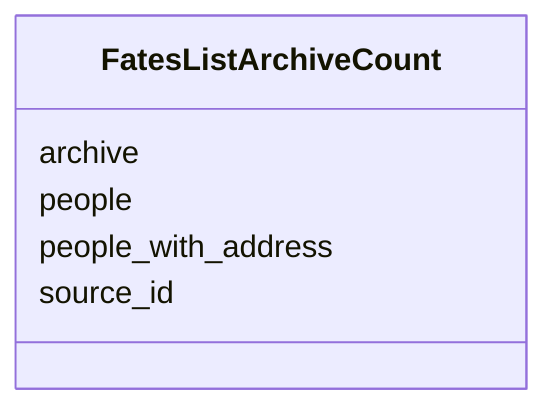

---
search:
  boost: 10.0
---

# Class: FatesListArchiveCount 


_How many people an archive's database names, and how many of them with an address._


<div data-search-exclude markdown="1">


URI: [pc:FatesListArchiveCount](https://pruzhany.org/ns/sourced-entities#FatesListArchiveCount)





<!-- no inheritance hierarchy -->

## Slots

| Name | Cardinality and Range | Description | Inheritance |
| ---  | --- | --- | --- |
| [source_id](source_id.md) | 1 <br/> [NonBlankText](NonBlankText.md) | The database as the shared record's source id. | direct |
| [archive](archive.md) | 1 <br/> [NonBlankText](NonBlankText.md) | The archive's name. | direct |
| [people](people.md) | 1 <br/> [NonNegativeInteger](NonNegativeInteger.md) | The people its records name. | direct |
| [people_with_address](people_with_address.md) | 1 <br/> [NonNegativeInteger](NonNegativeInteger.md) | The people with at least one of its records at the record's own address. | direct |


## Usages

| used by | used in | type | used |
| ---  | --- | --- | --- |
| [FatesListCounts](FatesListCounts.md) | [outside_records](outside_records.md) | range | [FatesListArchiveCount](FatesListArchiveCount.md) |


## Identifier and Mapping Information


### Schema Source


* from schema: https://pruzhany.org/ns/fates_list


## Mappings

| Mapping Type | Mapped Value |
| ---  | ---  |
| self | pc:FatesListArchiveCount |
| native | pc:FatesListArchiveCount |


## LinkML Source

<!-- TODO: investigate https://stackoverflow.com/questions/37606292/how-to-create-tabbed-code-blocks-in-mkdocs-or-sphinx -->

### Direct

<details>
```yaml
name: FatesListArchiveCount
description: How many people an archive's database names, and how many of them with
  an address.
from_schema: https://pruzhany.org/ns/fates_list
rank: 1000
attributes:
  source_id:
    name: source_id
    description: The database as the shared record's source id.
    from_schema: https://pruzhany.org/ns/fates_list
    domain_of:
    - FatesListOutsideRecord
    - FatesListArchiveCount
    - SourceDerivation
    - Citation
    range: NonBlankText
    required: true
  archive:
    name: archive
    description: The archive's name.
    from_schema: https://pruzhany.org/ns/fates_list
    domain_of:
    - FatesListOutsideRecord
    - FatesListArchiveCount
    range: NonBlankText
    required: true
  people:
    name: people
    description: The people its records name.
    from_schema: https://pruzhany.org/ns/fates_list
    domain_of:
    - FatesList
    - FatesListCounts
    - FatesListArchiveCount
    range: NonNegativeInteger
    required: true
  people_with_address:
    name: people_with_address
    description: The people with at least one of its records at the record's own address.
    from_schema: https://pruzhany.org/ns/fates_list
    rank: 1000
    domain_of:
    - FatesListArchiveCount
    range: NonNegativeInteger
    required: true

```
</details>

### Induced

<details>
```yaml
name: FatesListArchiveCount
description: How many people an archive's database names, and how many of them with
  an address.
from_schema: https://pruzhany.org/ns/fates_list
rank: 1000
attributes:
  source_id:
    name: source_id
    description: The database as the shared record's source id.
    from_schema: https://pruzhany.org/ns/fates_list
    owner: FatesListArchiveCount
    domain_of:
    - FatesListOutsideRecord
    - FatesListArchiveCount
    - SourceDerivation
    - Citation
    range: NonBlankText
    required: true
  archive:
    name: archive
    description: The archive's name.
    from_schema: https://pruzhany.org/ns/fates_list
    owner: FatesListArchiveCount
    domain_of:
    - FatesListOutsideRecord
    - FatesListArchiveCount
    range: NonBlankText
    required: true
  people:
    name: people
    description: The people its records name.
    from_schema: https://pruzhany.org/ns/fates_list
    owner: FatesListArchiveCount
    domain_of:
    - FatesList
    - FatesListCounts
    - FatesListArchiveCount
    range: NonNegativeInteger
    required: true
  people_with_address:
    name: people_with_address
    description: The people with at least one of its records at the record's own address.
    from_schema: https://pruzhany.org/ns/fates_list
    rank: 1000
    owner: FatesListArchiveCount
    domain_of:
    - FatesListArchiveCount
    range: NonNegativeInteger
    required: true

```
</details></div>
