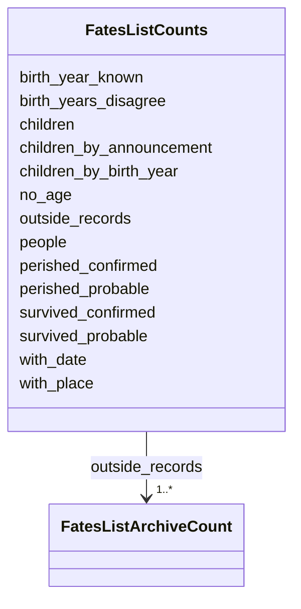

---
search:
  boost: 10.0
---

# Class: FatesListCounts 


_The list's counts._


<div data-search-exclude markdown="1">


URI: [pc:FatesListCounts](https://pruzhany.org/ns/sourced-entities#FatesListCounts)





<!-- no inheritance hierarchy -->

## Slots

| Name | Cardinality and Range | Description | Inheritance |
| ---  | --- | --- | --- |
| [people](people.md) | 1 <br/> [NonNegativeInteger](NonNegativeInteger.md) | The people on the list. | direct |
| [perished_confirmed](perished_confirmed.md) | 1 <br/> [NonNegativeInteger](NonNegativeInteger.md) | The people who perished. | direct |
| [perished_probable](perished_probable.md) | 1 <br/> [NonNegativeInteger](NonNegativeInteger.md) | The people who probably perished. | direct |
| [survived_confirmed](survived_confirmed.md) | 1 <br/> [NonNegativeInteger](NonNegativeInteger.md) | The people who survived. | direct |
| [survived_probable](survived_probable.md) | 1 <br/> [NonNegativeInteger](NonNegativeInteger.md) | The people who probably survived. | direct |
| [children](children.md) | 1 <br/> [NonNegativeInteger](NonNegativeInteger.md) | The people marked as children. | direct |
| [children_by_birth_year](children_by_birth_year.md) | 1 <br/> [NonNegativeInteger](NonNegativeInteger.md) | The children marked by one year of birth of 1925 or later. | direct |
| [children_by_announcement](children_by_announcement.md) | 1 <br/> [NonNegativeInteger](NonNegativeInteger.md) | The children marked because the paper announced their birth. | direct |
| [birth_year_known](birth_year_known.md) | 1 <br/> [NonNegativeInteger](NonNegativeInteger.md) | The people whose own records give one year of birth, children or not. | direct |
| [birth_years_disagree](birth_years_disagree.md) | 1 <br/> [NonNegativeInteger](NonNegativeInteger.md) | The people whose own records give years of birth that disagree. | direct |
| [no_age](no_age.md) | 1 <br/> [NonNegativeInteger](NonNegativeInteger.md) | The people with no age in the record; they are not marked as children. | direct |
| [with_place](with_place.md) | 1 <br/> [NonNegativeInteger](NonNegativeInteger.md) | The people whose fate the record places somewhere. | direct |
| [with_date](with_date.md) | 1 <br/> [NonNegativeInteger](NonNegativeInteger.md) | The people whose fate the record dates. | direct |
| [outside_records](outside_records.md) | 1..* <br/> [FatesListArchiveCount](FatesListArchiveCount.md) | For each archive's database, how many people its records name. | direct |


## Usages

| used by | used in | type | used |
| ---  | --- | --- | --- |
| [FatesList](FatesList.md) | [counts](counts.md) | range | [FatesListCounts](FatesListCounts.md) |


## Identifier and Mapping Information


### Schema Source


* from schema: https://pruzhany.org/ns/fates_list


## Mappings

| Mapping Type | Mapped Value |
| ---  | ---  |
| self | pc:FatesListCounts |
| native | pc:FatesListCounts |


## LinkML Source

<!-- TODO: investigate https://stackoverflow.com/questions/37606292/how-to-create-tabbed-code-blocks-in-mkdocs-or-sphinx -->

### Direct

<details>
```yaml
name: FatesListCounts
description: The list's counts.
from_schema: https://pruzhany.org/ns/fates_list
rank: 1000
attributes:
  people:
    name: people
    description: The people on the list.
    from_schema: https://pruzhany.org/ns/fates_list
    domain_of:
    - FatesList
    - FatesListCounts
    - FatesListArchiveCount
    range: NonNegativeInteger
    required: true
  perished_confirmed:
    name: perished_confirmed
    description: The people who perished.
    from_schema: https://pruzhany.org/ns/fates_list
    rank: 1000
    domain_of:
    - FatesListCounts
    range: NonNegativeInteger
    required: true
  perished_probable:
    name: perished_probable
    description: The people who probably perished.
    from_schema: https://pruzhany.org/ns/fates_list
    rank: 1000
    domain_of:
    - FatesListCounts
    range: NonNegativeInteger
    required: true
  survived_confirmed:
    name: survived_confirmed
    description: The people who survived.
    from_schema: https://pruzhany.org/ns/fates_list
    rank: 1000
    domain_of:
    - FatesListCounts
    range: NonNegativeInteger
    required: true
  survived_probable:
    name: survived_probable
    description: The people who probably survived.
    from_schema: https://pruzhany.org/ns/fates_list
    rank: 1000
    domain_of:
    - FatesListCounts
    range: NonNegativeInteger
    required: true
  children:
    name: children
    description: The people marked as children.
    from_schema: https://pruzhany.org/ns/fates_list
    rank: 1000
    domain_of:
    - FatesListCounts
    range: NonNegativeInteger
    required: true
  children_by_birth_year:
    name: children_by_birth_year
    description: The children marked by one year of birth of 1925 or later.
    from_schema: https://pruzhany.org/ns/fates_list
    rank: 1000
    domain_of:
    - FatesListCounts
    range: NonNegativeInteger
    required: true
  children_by_announcement:
    name: children_by_announcement
    description: The children marked because the paper announced their birth.
    from_schema: https://pruzhany.org/ns/fates_list
    rank: 1000
    domain_of:
    - FatesListCounts
    range: NonNegativeInteger
    required: true
  birth_year_known:
    name: birth_year_known
    description: The people whose own records give one year of birth, children or
      not.
    from_schema: https://pruzhany.org/ns/fates_list
    rank: 1000
    domain_of:
    - FatesListCounts
    range: NonNegativeInteger
    required: true
  birth_years_disagree:
    name: birth_years_disagree
    description: The people whose own records give years of birth that disagree.
    from_schema: https://pruzhany.org/ns/fates_list
    rank: 1000
    domain_of:
    - FatesListCounts
    range: NonNegativeInteger
    required: true
  no_age:
    name: no_age
    description: The people with no age in the record; they are not marked as children.
    from_schema: https://pruzhany.org/ns/fates_list
    rank: 1000
    domain_of:
    - FatesListCounts
    range: NonNegativeInteger
    required: true
  with_place:
    name: with_place
    description: The people whose fate the record places somewhere.
    from_schema: https://pruzhany.org/ns/fates_list
    rank: 1000
    domain_of:
    - FatesListCounts
    range: NonNegativeInteger
    required: true
  with_date:
    name: with_date
    description: The people whose fate the record dates.
    from_schema: https://pruzhany.org/ns/fates_list
    rank: 1000
    domain_of:
    - FatesListCounts
    range: NonNegativeInteger
    required: true
  outside_records:
    name: outside_records
    description: For each archive's database, how many people its records name.
    from_schema: https://pruzhany.org/ns/fates_list
    domain_of:
    - FatesListPerson
    - FatesListCounts
    range: FatesListArchiveCount
    required: true
    multivalued: true
    inlined_as_list: true

```
</details>

### Induced

<details>
```yaml
name: FatesListCounts
description: The list's counts.
from_schema: https://pruzhany.org/ns/fates_list
rank: 1000
attributes:
  people:
    name: people
    description: The people on the list.
    from_schema: https://pruzhany.org/ns/fates_list
    owner: FatesListCounts
    domain_of:
    - FatesList
    - FatesListCounts
    - FatesListArchiveCount
    range: NonNegativeInteger
    required: true
  perished_confirmed:
    name: perished_confirmed
    description: The people who perished.
    from_schema: https://pruzhany.org/ns/fates_list
    rank: 1000
    owner: FatesListCounts
    domain_of:
    - FatesListCounts
    range: NonNegativeInteger
    required: true
  perished_probable:
    name: perished_probable
    description: The people who probably perished.
    from_schema: https://pruzhany.org/ns/fates_list
    rank: 1000
    owner: FatesListCounts
    domain_of:
    - FatesListCounts
    range: NonNegativeInteger
    required: true
  survived_confirmed:
    name: survived_confirmed
    description: The people who survived.
    from_schema: https://pruzhany.org/ns/fates_list
    rank: 1000
    owner: FatesListCounts
    domain_of:
    - FatesListCounts
    range: NonNegativeInteger
    required: true
  survived_probable:
    name: survived_probable
    description: The people who probably survived.
    from_schema: https://pruzhany.org/ns/fates_list
    rank: 1000
    owner: FatesListCounts
    domain_of:
    - FatesListCounts
    range: NonNegativeInteger
    required: true
  children:
    name: children
    description: The people marked as children.
    from_schema: https://pruzhany.org/ns/fates_list
    rank: 1000
    owner: FatesListCounts
    domain_of:
    - FatesListCounts
    range: NonNegativeInteger
    required: true
  children_by_birth_year:
    name: children_by_birth_year
    description: The children marked by one year of birth of 1925 or later.
    from_schema: https://pruzhany.org/ns/fates_list
    rank: 1000
    owner: FatesListCounts
    domain_of:
    - FatesListCounts
    range: NonNegativeInteger
    required: true
  children_by_announcement:
    name: children_by_announcement
    description: The children marked because the paper announced their birth.
    from_schema: https://pruzhany.org/ns/fates_list
    rank: 1000
    owner: FatesListCounts
    domain_of:
    - FatesListCounts
    range: NonNegativeInteger
    required: true
  birth_year_known:
    name: birth_year_known
    description: The people whose own records give one year of birth, children or
      not.
    from_schema: https://pruzhany.org/ns/fates_list
    rank: 1000
    owner: FatesListCounts
    domain_of:
    - FatesListCounts
    range: NonNegativeInteger
    required: true
  birth_years_disagree:
    name: birth_years_disagree
    description: The people whose own records give years of birth that disagree.
    from_schema: https://pruzhany.org/ns/fates_list
    rank: 1000
    owner: FatesListCounts
    domain_of:
    - FatesListCounts
    range: NonNegativeInteger
    required: true
  no_age:
    name: no_age
    description: The people with no age in the record; they are not marked as children.
    from_schema: https://pruzhany.org/ns/fates_list
    rank: 1000
    owner: FatesListCounts
    domain_of:
    - FatesListCounts
    range: NonNegativeInteger
    required: true
  with_place:
    name: with_place
    description: The people whose fate the record places somewhere.
    from_schema: https://pruzhany.org/ns/fates_list
    rank: 1000
    owner: FatesListCounts
    domain_of:
    - FatesListCounts
    range: NonNegativeInteger
    required: true
  with_date:
    name: with_date
    description: The people whose fate the record dates.
    from_schema: https://pruzhany.org/ns/fates_list
    rank: 1000
    owner: FatesListCounts
    domain_of:
    - FatesListCounts
    range: NonNegativeInteger
    required: true
  outside_records:
    name: outside_records
    description: For each archive's database, how many people its records name.
    from_schema: https://pruzhany.org/ns/fates_list
    owner: FatesListCounts
    domain_of:
    - FatesListPerson
    - FatesListCounts
    range: FatesListArchiveCount
    required: true
    multivalued: true
    inlined: true
    inlined_as_list: true

```
</details></div>
