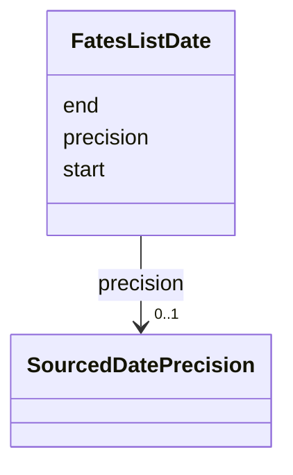

---
search:
  boost: 10.0
---

# Class: FatesListDate 


_A normalized date: its start, how precise it is and, for a range, its end._


<div data-search-exclude markdown="1">


URI: [rico:Date](https://www.ica.org/standards/RiC/ontology#Date)





<!-- no inheritance hierarchy -->

## Class Properties

| Property | Value |
| --- | --- |
| Class URI | [rico:Date](https://www.ica.org/standards/RiC/ontology#Date) |


## Slots

| Name | Cardinality and Range | Description | Inheritance |
| ---  | --- | --- | --- |
| [start](start.md) | 1 <br/> [IsoYearMonthOrDay](IsoYearMonthOrDay.md) | The date's start, as far as it is known: YYYY, YYYY-MM or YYYY-MM-DD. | direct |
| [precision](precision.md) | 0..1 <br/> [SourcedDatePrecision](SourcedDatePrecision.md) | How much of the date is known: year, month, day or range. | direct |
| [end](end.md) | 0..1 <br/> [IsoYearMonthOrDay](IsoYearMonthOrDay.md) | The end of a range of dates, written as the start is. | direct |


## Usages

| used by | used in | type | used |
| ---  | --- | --- | --- |
| [FatesListFateDetail](FatesListFateDetail.md) | [date](date.md) | range | [FatesListDate](FatesListDate.md) |


## Identifier and Mapping Information


### Schema Source


* from schema: https://pruzhany.org/ns/fates_list


## Mappings

| Mapping Type | Mapped Value |
| ---  | ---  |
| self | rico:Date |
| native | pc:FatesListDate |


## LinkML Source

<!-- TODO: investigate https://stackoverflow.com/questions/37606292/how-to-create-tabbed-code-blocks-in-mkdocs-or-sphinx -->

### Direct

<details>
```yaml
name: FatesListDate
description: 'A normalized date: its start, how precise it is and, for a range, its
  end.'
from_schema: https://pruzhany.org/ns/fates_list
rank: 1000
attributes:
  start:
    name: start
    description: 'The date''s start, as far as it is known: YYYY, YYYY-MM or YYYY-MM-DD.'
    from_schema: https://pruzhany.org/ns/fates_list
    rank: 1000
    domain_of:
    - FatesListDate
    - SourcedDate
    range: IsoYearMonthOrDay
    required: true
  precision:
    name: precision
    description: 'How much of the date is known: year, month, day or range.'
    from_schema: https://pruzhany.org/ns/fates_list
    rank: 1000
    domain_of:
    - FatesListDate
    - SourcedDate
    range: SourcedDatePrecision
  end:
    name: end
    description: The end of a range of dates, written as the start is.
    from_schema: https://pruzhany.org/ns/fates_list
    rank: 1000
    domain_of:
    - FatesListDate
    - SourcedDate
    range: IsoYearMonthOrDay
class_uri: rico:Date

```
</details>

### Induced

<details>
```yaml
name: FatesListDate
description: 'A normalized date: its start, how precise it is and, for a range, its
  end.'
from_schema: https://pruzhany.org/ns/fates_list
rank: 1000
attributes:
  start:
    name: start
    description: 'The date''s start, as far as it is known: YYYY, YYYY-MM or YYYY-MM-DD.'
    from_schema: https://pruzhany.org/ns/fates_list
    rank: 1000
    owner: FatesListDate
    domain_of:
    - FatesListDate
    - SourcedDate
    range: IsoYearMonthOrDay
    required: true
  precision:
    name: precision
    description: 'How much of the date is known: year, month, day or range.'
    from_schema: https://pruzhany.org/ns/fates_list
    rank: 1000
    owner: FatesListDate
    domain_of:
    - FatesListDate
    - SourcedDate
    range: SourcedDatePrecision
  end:
    name: end
    description: The end of a range of dates, written as the start is.
    from_schema: https://pruzhany.org/ns/fates_list
    rank: 1000
    owner: FatesListDate
    domain_of:
    - FatesListDate
    - SourcedDate
    range: IsoYearMonthOrDay
class_uri: rico:Date

```
</details></div>
