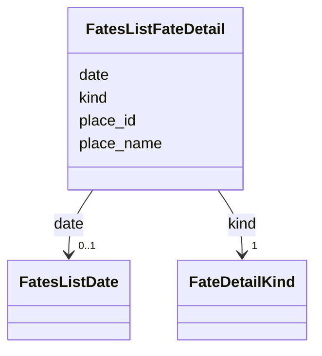

---
search:
  boost: 10.0
---

# Class: FatesListFateDetail 


_Where or when one of the person's own fate statements, or the death event it names, places the fate._


<div data-search-exclude markdown="1">


URI: [pc:FatesListFateDetail](https://pruzhany.org/ns/sourced-entities#FatesListFateDetail)





<!-- no inheritance hierarchy -->

## Slots

| Name | Cardinality and Range | Description | Inheritance |
| ---  | --- | --- | --- |
| [kind](kind.md) | 1 <br/> [FateDetailKind](FateDetailKind.md) | The kind of statement: death, survival or deportation. | direct |
| [place_id](place_id.md) | 0..1 <br/> [String](String.md) | The place's id in the shared record. | direct |
| [place_name](place_name.md) | 0..1 <br/> [NonBlankText](NonBlankText.md) | The place's name in the shared record. | direct |
| [date](date.md) | 0..1 <br/> [FatesListDate](FatesListDate.md) | The date, as the record holds it structured; its printed words are never carried. | direct |


## Usages

| used by | used in | type | used |
| ---  | --- | --- | --- |
| [FatesListPerson](FatesListPerson.md) | [fate_details](fate_details.md) | range | [FatesListFateDetail](FatesListFateDetail.md) |


## Rules


### 

| Rule Applied | Preconditions | Postconditions | Elseconditions |
|--------------|---------------|----------------|----------------|
| slot_conditions |```{'place_id': {'value_presence': 'ABSENT'}}``` |```{'date': {'required': True}}``` | |


## Identifier and Mapping Information


### Schema Source


* from schema: https://pruzhany.org/ns/fates_list


## Mappings

| Mapping Type | Mapped Value |
| ---  | ---  |
| self | pc:FatesListFateDetail |
| native | pc:FatesListFateDetail |
| close | rico:Event |


## LinkML Source

<!-- TODO: investigate https://stackoverflow.com/questions/37606292/how-to-create-tabbed-code-blocks-in-mkdocs-or-sphinx -->

### Direct

<details>
```yaml
name: FatesListFateDetail
description: Where or when one of the person's own fate statements, or the death event
  it names, places the fate.
from_schema: https://pruzhany.org/ns/fates_list
close_mappings:
- rico:Event
rank: 1000
attributes:
  kind:
    name: kind
    description: 'The kind of statement: death, survival or deportation.'
    from_schema: https://pruzhany.org/ns/fates_list
    rank: 1000
    domain_of:
    - FatesListFateDetail
    - Authorship
    - Source
    - Name
    range: FateDetailKind
    required: true
  place_id:
    name: place_id
    description: The place's id in the shared record.
    from_schema: https://pruzhany.org/ns/fates_list
    related_mappings:
    - rico:PlaceRelation
    rank: 1000
    domain_of:
    - FatesListFateDetail
    - Fact
    pattern: ^location-[A-Za-z0-9_-]+$
  place_name:
    name: place_name
    description: The place's name in the shared record.
    from_schema: https://pruzhany.org/ns/fates_list
    rank: 1000
    domain_of:
    - FatesListFateDetail
    range: NonBlankText
  date:
    name: date
    description: The date, as the record holds it structured; its printed words are
      never carried.
    from_schema: https://pruzhany.org/ns/fates_list
    rank: 1000
    domain_of:
    - FatesListFateDetail
    - Fact
    range: FatesListDate
    inlined: true
rules:
- preconditions:
    slot_conditions:
      place_id:
        name: place_id
        value_presence: ABSENT
  postconditions:
    slot_conditions:
      date:
        name: date
        required: true
  description: 'A fate detail places the fate, dates it, or both: one without a place
    has a date.'

```
</details>

### Induced

<details>
```yaml
name: FatesListFateDetail
description: Where or when one of the person's own fate statements, or the death event
  it names, places the fate.
from_schema: https://pruzhany.org/ns/fates_list
close_mappings:
- rico:Event
rank: 1000
attributes:
  kind:
    name: kind
    description: 'The kind of statement: death, survival or deportation.'
    from_schema: https://pruzhany.org/ns/fates_list
    rank: 1000
    owner: FatesListFateDetail
    domain_of:
    - FatesListFateDetail
    - Authorship
    - Source
    - Name
    range: FateDetailKind
    required: true
  place_id:
    name: place_id
    description: The place's id in the shared record.
    from_schema: https://pruzhany.org/ns/fates_list
    related_mappings:
    - rico:PlaceRelation
    rank: 1000
    owner: FatesListFateDetail
    domain_of:
    - FatesListFateDetail
    - Fact
    range: string
    pattern: ^location-[A-Za-z0-9_-]+$
  place_name:
    name: place_name
    description: The place's name in the shared record.
    from_schema: https://pruzhany.org/ns/fates_list
    rank: 1000
    owner: FatesListFateDetail
    domain_of:
    - FatesListFateDetail
    range: NonBlankText
  date:
    name: date
    description: The date, as the record holds it structured; its printed words are
      never carried.
    from_schema: https://pruzhany.org/ns/fates_list
    rank: 1000
    owner: FatesListFateDetail
    domain_of:
    - FatesListFateDetail
    - Fact
    range: FatesListDate
    inlined: true
rules:
- preconditions:
    slot_conditions:
      place_id:
        name: place_id
        value_presence: ABSENT
  postconditions:
    slot_conditions:
      date:
        name: date
        required: true
  description: 'A fate detail places the fate, dates it, or both: one without a place
    has a date.'

```
</details></div>
