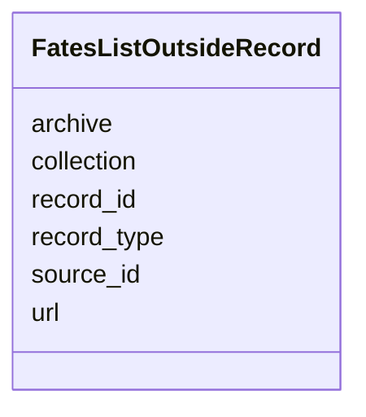

---
search:
  boost: 10.0
---

# Class: FatesListOutsideRecord 


_A record an archive holds about the person: the archive, the database it is in, the record's type and id as the archive gives them, and its own address where the record has one._


<div data-search-exclude markdown="1">


URI: [pc:FatesListOutsideRecord](https://pruzhany.org/ns/sourced-entities#FatesListOutsideRecord)





<!-- no inheritance hierarchy -->

## Slots

| Name | Cardinality and Range | Description | Inheritance |
| ---  | --- | --- | --- |
| [source_id](source_id.md) | 1 <br/> [NonBlankText](NonBlankText.md) | The archive's database as the shared record's source id, such as yad-vashem. | direct |
| [archive](archive.md) | 1 <br/> [NonBlankText](NonBlankText.md) | The archive's name, as the shared record's holder gives it. | direct |
| [collection](collection.md) | 1 <br/> [NonBlankText](NonBlankText.md) | The database's title, as the shared record's source gives it. | direct |
| [record_type](record_type.md) | 0..1 <br/> [NonBlankText](NonBlankText.md) | The record's type as the archive names it, from the record's citations, such as Page of Testimony; absent where they name none. | direct |
| [record_id](record_id.md) | 1 <br/> [NonBlankText](NonBlankText.md) | The archive's id for the record. | direct |
| [url](url.md) | 0..1 <br/> [ArchiveAddress](ArchiveAddress.md) | The record's own address at the archive, never a scan or file address; absent where the record has none. | direct |


## Usages

| used by | used in | type | used |
| ---  | --- | --- | --- |
| [FatesListPerson](FatesListPerson.md) | [outside_records](outside_records.md) | range | [FatesListOutsideRecord](FatesListOutsideRecord.md) |


## Identifier and Mapping Information


### Schema Source


* from schema: https://pruzhany.org/ns/fates_list


## Mappings

| Mapping Type | Mapped Value |
| ---  | ---  |
| self | pc:FatesListOutsideRecord |
| native | pc:FatesListOutsideRecord |
| close | rico:Record |


## LinkML Source

<!-- TODO: investigate https://stackoverflow.com/questions/37606292/how-to-create-tabbed-code-blocks-in-mkdocs-or-sphinx -->

### Direct

<details>
```yaml
name: FatesListOutsideRecord
description: 'A record an archive holds about the person: the archive, the database
  it is in, the record''s type and id as the archive gives them, and its own address
  where the record has one.'
from_schema: https://pruzhany.org/ns/fates_list
close_mappings:
- rico:Record
rank: 1000
attributes:
  source_id:
    name: source_id
    description: The archive's database as the shared record's source id, such as
      yad-vashem.
    from_schema: https://pruzhany.org/ns/fates_list
    rank: 1000
    domain_of:
    - FatesListOutsideRecord
    - FatesListArchiveCount
    - SourceDerivation
    - Citation
    range: NonBlankText
    required: true
  archive:
    name: archive
    description: The archive's name, as the shared record's holder gives it.
    from_schema: https://pruzhany.org/ns/fates_list
    related_mappings:
    - rico:hasOrHadHolder
    rank: 1000
    domain_of:
    - FatesListOutsideRecord
    - FatesListArchiveCount
    range: NonBlankText
    required: true
  collection:
    name: collection
    description: The database's title, as the shared record's source gives it.
    from_schema: https://pruzhany.org/ns/fates_list
    rank: 1000
    domain_of:
    - FatesListOutsideRecord
    range: NonBlankText
    required: true
  record_type:
    name: record_type
    description: The record's type as the archive names it, from the record's citations,
      such as Page of Testimony; absent where they name none.
    from_schema: https://pruzhany.org/ns/fates_list
    related_mappings:
    - rico:hasDocumentaryFormType
    rank: 1000
    domain_of:
    - FatesListOutsideRecord
    - Citation
    range: NonBlankText
  record_id:
    name: record_id
    description: The archive's id for the record.
    from_schema: https://pruzhany.org/ns/fates_list
    related_mappings:
    - rico:hasOrHadIdentifier
    rank: 1000
    domain_of:
    - FatesListOutsideRecord
    - Citation
    range: NonBlankText
    required: true
  url:
    name: url
    description: The record's own address at the archive, never a scan or file address;
      absent where the record has none.
    from_schema: https://pruzhany.org/ns/fates_list
    rank: 1000
    domain_of:
    - FatesListOutsideRecord
    - Citation
    range: ArchiveAddress

```
</details>

### Induced

<details>
```yaml
name: FatesListOutsideRecord
description: 'A record an archive holds about the person: the archive, the database
  it is in, the record''s type and id as the archive gives them, and its own address
  where the record has one.'
from_schema: https://pruzhany.org/ns/fates_list
close_mappings:
- rico:Record
rank: 1000
attributes:
  source_id:
    name: source_id
    description: The archive's database as the shared record's source id, such as
      yad-vashem.
    from_schema: https://pruzhany.org/ns/fates_list
    rank: 1000
    owner: FatesListOutsideRecord
    domain_of:
    - FatesListOutsideRecord
    - FatesListArchiveCount
    - SourceDerivation
    - Citation
    range: NonBlankText
    required: true
  archive:
    name: archive
    description: The archive's name, as the shared record's holder gives it.
    from_schema: https://pruzhany.org/ns/fates_list
    related_mappings:
    - rico:hasOrHadHolder
    rank: 1000
    owner: FatesListOutsideRecord
    domain_of:
    - FatesListOutsideRecord
    - FatesListArchiveCount
    range: NonBlankText
    required: true
  collection:
    name: collection
    description: The database's title, as the shared record's source gives it.
    from_schema: https://pruzhany.org/ns/fates_list
    rank: 1000
    owner: FatesListOutsideRecord
    domain_of:
    - FatesListOutsideRecord
    range: NonBlankText
    required: true
  record_type:
    name: record_type
    description: The record's type as the archive names it, from the record's citations,
      such as Page of Testimony; absent where they name none.
    from_schema: https://pruzhany.org/ns/fates_list
    related_mappings:
    - rico:hasDocumentaryFormType
    rank: 1000
    owner: FatesListOutsideRecord
    domain_of:
    - FatesListOutsideRecord
    - Citation
    range: NonBlankText
  record_id:
    name: record_id
    description: The archive's id for the record.
    from_schema: https://pruzhany.org/ns/fates_list
    related_mappings:
    - rico:hasOrHadIdentifier
    rank: 1000
    owner: FatesListOutsideRecord
    domain_of:
    - FatesListOutsideRecord
    - Citation
    range: NonBlankText
    required: true
  url:
    name: url
    description: The record's own address at the archive, never a scan or file address;
      absent where the record has none.
    from_schema: https://pruzhany.org/ns/fates_list
    rank: 1000
    owner: FatesListOutsideRecord
    domain_of:
    - FatesListOutsideRecord
    - Citation
    range: ArchiveAddress

```
</details></div>
