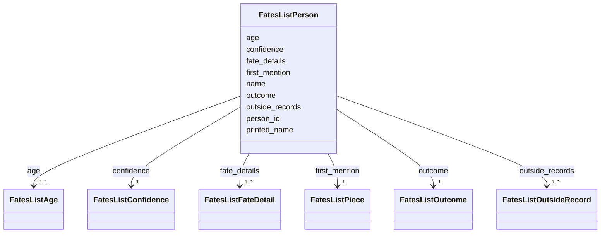

---
search:
  boost: 10.0
---

# Class: FatesListPerson 


_One person on the list: who, the fate, where the paper first prints them, where and when the fate is placed, the archives' records about them and how their age is known._


<div data-search-exclude markdown="1">


URI: [pc:FatesListPerson](https://pruzhany.org/ns/sourced-entities#FatesListPerson)





<!-- no inheritance hierarchy -->

## Slots

| Name | Cardinality and Range | Description | Inheritance |
| ---  | --- | --- | --- |
| [person_id](person_id.md) | 1 <br/> [String](String.md) | The person's id in the shared record; the site's person page has this address. | direct |
| [name](name.md) | 1 <br/> [NonBlankText](NonBlankText.md) | The person's name as the site shows it. | direct |
| [printed_name](printed_name.md) | 0..1 <br/> [NonBlankText](NonBlankText.md) | The person's name in Yiddish as the paper prints it, where the record has it. | direct |
| [outcome](outcome.md) | 1 <br/> [FatesListOutcome](FatesListOutcome.md) | The record's fate: perished or survived. | direct |
| [confidence](confidence.md) | 1 <br/> [FatesListConfidence](FatesListConfidence.md) | How sure the fate is: confirmed or probable. | direct |
| [first_mention](first_mention.md) | 1 <br/> [FatesListPiece](FatesListPiece.md) | The earliest published piece that prints the person. | direct |
| [fate_details](fate_details.md) | 1..* <br/> [FatesListFateDetail](FatesListFateDetail.md) | Where and when the person's own death, survival and deportation statements place the fate, as the record holds them structured. | direct |
| [outside_records](outside_records.md) | 1..* <br/> [FatesListOutsideRecord](FatesListOutsideRecord.md) | The archives' records about the person that the record cites. | direct |
| [age](age.md) | 0..1 <br/> [FatesListAge](FatesListAge.md) | How the person's age is known; absent where the record gives no age. | direct |


## Usages

| used by | used in | type | used |
| ---  | --- | --- | --- |
| [FatesList](FatesList.md) | [people](people.md) | range | [FatesListPerson](FatesListPerson.md) |


## Identifier and Mapping Information


### Schema Source


* from schema: https://pruzhany.org/ns/fates_list


## Mappings

| Mapping Type | Mapped Value |
| ---  | ---  |
| self | pc:FatesListPerson |
| native | pc:FatesListPerson |
| close | ehri:Person |


## LinkML Source

<!-- TODO: investigate https://stackoverflow.com/questions/37606292/how-to-create-tabbed-code-blocks-in-mkdocs-or-sphinx -->

### Direct

<details>
```yaml
name: FatesListPerson
description: 'One person on the list: who, the fate, where the paper first prints
  them, where and when the fate is placed, the archives'' records about them and how
  their age is known.'
from_schema: https://pruzhany.org/ns/fates_list
close_mappings:
- ehri:Person
rank: 1000
attributes:
  person_id:
    name: person_id
    description: The person's id in the shared record; the site's person page has
      this address.
    from_schema: https://pruzhany.org/ns/fates_list
    rank: 1000
    domain_of:
    - FatesListPerson
    - Mention
    required: true
    pattern: ^person-[A-Za-z0-9_-]+$
  name:
    name: name
    description: The person's name as the site shows it.
    from_schema: https://pruzhany.org/ns/fates_list
    rank: 1000
    domain_of:
    - FatesListPerson
    range: NonBlankText
    required: true
  printed_name:
    name: printed_name
    description: The person's name in Yiddish as the paper prints it, where the record
      has it.
    from_schema: https://pruzhany.org/ns/fates_list
    rank: 1000
    domain_of:
    - FatesListPerson
    - Mention
    range: NonBlankText
  outcome:
    name: outcome
    description: 'The record''s fate: perished or survived.'
    from_schema: https://pruzhany.org/ns/fates_list
    rank: 1000
    domain_of:
    - FatesListPerson
    - Fate
    range: FatesListOutcome
    required: true
  confidence:
    name: confidence
    description: 'How sure the fate is: confirmed or probable.'
    from_schema: https://pruzhany.org/ns/fates_list
    rank: 1000
    domain_of:
    - FatesListPerson
    - CrossReference
    - Fate
    range: FatesListConfidence
    required: true
  first_mention:
    name: first_mention
    description: The earliest published piece that prints the person.
    from_schema: https://pruzhany.org/ns/fates_list
    rank: 1000
    slot_uri: pc:site_mention
    domain_of:
    - FatesListPerson
    range: FatesListPiece
    required: true
    inlined: true
  fate_details:
    name: fate_details
    description: Where and when the person's own death, survival and deportation statements
      place the fate, as the record holds them structured.
    from_schema: https://pruzhany.org/ns/fates_list
    rank: 1000
    domain_of:
    - FatesListPerson
    range: FatesListFateDetail
    multivalued: true
    inlined_as_list: true
    minimum_cardinality: 1
  outside_records:
    name: outside_records
    description: The archives' records about the person that the record cites.
    from_schema: https://pruzhany.org/ns/fates_list
    rank: 1000
    domain_of:
    - FatesListPerson
    - FatesListCounts
    range: FatesListOutsideRecord
    multivalued: true
    inlined_as_list: true
    minimum_cardinality: 1
  age:
    name: age
    description: How the person's age is known; absent where the record gives no age.
    from_schema: https://pruzhany.org/ns/fates_list
    rank: 1000
    domain_of:
    - FatesListPerson
    range: FatesListAge
    inlined: true

```
</details>

### Induced

<details>
```yaml
name: FatesListPerson
description: 'One person on the list: who, the fate, where the paper first prints
  them, where and when the fate is placed, the archives'' records about them and how
  their age is known.'
from_schema: https://pruzhany.org/ns/fates_list
close_mappings:
- ehri:Person
rank: 1000
attributes:
  person_id:
    name: person_id
    description: The person's id in the shared record; the site's person page has
      this address.
    from_schema: https://pruzhany.org/ns/fates_list
    rank: 1000
    owner: FatesListPerson
    domain_of:
    - FatesListPerson
    - Mention
    range: string
    required: true
    pattern: ^person-[A-Za-z0-9_-]+$
  name:
    name: name
    description: The person's name as the site shows it.
    from_schema: https://pruzhany.org/ns/fates_list
    rank: 1000
    owner: FatesListPerson
    domain_of:
    - FatesListPerson
    range: NonBlankText
    required: true
  printed_name:
    name: printed_name
    description: The person's name in Yiddish as the paper prints it, where the record
      has it.
    from_schema: https://pruzhany.org/ns/fates_list
    rank: 1000
    owner: FatesListPerson
    domain_of:
    - FatesListPerson
    - Mention
    range: NonBlankText
  outcome:
    name: outcome
    description: 'The record''s fate: perished or survived.'
    from_schema: https://pruzhany.org/ns/fates_list
    rank: 1000
    owner: FatesListPerson
    domain_of:
    - FatesListPerson
    - Fate
    range: FatesListOutcome
    required: true
  confidence:
    name: confidence
    description: 'How sure the fate is: confirmed or probable.'
    from_schema: https://pruzhany.org/ns/fates_list
    rank: 1000
    owner: FatesListPerson
    domain_of:
    - FatesListPerson
    - CrossReference
    - Fate
    range: FatesListConfidence
    required: true
  first_mention:
    name: first_mention
    description: The earliest published piece that prints the person.
    from_schema: https://pruzhany.org/ns/fates_list
    rank: 1000
    slot_uri: pc:site_mention
    owner: FatesListPerson
    domain_of:
    - FatesListPerson
    range: FatesListPiece
    required: true
    inlined: true
  fate_details:
    name: fate_details
    description: Where and when the person's own death, survival and deportation statements
      place the fate, as the record holds them structured.
    from_schema: https://pruzhany.org/ns/fates_list
    rank: 1000
    owner: FatesListPerson
    domain_of:
    - FatesListPerson
    range: FatesListFateDetail
    multivalued: true
    inlined: true
    inlined_as_list: true
    minimum_cardinality: 1
  outside_records:
    name: outside_records
    description: The archives' records about the person that the record cites.
    from_schema: https://pruzhany.org/ns/fates_list
    rank: 1000
    owner: FatesListPerson
    domain_of:
    - FatesListPerson
    - FatesListCounts
    range: FatesListOutsideRecord
    multivalued: true
    inlined: true
    inlined_as_list: true
    minimum_cardinality: 1
  age:
    name: age
    description: How the person's age is known; absent where the record gives no age.
    from_schema: https://pruzhany.org/ns/fates_list
    rank: 1000
    owner: FatesListPerson
    domain_of:
    - FatesListPerson
    range: FatesListAge
    inlined: true

```
</details></div>
