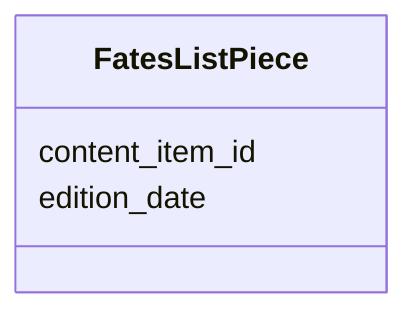

---
search:
  boost: 10.0
---

# Class: FatesListPiece 


_A published piece of an edition of the paper._


<div data-search-exclude markdown="1">


URI: [pc:FatesListPiece](https://pruzhany.org/ns/sourced-entities#FatesListPiece)





<!-- no inheritance hierarchy -->

## Slots

| Name | Cardinality and Range | Description | Inheritance |
| ---  | --- | --- | --- |
| [edition_date](edition_date.md) | 1 <br/> [IsoDay](IsoDay.md) | The edition's day, written YYYY-MM-DD. | direct |
| [content_item_id](content_item_id.md) | 1 <br/> [String](String.md) | The piece's id, such as cu-1938-12-16-i0105, with another paper's lowercase code after cu- for any paper but the first, such as cu-abcd-1938-12-16-i0105. | direct |


## Usages

| used by | used in | type | used |
| ---  | --- | --- | --- |
| [FatesListPerson](FatesListPerson.md) | [first_mention](first_mention.md) | range | [FatesListPiece](FatesListPiece.md) |
| [FatesListAge](FatesListAge.md) | [announced](announced.md) | range | [FatesListPiece](FatesListPiece.md) |


## Identifier and Mapping Information


### Schema Source


* from schema: https://pruzhany.org/ns/fates_list


## Mappings

| Mapping Type | Mapped Value |
| ---  | ---  |
| self | pc:FatesListPiece |
| native | pc:FatesListPiece |


## LinkML Source

<!-- TODO: investigate https://stackoverflow.com/questions/37606292/how-to-create-tabbed-code-blocks-in-mkdocs-or-sphinx -->

### Direct

<details>
```yaml
name: FatesListPiece
description: A published piece of an edition of the paper.
from_schema: https://pruzhany.org/ns/fates_list
rank: 1000
attributes:
  edition_date:
    name: edition_date
    description: The edition's day, written YYYY-MM-DD.
    from_schema: https://pruzhany.org/ns/fates_list
    rank: 1000
    domain_of:
    - FatesListPiece
    - Citation
    range: IsoDay
    required: true
  content_item_id:
    name: content_item_id
    description: The piece's id, such as cu-1938-12-16-i0105, with another paper's
      lowercase code after cu- for any paper but the first, such as cu-abcd-1938-12-16-i0105.
    from_schema: https://pruzhany.org/ns/fates_list
    rank: 1000
    domain_of:
    - FatesListPiece
    required: true
    pattern: ^cu-(?:[a-z]+-)?\d{4}-\d{2}-\d{2}-i\d{4}$(?![\s\S])

```
</details>

### Induced

<details>
```yaml
name: FatesListPiece
description: A published piece of an edition of the paper.
from_schema: https://pruzhany.org/ns/fates_list
rank: 1000
attributes:
  edition_date:
    name: edition_date
    description: The edition's day, written YYYY-MM-DD.
    from_schema: https://pruzhany.org/ns/fates_list
    rank: 1000
    owner: FatesListPiece
    domain_of:
    - FatesListPiece
    - Citation
    range: IsoDay
    required: true
  content_item_id:
    name: content_item_id
    description: The piece's id, such as cu-1938-12-16-i0105, with another paper's
      lowercase code after cu- for any paper but the first, such as cu-abcd-1938-12-16-i0105.
    from_schema: https://pruzhany.org/ns/fates_list
    rank: 1000
    owner: FatesListPiece
    domain_of:
    - FatesListPiece
    range: string
    required: true
    pattern: ^cu-(?:[a-z]+-)?\d{4}-\d{2}-\d{2}-i\d{4}$(?![\s\S])

```
</details></div>
