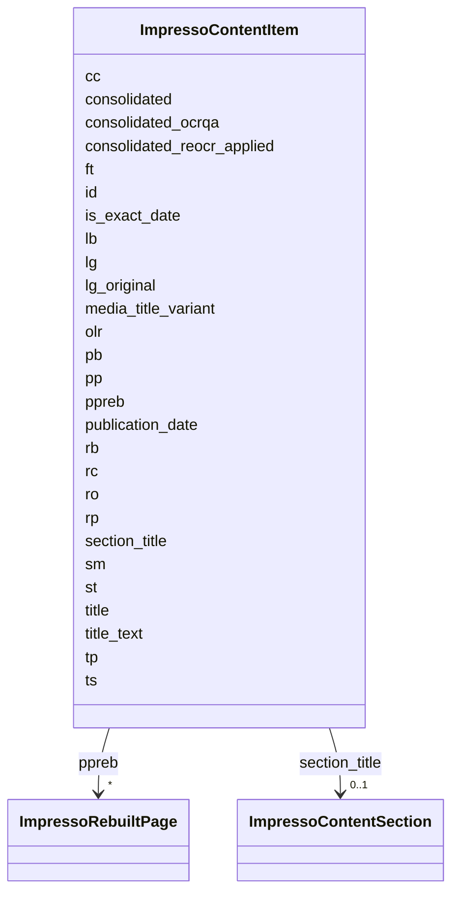

---
search:
  boost: 10.0
---

# Class: ImpressoContentItem 


_This schema defines the JSON representation of a paper-based content item — either printed or typewritten. A content item corresponds to any logical segmentation unit of a digitised media production, at or below the page level for printed documents. In newspapers, for example, an article is a typical type of content item._


<div data-search-exclude markdown="1">


URI: [pc:ImpressoContentItem](https://pruzhany.org/ns/sourced-entities#ImpressoContentItem)





<!-- no inheritance hierarchy -->

## Class Properties

| Property | Value |
| --- | --- |
| Tree Root | Yes |


## Slots

| Name | Cardinality and Range | Description | Inheritance |
| ---  | --- | --- | --- |
| [id](id.md) | 1 <br/> [String](String.md) | The unique identifier for a content item (CI), (e.g. GDL-1900-01-02-a-i0001, or SOC_CJ-1940-07-22-a-i0001) | direct |
| [ts](ts.md) | 1 <br/> [String](String.md) | timestamp of creation of the JSON file (in '%Y-%m-%dT%H:%M:%SZ' format e.g. '2018-09-18T08:00:08Z') | direct |
| [publication_date](publication_date.md) | 0..1 <br/> [String](String.md) | Date of publication of issue or broadcast to which the content item belongs to in yyyy-mm-dd format. | direct |
| [cc](cc.md) | 0..1 <br/> [Boolean](Boolean.md) | True if image box coordinates are known to be correct (eg. have been checked, converted or rescaled), False otherwise | direct |
| [olr](olr.md) | 1 <br/> [Boolean](Boolean.md) | True if optical layout recognition was applied to the issue/bulletin this content item originates from. | direct |
| [st](st.md) | 0..1 <br/> [String](String.md) | The type of media source to which this content item belongs. Must be a value from the impresso-essentials.utils SourceType enum. | direct |
| [sm](sm.md) | 0..1 <br/> [String](String.md) | The medium in which the source media this content item belongs to was originally produced. For printed documents, this relates to the physical paper support. | direct |
| [tp](tp.md) | 1 <br/> [String](String.md) | content item type (e.g. 'ar' for article, 'ad' for advertisement) | direct |
| [lg](lg.md) | 0..1 <br/> [String](String.md) | Language of the content item's text, expressed as a two-letter ISO 639-1 language code. | direct |
| [rc](rc.md) | 0..1 <br/> [String](String.md) | Radio channel, if applicable (st=='radio_broadcast') and is known. | direct |
| [rp](rp.md) | 0..1 <br/> [String](String.md) | Radio program, if applicable (st=='radio_broadcast') and is known. | direct |
| [media_title_variant](media_title_variant.md) | 0..1 <br/> [String](String.md) | Variant title of the media title this CI is from (mainly in the case of BL newspapers). The field is present only when a meaningful variant title is available. | direct |
| [title_text](title_text.md) | 0..1 <br/> [String](String.md) | Content-item title (deprecated). | direct |
| [title](title.md) | 0..1 <br/> [String](String.md) | Content-item title. | direct |
| [ro](ro.md) | 0..1 <br/> [Integer](Integer.md) | Reading order index of the content item, for the table of contents view on the interface. If not defined, the CI number (after 'i' in the ID) should be used. | direct |
| [consolidated](consolidated.md) | 0..1 <br/> [Boolean](Boolean.md) | True if the issue this CI comes from was consolidated, meaning it contains additional language identification and ocrqa information. | direct |
| [consolidated_reocr_applied](consolidated_reocr_applied.md) | 0..1 <br/> [Boolean](Boolean.md) | True if the CI's text went through the re-OCRisation process. | direct |
| [consolidated_ocrqa](consolidated_ocrqa.md) | 0..1 <br/> [Double](Double.md) | Estimated OCR quality, between 0 and 1. May be null if there is no text or not enough text to compute an estimate. | direct |
| [lg_original](lg_original.md) | 0..1 <br/> [String](String.md) | Language of the content item in the original OCR/OLR. Only defined if the content-item was consolidated. | direct |
| [is_exact_date](is_exact_date.md) | 0..1 <br/> [Boolean](Boolean.md) | False if the date assigned to the issue is known to be inexact or approximated, True or undefined otherwise. | direct |
| [section_title](section_title.md) | 0..1 <br/> [ImpressoContentSection](ImpressoContentSection.md) | A section title grouping this content item with others. | direct |
| [pp](pp.md) | 1..* <br/> [Double](Double.md) | Array of physical page numbers spanned by the content item, based on the issue pagination as extracted from the OCR. | direct |
| [ft](ft.md) | 0..1 <br/> [String](String.md) | The rebuilt full text. | direct |
| [rb](rb.md) | * <br/> [Integer](Integer.md) | text offsets of page regions (relative to 'ft' field) | direct |
| [pb](pb.md) | * <br/> [Integer](Integer.md) | text offsets of physical paragraph breaks (relative to 'ft' field) | direct |
| [lb](lb.md) | * <br/> [Integer](Integer.md) | text offsets of physical line breaks (relative to 'ft' field) | direct |
| [ppreb](ppreb.md) | * <br/> [ImpressoRebuiltPage](ImpressoRebuiltPage.md) | List of rebuilt pages | direct |


## Rules


### 

| Rule Applied | Preconditions | Postconditions | Elseconditions |
|--------------|---------------|----------------|----------------|
| slot_conditions |```{'sm': {'required': True}}``` |```{'st': {'required': True}}``` | |


### 

| Rule Applied | Preconditions | Postconditions | Elseconditions |
|--------------|---------------|----------------|----------------|
| slot_conditions |```{'st': {'required': True}}``` |```{'sm': {'required': True}}``` | |


### 

| Rule Applied | Preconditions | Postconditions | Elseconditions |
|--------------|---------------|----------------|----------------|
| slot_conditions |```{'consolidated': {'required': True}}``` |```{'consolidated_ocrqa': {'required': True}, 'lg_original': {'required': True}}``` | |


### 

| Rule Applied | Preconditions | Postconditions | Elseconditions |
|--------------|---------------|----------------|----------------|
| slot_conditions |```{'st': {'required': False, 'equals_string': 'radio_broadcast'}}``` |```{'ro': {'required': False, 'equals_number': 1}}``` | |


## Identifier and Mapping Information


### Annotations

| property | value |
| --- | --- |
| impresso | content |


### Schema Source


* from schema: https://pruzhany.org/ns/impresso_contentitem


## Mappings

| Mapping Type | Mapped Value |
| ---  | ---  |
| self | pc:ImpressoContentItem |
| native | pc:ImpressoContentItem |


## LinkML Source

<!-- TODO: investigate https://stackoverflow.com/questions/37606292/how-to-create-tabbed-code-blocks-in-mkdocs-or-sphinx -->

### Direct

<details>
```yaml
name: ImpressoContentItem
annotations:
  impresso:
    tag: impresso
    value: content
description: This schema defines the JSON representation of a paper-based content
  item — either printed or typewritten. A content item corresponds to any logical
  segmentation unit of a digitised media production, at or below the page level for
  printed documents. In newspapers, for example, an article is a typical type of content
  item.
from_schema: https://pruzhany.org/ns/impresso_contentitem
rank: 1000
attributes:
  id:
    name: id
    annotations:
      impresso:
        tag: impresso
        value: content.id
    description: The unique identifier for a content item (CI), (e.g. GDL-1900-01-02-a-i0001,
      or SOC_CJ-1940-07-22-a-i0001)
    from_schema: https://pruzhany.org/ns/impresso_contentitem
    rank: 1000
    domain_of:
    - ImpressoContentItem
    - ImpressoRebuiltPage
    required: true
    pattern: ^[A-Za-z][A-Za-z0-9_]*-\d{4}-\d{2}-\d{2}-[a-z]{1,2}-i[0-9]{4}$
  ts:
    name: ts
    annotations:
      impresso:
        tag: impresso
        value: content.ts
    description: timestamp of creation of the JSON file (in '%Y-%m-%dT%H:%M:%SZ' format
      e.g. '2018-09-18T08:00:08Z')
    from_schema: https://pruzhany.org/ns/impresso_contentitem
    rank: 1000
    domain_of:
    - ImpressoContentItem
    required: true
    pattern: ^[0-9]{4}-[0-9]{2}-[0-9]{2}T[0-9]{2}:[0-9]{2}:[0-9]{2}Z$
  publication_date:
    name: publication_date
    annotations:
      impresso:
        tag: impresso
        value: content.d
    description: Date of publication of issue or broadcast to which the content item
      belongs to in yyyy-mm-dd format.
    from_schema: https://pruzhany.org/ns/impresso_contentitem
    rank: 1000
    alias: d
    domain_of:
    - ImpressoContentItem
    pattern: ^[0-9]{4}-[0-9]{2}-[0-9]{2}$
  cc:
    name: cc
    annotations:
      impresso:
        tag: impresso
        value: content.cc
    description: True if image box coordinates are known to be correct (eg. have been
      checked, converted or rescaled), False otherwise
    from_schema: https://pruzhany.org/ns/impresso_contentitem
    rank: 1000
    domain_of:
    - ImpressoContentItem
    range: boolean
  olr:
    name: olr
    annotations:
      impresso:
        tag: impresso
        value: content.olr
    description: True if optical layout recognition was applied to the issue/bulletin
      this content item originates from.
    from_schema: https://pruzhany.org/ns/impresso_contentitem
    rank: 1000
    domain_of:
    - ImpressoContentItem
    range: boolean
    required: true
  st:
    name: st
    annotations:
      impresso:
        tag: impresso
        value: content.st
    description: The type of media source to which this content item belongs. Must
      be a value from the impresso-essentials.utils SourceType enum.
    from_schema: https://pruzhany.org/ns/impresso_contentitem
    rank: 1000
    domain_of:
    - ImpressoContentItem
    equals_string_in:
    - newspaper
    - radio_broadcast
    - radio_magazine
    - radio_schedule
    - monograph
    - encyclopedia
  sm:
    name: sm
    annotations:
      impresso:
        tag: impresso
        value: content.sm
    description: The medium in which the source media this content item belongs to
      was originally produced. For printed documents, this relates to the physical
      paper support.
    from_schema: https://pruzhany.org/ns/impresso_contentitem
    rank: 1000
    domain_of:
    - ImpressoContentItem
    equals_string_in:
    - print
    - typescript
  tp:
    name: tp
    annotations:
      impresso:
        tag: impresso
        value: content.tp
      nullable:
        tag: nullable
        value: true
    description: content item type (e.g. 'ar' for article, 'ad' for advertisement)
    from_schema: https://pruzhany.org/ns/impresso_contentitem
    rank: 1000
    domain_of:
    - ImpressoContentItem
    required: true
  lg:
    name: lg
    annotations:
      impresso:
        tag: impresso
        value: content.lg
    description: Language of the content item's text, expressed as a two-letter ISO
      639-1 language code.
    from_schema: https://pruzhany.org/ns/impresso_contentitem
    rank: 1000
    domain_of:
    - ImpressoContentItem
    pattern: ^[a-z]{2,3}$
  rc:
    name: rc
    annotations:
      impresso:
        tag: impresso
        value: content.rc
      nullable:
        tag: nullable
        value: true
    description: Radio channel, if applicable (st=='radio_broadcast') and is known.
    from_schema: https://pruzhany.org/ns/impresso_contentitem
    rank: 1000
    domain_of:
    - ImpressoContentItem
  rp:
    name: rp
    annotations:
      impresso:
        tag: impresso
        value: content.rp
      nullable:
        tag: nullable
        value: true
    description: Radio program, if applicable (st=='radio_broadcast') and is known.
    from_schema: https://pruzhany.org/ns/impresso_contentitem
    rank: 1000
    domain_of:
    - ImpressoContentItem
  media_title_variant:
    name: media_title_variant
    annotations:
      impresso:
        tag: impresso
        value: content.media_title_variant
      json_min_length:
        tag: json_min_length
        value: 1
    description: Variant title of the media title this CI is from (mainly in the case
      of BL newspapers). The field is present only when a meaningful variant title
      is available.
    from_schema: https://pruzhany.org/ns/impresso_contentitem
    rank: 1000
    domain_of:
    - ImpressoContentItem
  title_text:
    name: title_text
    annotations:
      impresso:
        tag: impresso
        value: content.t
      nullable:
        tag: nullable
        value: true
    description: Content-item title (deprecated).
    from_schema: https://pruzhany.org/ns/impresso_contentitem
    rank: 1000
    alias: t
    domain_of:
    - ImpressoContentItem
    - ImpressoContentSection
  title:
    name: title
    annotations:
      impresso:
        tag: impresso
        value: content.title
      nullable:
        tag: nullable
        value: true
    description: Content-item title.
    from_schema: https://pruzhany.org/ns/impresso_contentitem
    rank: 1000
    domain_of:
    - ImpressoContentItem
  ro:
    name: ro
    annotations:
      impresso:
        tag: impresso
        value: content.ro
    description: Reading order index of the content item, for the table of contents
      view on the interface. If not defined, the CI number (after 'i' in the ID) should
      be used.
    from_schema: https://pruzhany.org/ns/impresso_contentitem
    rank: 1000
    domain_of:
    - ImpressoContentItem
    range: integer
  consolidated:
    name: consolidated
    annotations:
      impresso:
        tag: impresso
        value: content.consolidated
    description: True if the issue this CI comes from was consolidated, meaning it
      contains additional language identification and ocrqa information.
    from_schema: https://pruzhany.org/ns/impresso_contentitem
    rank: 1000
    domain_of:
    - ImpressoContentItem
    range: boolean
  consolidated_reocr_applied:
    name: consolidated_reocr_applied
    annotations:
      impresso:
        tag: impresso
        value: content.consolidated_reocr_applied
    description: True if the CI's text went through the re-OCRisation process.
    from_schema: https://pruzhany.org/ns/impresso_contentitem
    rank: 1000
    domain_of:
    - ImpressoContentItem
    range: boolean
  consolidated_ocrqa:
    name: consolidated_ocrqa
    annotations:
      impresso:
        tag: impresso
        value: content.consolidated_ocrqa
      nullable:
        tag: nullable
        value: true
    description: Estimated OCR quality, between 0 and 1. May be null if there is no
      text or not enough text to compute an estimate.
    from_schema: https://pruzhany.org/ns/impresso_contentitem
    rank: 1000
    domain_of:
    - ImpressoContentItem
    range: double
    minimum_value: 0
    maximum_value: 1
  lg_original:
    name: lg_original
    annotations:
      impresso:
        tag: impresso
        value: content.lg_original
      nullable:
        tag: nullable
        value: true
    description: Language of the content item in the original OCR/OLR. Only defined
      if the content-item was consolidated.
    from_schema: https://pruzhany.org/ns/impresso_contentitem
    rank: 1000
    domain_of:
    - ImpressoContentItem
  is_exact_date:
    name: is_exact_date
    annotations:
      impresso:
        tag: impresso
        value: content.is_exact_date
    description: False if the date assigned to the issue is known to be inexact or
      approximated, True or undefined otherwise.
    from_schema: https://pruzhany.org/ns/impresso_contentitem
    rank: 1000
    domain_of:
    - ImpressoContentItem
    range: boolean
  section_title:
    name: section_title
    annotations:
      impresso:
        tag: impresso
        value: content.section_title
    description: A section title grouping this content item with others.
    from_schema: https://pruzhany.org/ns/impresso_contentitem
    rank: 1000
    domain_of:
    - ImpressoContentItem
    range: ImpressoContentSection
    inlined: true
  pp:
    name: pp
    annotations:
      impresso:
        tag: impresso
        value: content.pp
    description: Array of physical page numbers spanned by the content item, based
      on the issue pagination as extracted from the OCR.
    from_schema: https://pruzhany.org/ns/impresso_contentitem
    rank: 1000
    domain_of:
    - ImpressoContentItem
    range: double
    multivalued: true
    minimum_cardinality: 1
  ft:
    name: ft
    annotations:
      impresso:
        tag: impresso
        value: content.ft
    description: The rebuilt full text.
    from_schema: https://pruzhany.org/ns/impresso_contentitem
    rank: 1000
    domain_of:
    - ImpressoContentItem
  rb:
    name: rb
    annotations:
      impresso:
        tag: impresso
        value: content.rb
    description: text offsets of page regions (relative to 'ft' field)
    from_schema: https://pruzhany.org/ns/impresso_contentitem
    rank: 1000
    domain_of:
    - ImpressoContentItem
    range: integer
    multivalued: true
  pb:
    name: pb
    annotations:
      impresso:
        tag: impresso
        value: content.pb
    description: text offsets of physical paragraph breaks (relative to 'ft' field)
    from_schema: https://pruzhany.org/ns/impresso_contentitem
    rank: 1000
    domain_of:
    - ImpressoContentItem
    range: integer
    multivalued: true
  lb:
    name: lb
    annotations:
      impresso:
        tag: impresso
        value: content.lb
    description: text offsets of physical line breaks (relative to 'ft' field)
    from_schema: https://pruzhany.org/ns/impresso_contentitem
    rank: 1000
    domain_of:
    - ImpressoContentItem
    range: integer
    multivalued: true
  ppreb:
    name: ppreb
    annotations:
      impresso:
        tag: impresso
        value: content.ppreb
    description: List of rebuilt pages
    from_schema: https://pruzhany.org/ns/impresso_contentitem
    rank: 1000
    domain_of:
    - ImpressoContentItem
    range: ImpressoRebuiltPage
    multivalued: true
    inlined_as_list: true
tree_root: true
rules:
- preconditions:
    slot_conditions:
      sm:
        name: sm
        required: true
  postconditions:
    slot_conditions:
      st:
        name: st
        required: true
- preconditions:
    slot_conditions:
      st:
        name: st
        required: true
  postconditions:
    slot_conditions:
      sm:
        name: sm
        required: true
- preconditions:
    slot_conditions:
      consolidated:
        name: consolidated
        required: true
  postconditions:
    slot_conditions:
      consolidated_ocrqa:
        name: consolidated_ocrqa
        required: true
      lg_original:
        name: lg_original
        required: true
- preconditions:
    slot_conditions:
      st:
        name: st
        required: false
        equals_string: radio_broadcast
  postconditions:
    slot_conditions:
      ro:
        name: ro
        required: false
        equals_number: 1
extra_slots:
  allowed: true

```
</details>

### Induced

<details>
```yaml
name: ImpressoContentItem
annotations:
  impresso:
    tag: impresso
    value: content
description: This schema defines the JSON representation of a paper-based content
  item — either printed or typewritten. A content item corresponds to any logical
  segmentation unit of a digitised media production, at or below the page level for
  printed documents. In newspapers, for example, an article is a typical type of content
  item.
from_schema: https://pruzhany.org/ns/impresso_contentitem
rank: 1000
attributes:
  id:
    name: id
    annotations:
      impresso:
        tag: impresso
        value: content.id
    description: The unique identifier for a content item (CI), (e.g. GDL-1900-01-02-a-i0001,
      or SOC_CJ-1940-07-22-a-i0001)
    from_schema: https://pruzhany.org/ns/impresso_contentitem
    rank: 1000
    owner: ImpressoContentItem
    domain_of:
    - ImpressoContentItem
    - ImpressoRebuiltPage
    range: string
    required: true
    pattern: ^[A-Za-z][A-Za-z0-9_]*-\d{4}-\d{2}-\d{2}-[a-z]{1,2}-i[0-9]{4}$
  ts:
    name: ts
    annotations:
      impresso:
        tag: impresso
        value: content.ts
    description: timestamp of creation of the JSON file (in '%Y-%m-%dT%H:%M:%SZ' format
      e.g. '2018-09-18T08:00:08Z')
    from_schema: https://pruzhany.org/ns/impresso_contentitem
    rank: 1000
    owner: ImpressoContentItem
    domain_of:
    - ImpressoContentItem
    range: string
    required: true
    pattern: ^[0-9]{4}-[0-9]{2}-[0-9]{2}T[0-9]{2}:[0-9]{2}:[0-9]{2}Z$
  publication_date:
    name: publication_date
    annotations:
      impresso:
        tag: impresso
        value: content.d
    description: Date of publication of issue or broadcast to which the content item
      belongs to in yyyy-mm-dd format.
    from_schema: https://pruzhany.org/ns/impresso_contentitem
    rank: 1000
    alias: d
    owner: ImpressoContentItem
    domain_of:
    - ImpressoContentItem
    range: string
    pattern: ^[0-9]{4}-[0-9]{2}-[0-9]{2}$
  cc:
    name: cc
    annotations:
      impresso:
        tag: impresso
        value: content.cc
    description: True if image box coordinates are known to be correct (eg. have been
      checked, converted or rescaled), False otherwise
    from_schema: https://pruzhany.org/ns/impresso_contentitem
    rank: 1000
    owner: ImpressoContentItem
    domain_of:
    - ImpressoContentItem
    range: boolean
  olr:
    name: olr
    annotations:
      impresso:
        tag: impresso
        value: content.olr
    description: True if optical layout recognition was applied to the issue/bulletin
      this content item originates from.
    from_schema: https://pruzhany.org/ns/impresso_contentitem
    rank: 1000
    owner: ImpressoContentItem
    domain_of:
    - ImpressoContentItem
    range: boolean
    required: true
  st:
    name: st
    annotations:
      impresso:
        tag: impresso
        value: content.st
    description: The type of media source to which this content item belongs. Must
      be a value from the impresso-essentials.utils SourceType enum.
    from_schema: https://pruzhany.org/ns/impresso_contentitem
    rank: 1000
    owner: ImpressoContentItem
    domain_of:
    - ImpressoContentItem
    range: string
    equals_string_in:
    - newspaper
    - radio_broadcast
    - radio_magazine
    - radio_schedule
    - monograph
    - encyclopedia
  sm:
    name: sm
    annotations:
      impresso:
        tag: impresso
        value: content.sm
    description: The medium in which the source media this content item belongs to
      was originally produced. For printed documents, this relates to the physical
      paper support.
    from_schema: https://pruzhany.org/ns/impresso_contentitem
    rank: 1000
    owner: ImpressoContentItem
    domain_of:
    - ImpressoContentItem
    range: string
    equals_string_in:
    - print
    - typescript
  tp:
    name: tp
    annotations:
      impresso:
        tag: impresso
        value: content.tp
      nullable:
        tag: nullable
        value: true
    description: content item type (e.g. 'ar' for article, 'ad' for advertisement)
    from_schema: https://pruzhany.org/ns/impresso_contentitem
    rank: 1000
    owner: ImpressoContentItem
    domain_of:
    - ImpressoContentItem
    range: string
    required: true
  lg:
    name: lg
    annotations:
      impresso:
        tag: impresso
        value: content.lg
    description: Language of the content item's text, expressed as a two-letter ISO
      639-1 language code.
    from_schema: https://pruzhany.org/ns/impresso_contentitem
    rank: 1000
    owner: ImpressoContentItem
    domain_of:
    - ImpressoContentItem
    range: string
    pattern: ^[a-z]{2,3}$
  rc:
    name: rc
    annotations:
      impresso:
        tag: impresso
        value: content.rc
      nullable:
        tag: nullable
        value: true
    description: Radio channel, if applicable (st=='radio_broadcast') and is known.
    from_schema: https://pruzhany.org/ns/impresso_contentitem
    rank: 1000
    owner: ImpressoContentItem
    domain_of:
    - ImpressoContentItem
    range: string
  rp:
    name: rp
    annotations:
      impresso:
        tag: impresso
        value: content.rp
      nullable:
        tag: nullable
        value: true
    description: Radio program, if applicable (st=='radio_broadcast') and is known.
    from_schema: https://pruzhany.org/ns/impresso_contentitem
    rank: 1000
    owner: ImpressoContentItem
    domain_of:
    - ImpressoContentItem
    range: string
  media_title_variant:
    name: media_title_variant
    annotations:
      impresso:
        tag: impresso
        value: content.media_title_variant
      json_min_length:
        tag: json_min_length
        value: 1
    description: Variant title of the media title this CI is from (mainly in the case
      of BL newspapers). The field is present only when a meaningful variant title
      is available.
    from_schema: https://pruzhany.org/ns/impresso_contentitem
    rank: 1000
    owner: ImpressoContentItem
    domain_of:
    - ImpressoContentItem
    range: string
  title_text:
    name: title_text
    annotations:
      impresso:
        tag: impresso
        value: content.t
      nullable:
        tag: nullable
        value: true
    description: Content-item title (deprecated).
    from_schema: https://pruzhany.org/ns/impresso_contentitem
    rank: 1000
    alias: t
    owner: ImpressoContentItem
    domain_of:
    - ImpressoContentItem
    - ImpressoContentSection
    range: string
  title:
    name: title
    annotations:
      impresso:
        tag: impresso
        value: content.title
      nullable:
        tag: nullable
        value: true
    description: Content-item title.
    from_schema: https://pruzhany.org/ns/impresso_contentitem
    rank: 1000
    owner: ImpressoContentItem
    domain_of:
    - ImpressoContentItem
    range: string
  ro:
    name: ro
    annotations:
      impresso:
        tag: impresso
        value: content.ro
    description: Reading order index of the content item, for the table of contents
      view on the interface. If not defined, the CI number (after 'i' in the ID) should
      be used.
    from_schema: https://pruzhany.org/ns/impresso_contentitem
    rank: 1000
    owner: ImpressoContentItem
    domain_of:
    - ImpressoContentItem
    range: integer
  consolidated:
    name: consolidated
    annotations:
      impresso:
        tag: impresso
        value: content.consolidated
    description: True if the issue this CI comes from was consolidated, meaning it
      contains additional language identification and ocrqa information.
    from_schema: https://pruzhany.org/ns/impresso_contentitem
    rank: 1000
    owner: ImpressoContentItem
    domain_of:
    - ImpressoContentItem
    range: boolean
  consolidated_reocr_applied:
    name: consolidated_reocr_applied
    annotations:
      impresso:
        tag: impresso
        value: content.consolidated_reocr_applied
    description: True if the CI's text went through the re-OCRisation process.
    from_schema: https://pruzhany.org/ns/impresso_contentitem
    rank: 1000
    owner: ImpressoContentItem
    domain_of:
    - ImpressoContentItem
    range: boolean
  consolidated_ocrqa:
    name: consolidated_ocrqa
    annotations:
      impresso:
        tag: impresso
        value: content.consolidated_ocrqa
      nullable:
        tag: nullable
        value: true
    description: Estimated OCR quality, between 0 and 1. May be null if there is no
      text or not enough text to compute an estimate.
    from_schema: https://pruzhany.org/ns/impresso_contentitem
    rank: 1000
    owner: ImpressoContentItem
    domain_of:
    - ImpressoContentItem
    range: double
    minimum_value: 0
    maximum_value: 1
  lg_original:
    name: lg_original
    annotations:
      impresso:
        tag: impresso
        value: content.lg_original
      nullable:
        tag: nullable
        value: true
    description: Language of the content item in the original OCR/OLR. Only defined
      if the content-item was consolidated.
    from_schema: https://pruzhany.org/ns/impresso_contentitem
    rank: 1000
    owner: ImpressoContentItem
    domain_of:
    - ImpressoContentItem
    range: string
  is_exact_date:
    name: is_exact_date
    annotations:
      impresso:
        tag: impresso
        value: content.is_exact_date
    description: False if the date assigned to the issue is known to be inexact or
      approximated, True or undefined otherwise.
    from_schema: https://pruzhany.org/ns/impresso_contentitem
    rank: 1000
    owner: ImpressoContentItem
    domain_of:
    - ImpressoContentItem
    range: boolean
  section_title:
    name: section_title
    annotations:
      impresso:
        tag: impresso
        value: content.section_title
    description: A section title grouping this content item with others.
    from_schema: https://pruzhany.org/ns/impresso_contentitem
    rank: 1000
    owner: ImpressoContentItem
    domain_of:
    - ImpressoContentItem
    range: ImpressoContentSection
    inlined: true
  pp:
    name: pp
    annotations:
      impresso:
        tag: impresso
        value: content.pp
    description: Array of physical page numbers spanned by the content item, based
      on the issue pagination as extracted from the OCR.
    from_schema: https://pruzhany.org/ns/impresso_contentitem
    rank: 1000
    owner: ImpressoContentItem
    domain_of:
    - ImpressoContentItem
    range: double
    multivalued: true
    minimum_cardinality: 1
  ft:
    name: ft
    annotations:
      impresso:
        tag: impresso
        value: content.ft
    description: The rebuilt full text.
    from_schema: https://pruzhany.org/ns/impresso_contentitem
    rank: 1000
    owner: ImpressoContentItem
    domain_of:
    - ImpressoContentItem
    range: string
  rb:
    name: rb
    annotations:
      impresso:
        tag: impresso
        value: content.rb
    description: text offsets of page regions (relative to 'ft' field)
    from_schema: https://pruzhany.org/ns/impresso_contentitem
    rank: 1000
    owner: ImpressoContentItem
    domain_of:
    - ImpressoContentItem
    range: integer
    multivalued: true
  pb:
    name: pb
    annotations:
      impresso:
        tag: impresso
        value: content.pb
    description: text offsets of physical paragraph breaks (relative to 'ft' field)
    from_schema: https://pruzhany.org/ns/impresso_contentitem
    rank: 1000
    owner: ImpressoContentItem
    domain_of:
    - ImpressoContentItem
    range: integer
    multivalued: true
  lb:
    name: lb
    annotations:
      impresso:
        tag: impresso
        value: content.lb
    description: text offsets of physical line breaks (relative to 'ft' field)
    from_schema: https://pruzhany.org/ns/impresso_contentitem
    rank: 1000
    owner: ImpressoContentItem
    domain_of:
    - ImpressoContentItem
    range: integer
    multivalued: true
  ppreb:
    name: ppreb
    annotations:
      impresso:
        tag: impresso
        value: content.ppreb
    description: List of rebuilt pages
    from_schema: https://pruzhany.org/ns/impresso_contentitem
    rank: 1000
    owner: ImpressoContentItem
    domain_of:
    - ImpressoContentItem
    range: ImpressoRebuiltPage
    multivalued: true
    inlined: true
    inlined_as_list: true
tree_root: true
rules:
- preconditions:
    slot_conditions:
      sm:
        name: sm
        required: true
  postconditions:
    slot_conditions:
      st:
        name: st
        required: true
- preconditions:
    slot_conditions:
      st:
        name: st
        required: true
  postconditions:
    slot_conditions:
      sm:
        name: sm
        required: true
- preconditions:
    slot_conditions:
      consolidated:
        name: consolidated
        required: true
  postconditions:
    slot_conditions:
      consolidated_ocrqa:
        name: consolidated_ocrqa
        required: true
      lg_original:
        name: lg_original
        required: true
- preconditions:
    slot_conditions:
      st:
        name: st
        required: false
        equals_string: radio_broadcast
  postconditions:
    slot_conditions:
      ro:
        name: ro
        required: false
        equals_number: 1
extra_slots:
  allowed: true

```
</details></div>
