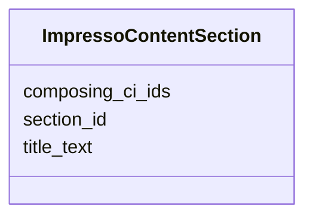

---
search:
  boost: 10.0
---

# Class: ImpressoContentSection 


_A section title grouping this content item with others._


<div data-search-exclude markdown="1">


URI: [pc:ImpressoContentSection](https://pruzhany.org/ns/sourced-entities#ImpressoContentSection)





<!-- no inheritance hierarchy -->

## Slots

| Name | Cardinality and Range | Description | Inheritance |
| ---  | --- | --- | --- |
| [title_text](title_text.md) | 1 <br/> [String](String.md) | A section title grouping this content item with others.title_text. | direct |
| [composing_ci_ids](composing_ci_ids.md) | 1..* <br/> [String](String.md) | A section title grouping this content item with others.composing_ci_ids. | direct |
| [section_id](section_id.md) | 1 <br/> [String](String.md) | A section title grouping this content item with others.section_id. | direct |


## Usages

| used by | used in | type | used |
| ---  | --- | --- | --- |
| [ImpressoContentItem](ImpressoContentItem.md) | [section_title](section_title.md) | range | [ImpressoContentSection](ImpressoContentSection.md) |


## Identifier and Mapping Information


### Annotations

| property | value |
| --- | --- |
| impresso | content.section_title |


### Schema Source


* from schema: https://pruzhany.org/ns/impresso_contentitem


## Mappings

| Mapping Type | Mapped Value |
| ---  | ---  |
| self | pc:ImpressoContentSection |
| native | pc:ImpressoContentSection |


## LinkML Source

<!-- TODO: investigate https://stackoverflow.com/questions/37606292/how-to-create-tabbed-code-blocks-in-mkdocs-or-sphinx -->

### Direct

<details>
```yaml
name: ImpressoContentSection
annotations:
  impresso:
    tag: impresso
    value: content.section_title
description: A section title grouping this content item with others.
from_schema: https://pruzhany.org/ns/impresso_contentitem
rank: 1000
attributes:
  title_text:
    name: title_text
    annotations:
      impresso:
        tag: impresso
        value: content.section_title.title_text
    description: A section title grouping this content item with others.title_text.
    from_schema: https://pruzhany.org/ns/impresso_contentitem
    domain_of:
    - ImpressoContentItem
    - ImpressoContentSection
    required: true
  composing_ci_ids:
    name: composing_ci_ids
    annotations:
      impresso:
        tag: impresso
        value: content.section_title.composing_ci_ids
    description: A section title grouping this content item with others.composing_ci_ids.
    from_schema: https://pruzhany.org/ns/impresso_contentitem
    rank: 1000
    domain_of:
    - ImpressoContentSection
    required: true
    multivalued: true
  section_id:
    name: section_id
    annotations:
      impresso:
        tag: impresso
        value: content.section_title.section_id
    description: A section title grouping this content item with others.section_id.
    from_schema: https://pruzhany.org/ns/impresso_contentitem
    rank: 1000
    domain_of:
    - ImpressoContentSection
    required: true
extra_slots:
  allowed: true

```
</details>

### Induced

<details>
```yaml
name: ImpressoContentSection
annotations:
  impresso:
    tag: impresso
    value: content.section_title
description: A section title grouping this content item with others.
from_schema: https://pruzhany.org/ns/impresso_contentitem
rank: 1000
attributes:
  title_text:
    name: title_text
    annotations:
      impresso:
        tag: impresso
        value: content.section_title.title_text
    description: A section title grouping this content item with others.title_text.
    from_schema: https://pruzhany.org/ns/impresso_contentitem
    owner: ImpressoContentSection
    domain_of:
    - ImpressoContentItem
    - ImpressoContentSection
    range: string
    required: true
  composing_ci_ids:
    name: composing_ci_ids
    annotations:
      impresso:
        tag: impresso
        value: content.section_title.composing_ci_ids
    description: A section title grouping this content item with others.composing_ci_ids.
    from_schema: https://pruzhany.org/ns/impresso_contentitem
    rank: 1000
    owner: ImpressoContentSection
    domain_of:
    - ImpressoContentSection
    range: string
    required: true
    multivalued: true
  section_id:
    name: section_id
    annotations:
      impresso:
        tag: impresso
        value: content.section_title.section_id
    description: A section title grouping this content item with others.section_id.
    from_schema: https://pruzhany.org/ns/impresso_contentitem
    rank: 1000
    owner: ImpressoContentSection
    domain_of:
    - ImpressoContentSection
    range: string
    required: true
extra_slots:
  allowed: true

```
</details></div>
