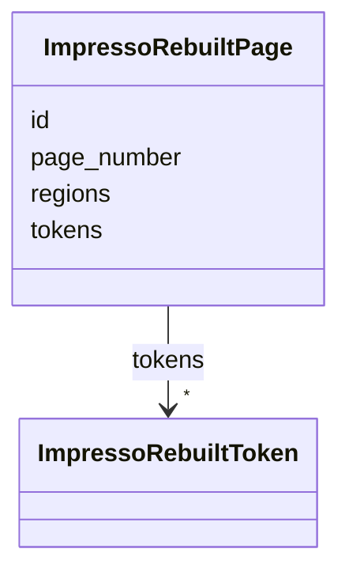

---
search:
  boost: 10.0
---

# Class: ImpressoRebuiltPage 


_The rebuilt tokens and region boxes for one physical page of this content item._


<div data-search-exclude markdown="1">


URI: [pc:ImpressoRebuiltPage](https://pruzhany.org/ns/sourced-entities#ImpressoRebuiltPage)





<!-- no inheritance hierarchy -->

## Slots

| Name | Cardinality and Range | Description | Inheritance |
| ---  | --- | --- | --- |
| [id](id.md) | 0..1 <br/> [String](String.md) | Page canonical ID | direct |
| [page_number](page_number.md) | 0..1 <br/> [Integer](Integer.md) | page number | direct |
| [tokens](tokens.md) | * <br/> [ImpressoRebuiltToken](ImpressoRebuiltToken.md) | List of tokens | direct |
| [regions](regions.md) | 0..1 <br/> [Integer](Integer.md) | List of region coordinates. | direct |


## Usages

| used by | used in | type | used |
| ---  | --- | --- | --- |
| [ImpressoContentItem](ImpressoContentItem.md) | [ppreb](ppreb.md) | range | [ImpressoRebuiltPage](ImpressoRebuiltPage.md) |


## Identifier and Mapping Information


### Annotations

| property | value |
| --- | --- |
| impresso | content.ppreb[] |


### Schema Source


* from schema: https://pruzhany.org/ns/impresso_contentitem


## Mappings

| Mapping Type | Mapped Value |
| ---  | ---  |
| self | pc:ImpressoRebuiltPage |
| native | pc:ImpressoRebuiltPage |


## LinkML Source

<!-- TODO: investigate https://stackoverflow.com/questions/37606292/how-to-create-tabbed-code-blocks-in-mkdocs-or-sphinx -->

### Direct

<details>
```yaml
name: ImpressoRebuiltPage
annotations:
  impresso:
    tag: impresso
    value: content.ppreb[]
description: The rebuilt tokens and region boxes for one physical page of this content
  item.
from_schema: https://pruzhany.org/ns/impresso_contentitem
rank: 1000
attributes:
  id:
    name: id
    annotations:
      impresso:
        tag: impresso
        value: content.ppreb[].id
    description: Page canonical ID
    from_schema: https://pruzhany.org/ns/impresso_contentitem
    domain_of:
    - ImpressoContentItem
    - ImpressoRebuiltPage
    pattern: ^[A-Za-z_]+-\d{4}-\d{2}-\d{2}-[a-z]{1,2}-p[0-9]{4}$
  page_number:
    name: page_number
    annotations:
      impresso:
        tag: impresso
        value: content.ppreb[].n
    description: page number
    from_schema: https://pruzhany.org/ns/impresso_contentitem
    rank: 1000
    alias: n
    domain_of:
    - ImpressoRebuiltPage
    range: integer
  tokens:
    name: tokens
    annotations:
      impresso:
        tag: impresso
        value: content.ppreb[].t
    description: List of tokens
    from_schema: https://pruzhany.org/ns/impresso_contentitem
    rank: 1000
    alias: t
    domain_of:
    - ImpressoRebuiltPage
    range: ImpressoRebuiltToken
    multivalued: true
    inlined_as_list: true
  regions:
    name: regions
    annotations:
      impresso:
        tag: impresso
        value: content.ppreb[].r
    description: List of region coordinates.
    from_schema: https://pruzhany.org/ns/impresso_contentitem
    rank: 1000
    alias: r
    domain_of:
    - ImpressoRebuiltPage
    range: integer
    array:
      dimensions:
      - minimum_cardinality: 0
      - maximum_cardinality: 4
        minimum_cardinality: 4
extra_slots:
  allowed: true

```
</details>

### Induced

<details>
```yaml
name: ImpressoRebuiltPage
annotations:
  impresso:
    tag: impresso
    value: content.ppreb[]
description: The rebuilt tokens and region boxes for one physical page of this content
  item.
from_schema: https://pruzhany.org/ns/impresso_contentitem
rank: 1000
attributes:
  id:
    name: id
    annotations:
      impresso:
        tag: impresso
        value: content.ppreb[].id
    description: Page canonical ID
    from_schema: https://pruzhany.org/ns/impresso_contentitem
    owner: ImpressoRebuiltPage
    domain_of:
    - ImpressoContentItem
    - ImpressoRebuiltPage
    range: string
    pattern: ^[A-Za-z_]+-\d{4}-\d{2}-\d{2}-[a-z]{1,2}-p[0-9]{4}$
  page_number:
    name: page_number
    annotations:
      impresso:
        tag: impresso
        value: content.ppreb[].n
    description: page number
    from_schema: https://pruzhany.org/ns/impresso_contentitem
    rank: 1000
    alias: n
    owner: ImpressoRebuiltPage
    domain_of:
    - ImpressoRebuiltPage
    range: integer
  tokens:
    name: tokens
    annotations:
      impresso:
        tag: impresso
        value: content.ppreb[].t
    description: List of tokens
    from_schema: https://pruzhany.org/ns/impresso_contentitem
    rank: 1000
    alias: t
    owner: ImpressoRebuiltPage
    domain_of:
    - ImpressoRebuiltPage
    range: ImpressoRebuiltToken
    multivalued: true
    inlined: true
    inlined_as_list: true
  regions:
    name: regions
    annotations:
      impresso:
        tag: impresso
        value: content.ppreb[].r
    description: List of region coordinates.
    from_schema: https://pruzhany.org/ns/impresso_contentitem
    rank: 1000
    alias: r
    owner: ImpressoRebuiltPage
    domain_of:
    - ImpressoRebuiltPage
    range: integer
    array:
      dimensions:
      - minimum_cardinality: 0
      - maximum_cardinality: 4
        minimum_cardinality: 4
extra_slots:
  allowed: true

```
</details></div>
