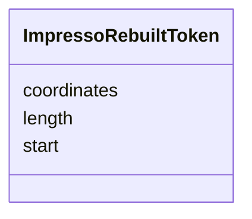

---
search:
  boost: 10.0
---

# Class: ImpressoRebuiltToken 


_The rebuilt tokens and region boxes for one physical page of this content item.t[]._


<div data-search-exclude markdown="1">


URI: [pc:ImpressoRebuiltToken](https://pruzhany.org/ns/sourced-entities#ImpressoRebuiltToken)





<!-- no inheritance hierarchy -->

## Slots

| Name | Cardinality and Range | Description | Inheritance |
| ---  | --- | --- | --- |
| [coordinates](coordinates.md) | 4..* <br/> [Integer](Integer.md) | Coordinates of token relative to page. | direct |
| [start](start.md) | 0..1 <br/> [Integer](Integer.md) | offset start (relative to ft field) | direct |
| [length](length.md) | 0..1 <br/> [Integer](Integer.md) | token length | direct |


## Usages

| used by | used in | type | used |
| ---  | --- | --- | --- |
| [ImpressoRebuiltPage](ImpressoRebuiltPage.md) | [tokens](tokens.md) | range | [ImpressoRebuiltToken](ImpressoRebuiltToken.md) |


## Identifier and Mapping Information


### Annotations

| property | value |
| --- | --- |
| impresso | content.ppreb[].t[] |


### Schema Source


* from schema: https://pruzhany.org/ns/impresso_contentitem


## Mappings

| Mapping Type | Mapped Value |
| ---  | ---  |
| self | pc:ImpressoRebuiltToken |
| native | pc:ImpressoRebuiltToken |


## LinkML Source

<!-- TODO: investigate https://stackoverflow.com/questions/37606292/how-to-create-tabbed-code-blocks-in-mkdocs-or-sphinx -->

### Direct

<details>
```yaml
name: ImpressoRebuiltToken
annotations:
  impresso:
    tag: impresso
    value: content.ppreb[].t[]
description: The rebuilt tokens and region boxes for one physical page of this content
  item.t[].
from_schema: https://pruzhany.org/ns/impresso_contentitem
rank: 1000
attributes:
  coordinates:
    name: coordinates
    annotations:
      impresso:
        tag: impresso
        value: content.ppreb[].t[].c
    description: Coordinates of token relative to page.
    from_schema: https://pruzhany.org/ns/impresso_contentitem
    rank: 1000
    alias: c
    domain_of:
    - ImpressoRebuiltToken
    range: integer
    multivalued: true
    minimum_cardinality: 4
    maximum_cardinality: 4
  start:
    name: start
    annotations:
      impresso:
        tag: impresso
        value: content.ppreb[].t[].s
    description: offset start (relative to ft field)
    from_schema: https://pruzhany.org/ns/impresso_contentitem
    rank: 1000
    alias: s
    domain_of:
    - ImpressoRebuiltToken
    range: integer
  length:
    name: length
    annotations:
      impresso:
        tag: impresso
        value: content.ppreb[].t[].l
    description: token length
    from_schema: https://pruzhany.org/ns/impresso_contentitem
    rank: 1000
    alias: l
    domain_of:
    - ImpressoRebuiltToken
    range: integer
extra_slots:
  allowed: true

```
</details>

### Induced

<details>
```yaml
name: ImpressoRebuiltToken
annotations:
  impresso:
    tag: impresso
    value: content.ppreb[].t[]
description: The rebuilt tokens and region boxes for one physical page of this content
  item.t[].
from_schema: https://pruzhany.org/ns/impresso_contentitem
rank: 1000
attributes:
  coordinates:
    name: coordinates
    annotations:
      impresso:
        tag: impresso
        value: content.ppreb[].t[].c
    description: Coordinates of token relative to page.
    from_schema: https://pruzhany.org/ns/impresso_contentitem
    rank: 1000
    alias: c
    owner: ImpressoRebuiltToken
    domain_of:
    - ImpressoRebuiltToken
    range: integer
    multivalued: true
    minimum_cardinality: 4
    maximum_cardinality: 4
  start:
    name: start
    annotations:
      impresso:
        tag: impresso
        value: content.ppreb[].t[].s
    description: offset start (relative to ft field)
    from_schema: https://pruzhany.org/ns/impresso_contentitem
    rank: 1000
    alias: s
    owner: ImpressoRebuiltToken
    domain_of:
    - ImpressoRebuiltToken
    range: integer
  length:
    name: length
    annotations:
      impresso:
        tag: impresso
        value: content.ppreb[].t[].l
    description: token length
    from_schema: https://pruzhany.org/ns/impresso_contentitem
    rank: 1000
    alias: l
    owner: ImpressoRebuiltToken
    domain_of:
    - ImpressoRebuiltToken
    range: integer
extra_slots:
  allowed: true

```
</details></div>
