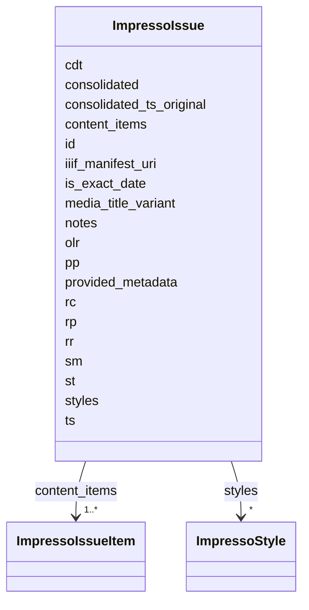

---
search:
  boost: 10.0
---

# Class: ImpressoIssue 


_Logical representation of the contents of a canonical issue (newspaper or broadcast)._


<div data-search-exclude markdown="1">


URI: [pc:ImpressoIssue](https://pruzhany.org/ns/sourced-entities#ImpressoIssue)





<!-- no inheritance hierarchy -->

## Class Properties

| Property | Value |
| --- | --- |
| Tree Root | Yes |


## Slots

| Name | Cardinality and Range | Description | Inheritance |
| ---  | --- | --- | --- |
| [id](id.md) | 1 <br/> [String](String.md) | Canonical ID of the newspaper or radio broadcast issue (e.g. GDL-1900-01-02-a, or SOC_CJ-1940-07-22-a) | direct |
| [cdt](cdt.md) | 0..1 <br/> [String](String.md) | Creation date timestamp (of the JSON file). | direct |
| [ts](ts.md) | 0..1 <br/> [String](String.md) | Creation date timestamp (in '%Y-%m-%dT%H:%M:%SZ' format). If consolidated==True, this is the consolidated timestamp (the original creation timestamp can be found in consolidated_timestamp_original); otherwise it is the original creation timestamp. | direct |
| [st](st.md) | 0..1 <br/> [String](String.md) | Type of media source. Should be a value the impresso-essentials.utils SourceType enum. | direct |
| [sm](sm.md) | 0..1 <br/> [String](String.md) | Source medium, format in which the media was originally produced. If `tp == radio_broadcast`, this is typically `typescript` or `audio`. | direct |
| [consolidated](consolidated.md) | 0..1 <br/> [Boolean](Boolean.md) | True if this issue is consolidated, and contains additional language identification and ocrqa information. | direct |
| [consolidated_ts_original](consolidated_ts_original.md) | 0..1 <br/> [String](String.md) | Creation date timestamp (in '%Y-%m-%dT%H:%M:%SZ' format) of the original issue which was consolidated into this object. Only defined if `consolidated==True`. | direct |
| [media_title_variant](media_title_variant.md) | 0..1 <br/> [String](String.md) | Variant title of the media title this CI is from (mainly in the case of BL newspapers). The field is present only when a meaningful variant title is available. | direct |
| [olr](olr.md) | 0..1 <br/> [Boolean](Boolean.md) | True if optical layout recognition was applied to the issue/bulletin this content item originates from. | direct |
| [content_items](content_items.md) | 1..* <br/> [ImpressoIssueItem](ImpressoIssueItem.md) | The content item(s) contained in the newspaper/radio_broadcast issue. Upstream places required m on the array, where JSON Schema does not apply it; the entry metadata is therefore optional. | direct |
| [styles](styles.md) | * <br/> [ImpressoStyle](ImpressoStyle.md) | The text style as defined in the OCR output. <br>Each style consists of:<br> - a name (`id`)<br> - a type-face (`f`)<br> - a font-size (`fs`)<br> - a color (`rgb`). | direct |
| [pp](pp.md) | * <br/> [String](String.md) | Canonical IDs of pages in the issue, without file extension (e.g. GDL-1900-01-02-a-p0004). In the case `sm` is in [`print`, `typescript`]. | direct |
| [rr](rr.md) | * <br/> [String](String.md) | Canonical ID of audio record of the issue (in list for consistency), without file extension (e.g. INA-1900-01-02-a-r0004). In the case `sm`==`audio`. | direct |
| [notes](notes.md) | 0..1 <br/> [String](String.md) | Notes. | direct |
| [iiif_manifest_uri](iiif_manifest_uri.md) | 0..1 <br/> [String](String.md) | URI for the issue's manifest in the IIIF Presentation API. The field is present only when a meaningful URI is available. | direct |
| [is_exact_date](is_exact_date.md) | 0..1 <br/> [Boolean](Boolean.md) | False if the date assigned to the issue is known to be inexact or approximated, True or undefined otherwise. | direct |
| [rc](rc.md) | 0..1 <br/> [String](String.md) | Radio channel, if applicable (st=='radio_broadcast'). The field is present only when a meaningful value is available. | direct |
| [rp](rp.md) | 0..1 <br/> [String](String.md) | Radio program if applicable (st=='radio_broadcast'). The field is present only when a meaningful program name is available. | direct |
| [provided_metadata](provided_metadata.md) | 0..1 <br/> [String](String.md) | Minimally preprocessed issue-level metadata included by the provider institution, especially useful for radio data (sm=audio). | direct |

<details>
<summary>Expressions & Logic</summary>
#### Any Of

The class must satisfy at least one of:
- AnonymousClassExpression({'slot_conditions': {'ts': SlotDefinition({'name': 'ts', 'required': True})}})
- AnonymousClassExpression({'slot_conditions': {'cdt': SlotDefinition({'name': 'cdt', 'required': True})}})

</details>


## Rules


### 

| Rule Applied | Preconditions | Postconditions | Elseconditions |
|--------------|---------------|----------------|----------------|
| slot_conditions |```{'sm': {'required': True}}``` |```{'st': {'required': True}}``` | |


### 

| Rule Applied | Preconditions | Postconditions | Elseconditions |
|--------------|---------------|----------------|----------------|
| slot_conditions |```{'st': {'required': True}}``` |```{'sm': {'required': True}}``` | |


### 

| Rule Applied | Preconditions | Postconditions | Elseconditions |
|--------------|---------------|----------------|----------------|
| slot_conditions |```{'sm': {'required': True, 'equals_string_in': ['typescript', 'print']}}``` |```{'pp': {'required': True}}``` | |


### 

| Rule Applied | Preconditions | Postconditions | Elseconditions |
|--------------|---------------|----------------|----------------|
| slot_conditions |```{'sm': {'required': True, 'equals_string': 'audio'}}``` |```{'rr': {'required': True}}``` | |


### 

| Rule Applied | Preconditions | Postconditions | Elseconditions |
|--------------|---------------|----------------|----------------|
| slot_conditions |```{'sm': {'required': True, 'equals_string': 'print'}}``` |```{'olr': {'required': True}}``` | |


## Identifier and Mapping Information


### Annotations

| property | value |
| --- | --- |
| impresso | issue |


### Schema Source


* from schema: https://pruzhany.org/ns/impresso_issue


## Mappings

| Mapping Type | Mapped Value |
| ---  | ---  |
| self | pc:ImpressoIssue |
| native | pc:ImpressoIssue |


## LinkML Source

<!-- TODO: investigate https://stackoverflow.com/questions/37606292/how-to-create-tabbed-code-blocks-in-mkdocs-or-sphinx -->

### Direct

<details>
```yaml
name: ImpressoIssue
annotations:
  impresso:
    tag: impresso
    value: issue
description: Logical representation of the contents of a canonical issue (newspaper
  or broadcast).
from_schema: https://pruzhany.org/ns/impresso_issue
rank: 1000
attributes:
  id:
    name: id
    annotations:
      impresso:
        tag: impresso
        value: issue.id
    description: Canonical ID of the newspaper or radio broadcast issue (e.g. GDL-1900-01-02-a,
      or SOC_CJ-1940-07-22-a)
    from_schema: https://pruzhany.org/ns/impresso_issue
    rank: 1000
    domain_of:
    - ImpressoIssue
    - ImpressoMetadata
    - ImpressoLegacy
    - ImpressoStyle
    required: true
    pattern: ^[A-Za-z][A-Za-z0-9_]*-\d{4}-\d{2}-\d{2}-[a-z]{1,2}$
  cdt:
    name: cdt
    annotations:
      impresso:
        tag: impresso
        value: issue.cdt
    description: Creation date timestamp (of the JSON file).
    from_schema: https://pruzhany.org/ns/impresso_issue
    rank: 1000
    domain_of:
    - ImpressoIssue
  ts:
    name: ts
    annotations:
      impresso:
        tag: impresso
        value: issue.ts
    description: Creation date timestamp (in '%Y-%m-%dT%H:%M:%SZ' format). If consolidated==True,
      this is the consolidated timestamp (the original creation timestamp can be found
      in consolidated_timestamp_original); otherwise it is the original creation timestamp.
    from_schema: https://pruzhany.org/ns/impresso_issue
    rank: 1000
    domain_of:
    - ImpressoIssue
    pattern: ^[0-9]{4}-[0-9]{2}-[0-9]{2}T[0-9]{2}:[0-9]{2}:[0-9]{2}Z$
  st:
    name: st
    annotations:
      impresso:
        tag: impresso
        value: issue.st
    description: Type of media source. Should be a value the impresso-essentials.utils
      SourceType enum.
    from_schema: https://pruzhany.org/ns/impresso_issue
    rank: 1000
    domain_of:
    - ImpressoIssue
    equals_string_in:
    - newspaper
    - radio_broadcast
    - radio_magazine
    - radio_schedule
    - monograph
    - encyclopedia
  sm:
    name: sm
    annotations:
      impresso:
        tag: impresso
        value: issue.sm
    description: Source medium, format in which the media was originally produced.
      If `tp == radio_broadcast`, this is typically `typescript` or `audio`.
    from_schema: https://pruzhany.org/ns/impresso_issue
    rank: 1000
    domain_of:
    - ImpressoIssue
    equals_string_in:
    - print
    - typescript
    - audio
  consolidated:
    name: consolidated
    annotations:
      impresso:
        tag: impresso
        value: issue.consolidated
    description: True if this issue is consolidated, and contains additional language
      identification and ocrqa information.
    from_schema: https://pruzhany.org/ns/impresso_issue
    rank: 1000
    domain_of:
    - ImpressoIssue
    range: boolean
  consolidated_ts_original:
    name: consolidated_ts_original
    annotations:
      impresso:
        tag: impresso
        value: issue.consolidated_ts_original
    description: Creation date timestamp (in '%Y-%m-%dT%H:%M:%SZ' format) of the original
      issue which was consolidated into this object. Only defined if `consolidated==True`.
    from_schema: https://pruzhany.org/ns/impresso_issue
    rank: 1000
    domain_of:
    - ImpressoIssue
    pattern: ^[0-9]{4}-[0-9]{2}-[0-9]{2}T[0-9]{2}:[0-9]{2}:[0-9]{2}Z$
  media_title_variant:
    name: media_title_variant
    annotations:
      impresso:
        tag: impresso
        value: issue.media_title_variant
      json_min_length:
        tag: json_min_length
        value: 1
    description: Variant title of the media title this CI is from (mainly in the case
      of BL newspapers). The field is present only when a meaningful variant title
      is available.
    from_schema: https://pruzhany.org/ns/impresso_issue
    rank: 1000
    domain_of:
    - ImpressoIssue
  olr:
    name: olr
    annotations:
      impresso:
        tag: impresso
        value: issue.olr
    description: True if optical layout recognition was applied to the issue/bulletin
      this content item originates from.
    from_schema: https://pruzhany.org/ns/impresso_issue
    rank: 1000
    domain_of:
    - ImpressoIssue
    range: boolean
  content_items:
    name: content_items
    annotations:
      impresso:
        tag: impresso
        value: issue.i
    description: The content item(s) contained in the newspaper/radio_broadcast issue.
      Upstream places required m on the array, where JSON Schema does not apply it;
      the entry metadata is therefore optional.
    from_schema: https://pruzhany.org/ns/impresso_issue
    rank: 1000
    alias: i
    domain_of:
    - ImpressoIssue
    range: ImpressoIssueItem
    required: true
    multivalued: true
    inlined_as_list: true
  styles:
    name: styles
    annotations:
      impresso:
        tag: impresso
        value: issue.s
    description: "The text style as defined in the OCR output. \nEach style consists\
      \ of:\n - a name (`id`)\n - a type-face (`f`)\n - a font-size (`fs`)\n - a color\
      \ (`rgb`)."
    from_schema: https://pruzhany.org/ns/impresso_issue
    rank: 1000
    alias: s
    domain_of:
    - ImpressoIssue
    range: ImpressoStyle
    multivalued: true
    inlined_as_list: true
  pp:
    name: pp
    annotations:
      impresso:
        tag: impresso
        value: issue.pp
    description: Canonical IDs of pages in the issue, without file extension (e.g.
      GDL-1900-01-02-a-p0004). In the case `sm` is in [`print`, `typescript`].
    from_schema: https://pruzhany.org/ns/impresso_issue
    rank: 1000
    domain_of:
    - ImpressoIssue
    - ImpressoMetadata
    multivalued: true
    pattern: ^[A-Za-z][A-Za-z0-9_]*-\d{4}-\d{2}-\d{2}-[a-z]{1,2}-p[0-9]{4}$
  rr:
    name: rr
    annotations:
      impresso:
        tag: impresso
        value: issue.rr
    description: Canonical ID of audio record of the issue (in list for consistency),
      without file extension (e.g. INA-1900-01-02-a-r0004). In the case `sm`==`audio`.
    from_schema: https://pruzhany.org/ns/impresso_issue
    rank: 1000
    domain_of:
    - ImpressoIssue
    - ImpressoMetadata
    multivalued: true
    pattern: ^[A-Za-z][A-Za-z0-9_]*-\d{4}-\d{2}-\d{2}-[a-z]{1,3}-r[0-9]{4}$
  notes:
    name: notes
    annotations:
      impresso:
        tag: impresso
        value: issue.n
      json_types:
        tag: json_types
        value: string,array
    description: Notes.
    from_schema: https://pruzhany.org/ns/impresso_issue
    rank: 1000
    alias: n
    domain_of:
    - ImpressoIssue
  iiif_manifest_uri:
    name: iiif_manifest_uri
    annotations:
      impresso:
        tag: impresso
        value: issue.iiif_manifest_uri
      json_min_length:
        tag: json_min_length
        value: 1
    description: URI for the issue's manifest in the IIIF Presentation API. The field
      is present only when a meaningful URI is available.
    from_schema: https://pruzhany.org/ns/impresso_issue
    rank: 1000
    domain_of:
    - ImpressoIssue
  is_exact_date:
    name: is_exact_date
    annotations:
      impresso:
        tag: impresso
        value: issue.is_exact_date
    description: False if the date assigned to the issue is known to be inexact or
      approximated, True or undefined otherwise.
    from_schema: https://pruzhany.org/ns/impresso_issue
    rank: 1000
    domain_of:
    - ImpressoIssue
    range: boolean
  rc:
    name: rc
    annotations:
      impresso:
        tag: impresso
        value: issue.rc
      json_min_length:
        tag: json_min_length
        value: 1
    description: Radio channel, if applicable (st=='radio_broadcast'). The field is
      present only when a meaningful value is available.
    from_schema: https://pruzhany.org/ns/impresso_issue
    rank: 1000
    domain_of:
    - ImpressoIssue
  rp:
    name: rp
    annotations:
      impresso:
        tag: impresso
        value: issue.rp
      json_min_length:
        tag: json_min_length
        value: 1
    description: Radio program if applicable (st=='radio_broadcast'). The field is
      present only when a meaningful program name is available.
    from_schema: https://pruzhany.org/ns/impresso_issue
    rank: 1000
    domain_of:
    - ImpressoIssue
  provided_metadata:
    name: provided_metadata
    annotations:
      impresso:
        tag: impresso
        value: issue.provided_metadata
      json_types:
        tag: json_types
        value: object,array
    description: Minimally preprocessed issue-level metadata included by the provider
      institution, especially useful for radio data (sm=audio).
    from_schema: https://pruzhany.org/ns/impresso_issue
    rank: 1000
    domain_of:
    - ImpressoIssue
tree_root: true
rules:
- preconditions:
    slot_conditions:
      sm:
        name: sm
        required: true
  postconditions:
    slot_conditions:
      st:
        name: st
        required: true
- preconditions:
    slot_conditions:
      st:
        name: st
        required: true
  postconditions:
    slot_conditions:
      sm:
        name: sm
        required: true
- preconditions:
    slot_conditions:
      sm:
        name: sm
        required: true
        equals_string_in:
        - typescript
        - print
  postconditions:
    slot_conditions:
      pp:
        name: pp
        required: true
- preconditions:
    slot_conditions:
      sm:
        name: sm
        required: true
        equals_string: audio
  postconditions:
    slot_conditions:
      rr:
        name: rr
        required: true
- preconditions:
    slot_conditions:
      sm:
        name: sm
        required: true
        equals_string: print
  postconditions:
    slot_conditions:
      olr:
        name: olr
        required: true
extra_slots:
  allowed: true
any_of:
- slot_conditions:
    ts:
      name: ts
      required: true
- slot_conditions:
    cdt:
      name: cdt
      required: true

```
</details>

### Induced

<details>
```yaml
name: ImpressoIssue
annotations:
  impresso:
    tag: impresso
    value: issue
description: Logical representation of the contents of a canonical issue (newspaper
  or broadcast).
from_schema: https://pruzhany.org/ns/impresso_issue
rank: 1000
attributes:
  id:
    name: id
    annotations:
      impresso:
        tag: impresso
        value: issue.id
    description: Canonical ID of the newspaper or radio broadcast issue (e.g. GDL-1900-01-02-a,
      or SOC_CJ-1940-07-22-a)
    from_schema: https://pruzhany.org/ns/impresso_issue
    rank: 1000
    owner: ImpressoIssue
    domain_of:
    - ImpressoIssue
    - ImpressoMetadata
    - ImpressoLegacy
    - ImpressoStyle
    range: string
    required: true
    pattern: ^[A-Za-z][A-Za-z0-9_]*-\d{4}-\d{2}-\d{2}-[a-z]{1,2}$
  cdt:
    name: cdt
    annotations:
      impresso:
        tag: impresso
        value: issue.cdt
    description: Creation date timestamp (of the JSON file).
    from_schema: https://pruzhany.org/ns/impresso_issue
    rank: 1000
    owner: ImpressoIssue
    domain_of:
    - ImpressoIssue
    range: string
  ts:
    name: ts
    annotations:
      impresso:
        tag: impresso
        value: issue.ts
    description: Creation date timestamp (in '%Y-%m-%dT%H:%M:%SZ' format). If consolidated==True,
      this is the consolidated timestamp (the original creation timestamp can be found
      in consolidated_timestamp_original); otherwise it is the original creation timestamp.
    from_schema: https://pruzhany.org/ns/impresso_issue
    rank: 1000
    owner: ImpressoIssue
    domain_of:
    - ImpressoIssue
    range: string
    pattern: ^[0-9]{4}-[0-9]{2}-[0-9]{2}T[0-9]{2}:[0-9]{2}:[0-9]{2}Z$
  st:
    name: st
    annotations:
      impresso:
        tag: impresso
        value: issue.st
    description: Type of media source. Should be a value the impresso-essentials.utils
      SourceType enum.
    from_schema: https://pruzhany.org/ns/impresso_issue
    rank: 1000
    owner: ImpressoIssue
    domain_of:
    - ImpressoIssue
    range: string
    equals_string_in:
    - newspaper
    - radio_broadcast
    - radio_magazine
    - radio_schedule
    - monograph
    - encyclopedia
  sm:
    name: sm
    annotations:
      impresso:
        tag: impresso
        value: issue.sm
    description: Source medium, format in which the media was originally produced.
      If `tp == radio_broadcast`, this is typically `typescript` or `audio`.
    from_schema: https://pruzhany.org/ns/impresso_issue
    rank: 1000
    owner: ImpressoIssue
    domain_of:
    - ImpressoIssue
    range: string
    equals_string_in:
    - print
    - typescript
    - audio
  consolidated:
    name: consolidated
    annotations:
      impresso:
        tag: impresso
        value: issue.consolidated
    description: True if this issue is consolidated, and contains additional language
      identification and ocrqa information.
    from_schema: https://pruzhany.org/ns/impresso_issue
    rank: 1000
    owner: ImpressoIssue
    domain_of:
    - ImpressoIssue
    range: boolean
  consolidated_ts_original:
    name: consolidated_ts_original
    annotations:
      impresso:
        tag: impresso
        value: issue.consolidated_ts_original
    description: Creation date timestamp (in '%Y-%m-%dT%H:%M:%SZ' format) of the original
      issue which was consolidated into this object. Only defined if `consolidated==True`.
    from_schema: https://pruzhany.org/ns/impresso_issue
    rank: 1000
    owner: ImpressoIssue
    domain_of:
    - ImpressoIssue
    range: string
    pattern: ^[0-9]{4}-[0-9]{2}-[0-9]{2}T[0-9]{2}:[0-9]{2}:[0-9]{2}Z$
  media_title_variant:
    name: media_title_variant
    annotations:
      impresso:
        tag: impresso
        value: issue.media_title_variant
      json_min_length:
        tag: json_min_length
        value: 1
    description: Variant title of the media title this CI is from (mainly in the case
      of BL newspapers). The field is present only when a meaningful variant title
      is available.
    from_schema: https://pruzhany.org/ns/impresso_issue
    rank: 1000
    owner: ImpressoIssue
    domain_of:
    - ImpressoIssue
    range: string
  olr:
    name: olr
    annotations:
      impresso:
        tag: impresso
        value: issue.olr
    description: True if optical layout recognition was applied to the issue/bulletin
      this content item originates from.
    from_schema: https://pruzhany.org/ns/impresso_issue
    rank: 1000
    owner: ImpressoIssue
    domain_of:
    - ImpressoIssue
    range: boolean
  content_items:
    name: content_items
    annotations:
      impresso:
        tag: impresso
        value: issue.i
    description: The content item(s) contained in the newspaper/radio_broadcast issue.
      Upstream places required m on the array, where JSON Schema does not apply it;
      the entry metadata is therefore optional.
    from_schema: https://pruzhany.org/ns/impresso_issue
    rank: 1000
    alias: i
    owner: ImpressoIssue
    domain_of:
    - ImpressoIssue
    range: ImpressoIssueItem
    required: true
    multivalued: true
    inlined: true
    inlined_as_list: true
  styles:
    name: styles
    annotations:
      impresso:
        tag: impresso
        value: issue.s
    description: "The text style as defined in the OCR output. \nEach style consists\
      \ of:\n - a name (`id`)\n - a type-face (`f`)\n - a font-size (`fs`)\n - a color\
      \ (`rgb`)."
    from_schema: https://pruzhany.org/ns/impresso_issue
    rank: 1000
    alias: s
    owner: ImpressoIssue
    domain_of:
    - ImpressoIssue
    range: ImpressoStyle
    multivalued: true
    inlined: true
    inlined_as_list: true
  pp:
    name: pp
    annotations:
      impresso:
        tag: impresso
        value: issue.pp
    description: Canonical IDs of pages in the issue, without file extension (e.g.
      GDL-1900-01-02-a-p0004). In the case `sm` is in [`print`, `typescript`].
    from_schema: https://pruzhany.org/ns/impresso_issue
    rank: 1000
    owner: ImpressoIssue
    domain_of:
    - ImpressoIssue
    - ImpressoMetadata
    range: string
    multivalued: true
    pattern: ^[A-Za-z][A-Za-z0-9_]*-\d{4}-\d{2}-\d{2}-[a-z]{1,2}-p[0-9]{4}$
  rr:
    name: rr
    annotations:
      impresso:
        tag: impresso
        value: issue.rr
    description: Canonical ID of audio record of the issue (in list for consistency),
      without file extension (e.g. INA-1900-01-02-a-r0004). In the case `sm`==`audio`.
    from_schema: https://pruzhany.org/ns/impresso_issue
    rank: 1000
    owner: ImpressoIssue
    domain_of:
    - ImpressoIssue
    - ImpressoMetadata
    range: string
    multivalued: true
    pattern: ^[A-Za-z][A-Za-z0-9_]*-\d{4}-\d{2}-\d{2}-[a-z]{1,3}-r[0-9]{4}$
  notes:
    name: notes
    annotations:
      impresso:
        tag: impresso
        value: issue.n
      json_types:
        tag: json_types
        value: string,array
    description: Notes.
    from_schema: https://pruzhany.org/ns/impresso_issue
    rank: 1000
    alias: n
    owner: ImpressoIssue
    domain_of:
    - ImpressoIssue
    range: string
  iiif_manifest_uri:
    name: iiif_manifest_uri
    annotations:
      impresso:
        tag: impresso
        value: issue.iiif_manifest_uri
      json_min_length:
        tag: json_min_length
        value: 1
    description: URI for the issue's manifest in the IIIF Presentation API. The field
      is present only when a meaningful URI is available.
    from_schema: https://pruzhany.org/ns/impresso_issue
    rank: 1000
    owner: ImpressoIssue
    domain_of:
    - ImpressoIssue
    range: string
  is_exact_date:
    name: is_exact_date
    annotations:
      impresso:
        tag: impresso
        value: issue.is_exact_date
    description: False if the date assigned to the issue is known to be inexact or
      approximated, True or undefined otherwise.
    from_schema: https://pruzhany.org/ns/impresso_issue
    rank: 1000
    owner: ImpressoIssue
    domain_of:
    - ImpressoIssue
    range: boolean
  rc:
    name: rc
    annotations:
      impresso:
        tag: impresso
        value: issue.rc
      json_min_length:
        tag: json_min_length
        value: 1
    description: Radio channel, if applicable (st=='radio_broadcast'). The field is
      present only when a meaningful value is available.
    from_schema: https://pruzhany.org/ns/impresso_issue
    rank: 1000
    owner: ImpressoIssue
    domain_of:
    - ImpressoIssue
    range: string
  rp:
    name: rp
    annotations:
      impresso:
        tag: impresso
        value: issue.rp
      json_min_length:
        tag: json_min_length
        value: 1
    description: Radio program if applicable (st=='radio_broadcast'). The field is
      present only when a meaningful program name is available.
    from_schema: https://pruzhany.org/ns/impresso_issue
    rank: 1000
    owner: ImpressoIssue
    domain_of:
    - ImpressoIssue
    range: string
  provided_metadata:
    name: provided_metadata
    annotations:
      impresso:
        tag: impresso
        value: issue.provided_metadata
      json_types:
        tag: json_types
        value: object,array
    description: Minimally preprocessed issue-level metadata included by the provider
      institution, especially useful for radio data (sm=audio).
    from_schema: https://pruzhany.org/ns/impresso_issue
    rank: 1000
    owner: ImpressoIssue
    domain_of:
    - ImpressoIssue
    range: string
tree_root: true
rules:
- preconditions:
    slot_conditions:
      sm:
        name: sm
        required: true
  postconditions:
    slot_conditions:
      st:
        name: st
        required: true
- preconditions:
    slot_conditions:
      st:
        name: st
        required: true
  postconditions:
    slot_conditions:
      sm:
        name: sm
        required: true
- preconditions:
    slot_conditions:
      sm:
        name: sm
        required: true
        equals_string_in:
        - typescript
        - print
  postconditions:
    slot_conditions:
      pp:
        name: pp
        required: true
- preconditions:
    slot_conditions:
      sm:
        name: sm
        required: true
        equals_string: audio
  postconditions:
    slot_conditions:
      rr:
        name: rr
        required: true
- preconditions:
    slot_conditions:
      sm:
        name: sm
        required: true
        equals_string: print
  postconditions:
    slot_conditions:
      olr:
        name: olr
        required: true
extra_slots:
  allowed: true
any_of:
- slot_conditions:
    ts:
      name: ts
      required: true
- slot_conditions:
    cdt:
      name: cdt
      required: true

```
</details></div>
