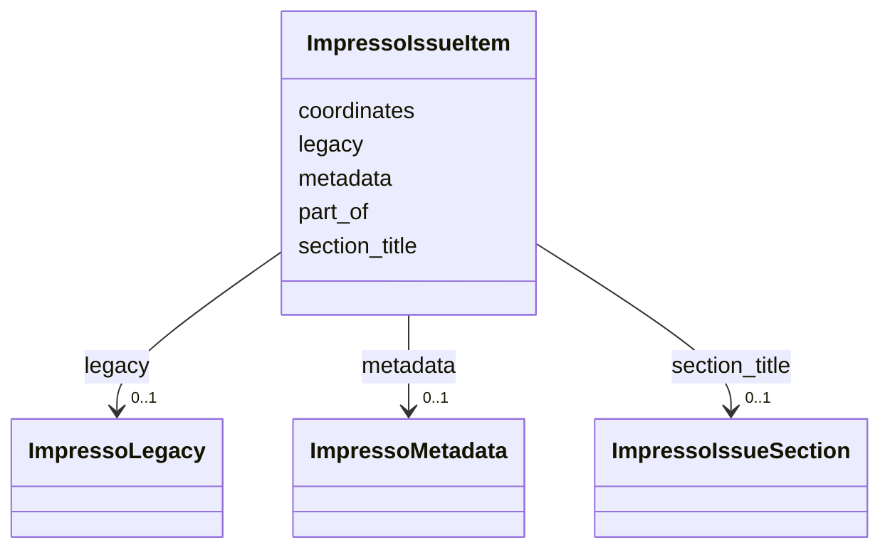

---
search:
  boost: 10.0
---

# Class: ImpressoIssueItem 


_A content item (e.g. article, advertisement, radio broadcast, etc.)_


<div data-search-exclude markdown="1">


URI: [pc:ImpressoIssueItem](https://pruzhany.org/ns/sourced-entities#ImpressoIssueItem)





<!-- no inheritance hierarchy -->

## Slots

| Name | Cardinality and Range | Description | Inheritance |
| ---  | --- | --- | --- |
| [metadata](metadata.md) | 0..1 <br/> [ImpressoMetadata](ImpressoMetadata.md) | Metadata about the content item. | direct |
| [coordinates](coordinates.md) | 4..* <br/> [Integer](Integer.md) | Coordinates (xywh format or [HPOS, VPOS, WIDTH, HEIGHT]) of image-region corresponding to the content-item depending on its type (if `tp == image`). NOTE: the 'null' option should be removed to prevent tables from having coordinates. | direct |
| [legacy](legacy.md) | 0..1 <br/> [ImpressoLegacy](ImpressoLegacy.md) | Legacy sections or components of the content item in the original OCR/OLR. They are meant to enable the reassignation of Impresso CIs (and enrichments) to the original OCR/OLR files. | direct |
| [part_of](part_of.md) | 0..1 <br/> [String](String.md) | Article/content-item to which the image is attached (if `tp == image`). | direct |
| [section_title](section_title.md) | 0..1 <br/> [ImpressoIssueSection](ImpressoIssueSection.md) | A section title grouping content items, with its original OCR components. | direct |


## Usages

| used by | used in | type | used |
| ---  | --- | --- | --- |
| [ImpressoIssue](ImpressoIssue.md) | [content_items](content_items.md) | range | [ImpressoIssueItem](ImpressoIssueItem.md) |


## Identifier and Mapping Information


### Annotations

| property | value |
| --- | --- |
| impresso | issue.i[] |


### Schema Source


* from schema: https://pruzhany.org/ns/impresso_issue


## Mappings

| Mapping Type | Mapped Value |
| ---  | ---  |
| self | pc:ImpressoIssueItem |
| native | pc:ImpressoIssueItem |


## LinkML Source

<!-- TODO: investigate https://stackoverflow.com/questions/37606292/how-to-create-tabbed-code-blocks-in-mkdocs-or-sphinx -->

### Direct

<details>
```yaml
name: ImpressoIssueItem
annotations:
  impresso:
    tag: impresso
    value: issue.i[]
description: A content item (e.g. article, advertisement, radio broadcast, etc.)
from_schema: https://pruzhany.org/ns/impresso_issue
rank: 1000
attributes:
  metadata:
    name: metadata
    annotations:
      impresso:
        tag: impresso
        value: issue.i[].m
    description: Metadata about the content item.
    from_schema: https://pruzhany.org/ns/impresso_issue
    rank: 1000
    alias: m
    domain_of:
    - ImpressoIssueItem
    range: ImpressoMetadata
    inlined: true
  coordinates:
    name: coordinates
    annotations:
      impresso:
        tag: impresso
        value: issue.i[].c
      nullable:
        tag: nullable
        value: true
    description: 'Coordinates (xywh format or [HPOS, VPOS, WIDTH, HEIGHT]) of image-region
      corresponding to the content-item depending on its type (if `tp == image`).
      NOTE: the ''null'' option should be removed to prevent tables from having coordinates.'
    from_schema: https://pruzhany.org/ns/impresso_issue
    rank: 1000
    alias: c
    domain_of:
    - ImpressoIssueItem
    range: integer
    multivalued: true
    minimum_cardinality: 4
  legacy:
    name: legacy
    annotations:
      impresso:
        tag: impresso
        value: issue.i[].l
    description: Legacy sections or components of the content item in the original
      OCR/OLR. They are meant to enable the reassignation of Impresso CIs (and enrichments)
      to the original OCR/OLR files.
    from_schema: https://pruzhany.org/ns/impresso_issue
    rank: 1000
    alias: l
    domain_of:
    - ImpressoIssueItem
    range: ImpressoLegacy
    inlined: true
  part_of:
    name: part_of
    annotations:
      impresso:
        tag: impresso
        value: issue.i[].pOf
      nullable:
        tag: nullable
        value: true
    description: Article/content-item to which the image is attached (if `tp == image`).
    from_schema: https://pruzhany.org/ns/impresso_issue
    rank: 1000
    alias: pOf
    domain_of:
    - ImpressoIssueItem
  section_title:
    name: section_title
    annotations:
      impresso:
        tag: impresso
        value: issue.i[].section_title
    description: A section title grouping content items, with its original OCR components.
    from_schema: https://pruzhany.org/ns/impresso_issue
    rank: 1000
    domain_of:
    - ImpressoIssueItem
    range: ImpressoIssueSection
    inlined: true
extra_slots:
  allowed: true

```
</details>

### Induced

<details>
```yaml
name: ImpressoIssueItem
annotations:
  impresso:
    tag: impresso
    value: issue.i[]
description: A content item (e.g. article, advertisement, radio broadcast, etc.)
from_schema: https://pruzhany.org/ns/impresso_issue
rank: 1000
attributes:
  metadata:
    name: metadata
    annotations:
      impresso:
        tag: impresso
        value: issue.i[].m
    description: Metadata about the content item.
    from_schema: https://pruzhany.org/ns/impresso_issue
    rank: 1000
    alias: m
    owner: ImpressoIssueItem
    domain_of:
    - ImpressoIssueItem
    range: ImpressoMetadata
    inlined: true
  coordinates:
    name: coordinates
    annotations:
      impresso:
        tag: impresso
        value: issue.i[].c
      nullable:
        tag: nullable
        value: true
    description: 'Coordinates (xywh format or [HPOS, VPOS, WIDTH, HEIGHT]) of image-region
      corresponding to the content-item depending on its type (if `tp == image`).
      NOTE: the ''null'' option should be removed to prevent tables from having coordinates.'
    from_schema: https://pruzhany.org/ns/impresso_issue
    rank: 1000
    alias: c
    owner: ImpressoIssueItem
    domain_of:
    - ImpressoIssueItem
    range: integer
    multivalued: true
    minimum_cardinality: 4
  legacy:
    name: legacy
    annotations:
      impresso:
        tag: impresso
        value: issue.i[].l
    description: Legacy sections or components of the content item in the original
      OCR/OLR. They are meant to enable the reassignation of Impresso CIs (and enrichments)
      to the original OCR/OLR files.
    from_schema: https://pruzhany.org/ns/impresso_issue
    rank: 1000
    alias: l
    owner: ImpressoIssueItem
    domain_of:
    - ImpressoIssueItem
    range: ImpressoLegacy
    inlined: true
  part_of:
    name: part_of
    annotations:
      impresso:
        tag: impresso
        value: issue.i[].pOf
      nullable:
        tag: nullable
        value: true
    description: Article/content-item to which the image is attached (if `tp == image`).
    from_schema: https://pruzhany.org/ns/impresso_issue
    rank: 1000
    alias: pOf
    owner: ImpressoIssueItem
    domain_of:
    - ImpressoIssueItem
    range: string
  section_title:
    name: section_title
    annotations:
      impresso:
        tag: impresso
        value: issue.i[].section_title
    description: A section title grouping content items, with its original OCR components.
    from_schema: https://pruzhany.org/ns/impresso_issue
    rank: 1000
    owner: ImpressoIssueItem
    domain_of:
    - ImpressoIssueItem
    range: ImpressoIssueSection
    inlined: true
extra_slots:
  allowed: true

```
</details></div>
