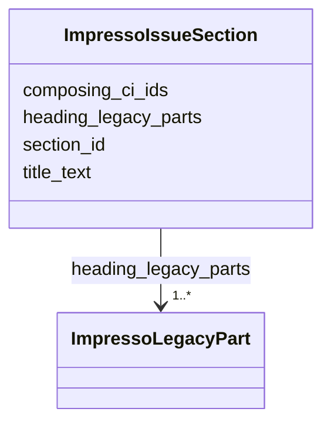

---
search:
  boost: 10.0
---

# Class: ImpressoIssueSection 


_A section title grouping content items, with its original OCR components._


<div data-search-exclude markdown="1">


URI: [pc:ImpressoIssueSection](https://pruzhany.org/ns/sourced-entities#ImpressoIssueSection)





<!-- no inheritance hierarchy -->

## Slots

| Name | Cardinality and Range | Description | Inheritance |
| ---  | --- | --- | --- |
| [title_text](title_text.md) | 1 <br/> [String](String.md) | A section title grouping content items, with its original OCR components.title_text. | direct |
| [composing_ci_ids](composing_ci_ids.md) | 1..* <br/> [String](String.md) | A section title grouping content items, with its original OCR components.composing_ci_ids. | direct |
| [section_id](section_id.md) | 1 <br/> [String](String.md) | A section title grouping content items, with its original OCR components.section_id. | direct |
| [heading_legacy_parts](heading_legacy_parts.md) | 1..* <br/> [ImpressoLegacyPart](ImpressoLegacyPart.md) | A section title grouping content items, with its original OCR components.heading_legacy_parts. | direct |


## Usages

| used by | used in | type | used |
| ---  | --- | --- | --- |
| [ImpressoIssueItem](ImpressoIssueItem.md) | [section_title](section_title.md) | range | [ImpressoIssueSection](ImpressoIssueSection.md) |


## Identifier and Mapping Information


### Annotations

| property | value |
| --- | --- |
| impresso | issue.i[].section_title |


### Schema Source


* from schema: https://pruzhany.org/ns/impresso_issue


## Mappings

| Mapping Type | Mapped Value |
| ---  | ---  |
| self | pc:ImpressoIssueSection |
| native | pc:ImpressoIssueSection |


## LinkML Source

<!-- TODO: investigate https://stackoverflow.com/questions/37606292/how-to-create-tabbed-code-blocks-in-mkdocs-or-sphinx -->

### Direct

<details>
```yaml
name: ImpressoIssueSection
annotations:
  impresso:
    tag: impresso
    value: issue.i[].section_title
description: A section title grouping content items, with its original OCR components.
from_schema: https://pruzhany.org/ns/impresso_issue
rank: 1000
attributes:
  title_text:
    name: title_text
    annotations:
      impresso:
        tag: impresso
        value: issue.i[].section_title.title_text
    description: A section title grouping content items, with its original OCR components.title_text.
    from_schema: https://pruzhany.org/ns/impresso_issue
    rank: 1000
    domain_of:
    - ImpressoIssueSection
    required: true
  composing_ci_ids:
    name: composing_ci_ids
    annotations:
      impresso:
        tag: impresso
        value: issue.i[].section_title.composing_ci_ids
    description: A section title grouping content items, with its original OCR components.composing_ci_ids.
    from_schema: https://pruzhany.org/ns/impresso_issue
    rank: 1000
    domain_of:
    - ImpressoIssueSection
    required: true
    multivalued: true
  section_id:
    name: section_id
    annotations:
      impresso:
        tag: impresso
        value: issue.i[].section_title.section_id
    description: A section title grouping content items, with its original OCR components.section_id.
    from_schema: https://pruzhany.org/ns/impresso_issue
    rank: 1000
    domain_of:
    - ImpressoIssueSection
    required: true
  heading_legacy_parts:
    name: heading_legacy_parts
    annotations:
      impresso:
        tag: impresso
        value: issue.i[].section_title.heading_legacy_parts
    description: A section title grouping content items, with its original OCR components.heading_legacy_parts.
    from_schema: https://pruzhany.org/ns/impresso_issue
    rank: 1000
    domain_of:
    - ImpressoIssueSection
    range: ImpressoLegacyPart
    required: true
    multivalued: true
    inlined_as_list: true
extra_slots:
  allowed: true

```
</details>

### Induced

<details>
```yaml
name: ImpressoIssueSection
annotations:
  impresso:
    tag: impresso
    value: issue.i[].section_title
description: A section title grouping content items, with its original OCR components.
from_schema: https://pruzhany.org/ns/impresso_issue
rank: 1000
attributes:
  title_text:
    name: title_text
    annotations:
      impresso:
        tag: impresso
        value: issue.i[].section_title.title_text
    description: A section title grouping content items, with its original OCR components.title_text.
    from_schema: https://pruzhany.org/ns/impresso_issue
    rank: 1000
    owner: ImpressoIssueSection
    domain_of:
    - ImpressoIssueSection
    range: string
    required: true
  composing_ci_ids:
    name: composing_ci_ids
    annotations:
      impresso:
        tag: impresso
        value: issue.i[].section_title.composing_ci_ids
    description: A section title grouping content items, with its original OCR components.composing_ci_ids.
    from_schema: https://pruzhany.org/ns/impresso_issue
    rank: 1000
    owner: ImpressoIssueSection
    domain_of:
    - ImpressoIssueSection
    range: string
    required: true
    multivalued: true
  section_id:
    name: section_id
    annotations:
      impresso:
        tag: impresso
        value: issue.i[].section_title.section_id
    description: A section title grouping content items, with its original OCR components.section_id.
    from_schema: https://pruzhany.org/ns/impresso_issue
    rank: 1000
    owner: ImpressoIssueSection
    domain_of:
    - ImpressoIssueSection
    range: string
    required: true
  heading_legacy_parts:
    name: heading_legacy_parts
    annotations:
      impresso:
        tag: impresso
        value: issue.i[].section_title.heading_legacy_parts
    description: A section title grouping content items, with its original OCR components.heading_legacy_parts.
    from_schema: https://pruzhany.org/ns/impresso_issue
    rank: 1000
    owner: ImpressoIssueSection
    domain_of:
    - ImpressoIssueSection
    range: ImpressoLegacyPart
    required: true
    multivalued: true
    inlined: true
    inlined_as_list: true
extra_slots:
  allowed: true

```
</details></div>
