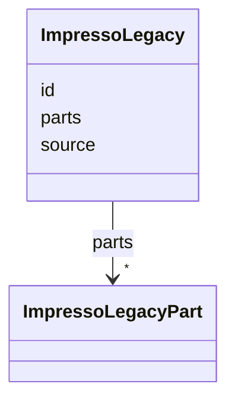

---
search:
  boost: 10.0
---

# Class: ImpressoLegacy 


_Legacy sections or components of the content item in the original OCR/OLR. They are meant to enable the reassignation of Impresso CIs (and enrichments) to the original OCR/OLR files._


<div data-search-exclude markdown="1">


URI: [pc:ImpressoLegacy](https://pruzhany.org/ns/sourced-entities#ImpressoLegacy)





<!-- no inheritance hierarchy -->

## Slots

| Name | Cardinality and Range | Description | Inheritance |
| ---  | --- | --- | --- |
| [id](id.md) | 0..1 <br/> [String](String.md) | ID of the sections or components used to compose the CI in the original OCR/OLR files. | direct |
| [parts](parts.md) | * <br/> [ImpressoLegacyPart](ImpressoLegacyPart.md) | List of parts of the given section or components. Exact contents can vary, will typically be composed of the metadata at disposal in the OCR/OLR. | direct |
| [source](source.md) | 0..1 <br/> [String](String.md) | Source image or OCR/OLR file name. | direct |


## Usages

| used by | used in | type | used |
| ---  | --- | --- | --- |
| [ImpressoIssueItem](ImpressoIssueItem.md) | [legacy](legacy.md) | range | [ImpressoLegacy](ImpressoLegacy.md) |


## Identifier and Mapping Information


### Annotations

| property | value |
| --- | --- |
| impresso | issue.i[].l |


### Schema Source


* from schema: https://pruzhany.org/ns/impresso_issue


## Mappings

| Mapping Type | Mapped Value |
| ---  | ---  |
| self | pc:ImpressoLegacy |
| native | pc:ImpressoLegacy |


## LinkML Source

<!-- TODO: investigate https://stackoverflow.com/questions/37606292/how-to-create-tabbed-code-blocks-in-mkdocs-or-sphinx -->

### Direct

<details>
```yaml
name: ImpressoLegacy
annotations:
  impresso:
    tag: impresso
    value: issue.i[].l
description: Legacy sections or components of the content item in the original OCR/OLR.
  They are meant to enable the reassignation of Impresso CIs (and enrichments) to
  the original OCR/OLR files.
from_schema: https://pruzhany.org/ns/impresso_issue
rank: 1000
attributes:
  id:
    name: id
    annotations:
      impresso:
        tag: impresso
        value: issue.i[].l.id
      json_types:
        tag: json_types
        value: string,array
    description: ID of the sections or components used to compose the CI in the original
      OCR/OLR files.
    from_schema: https://pruzhany.org/ns/impresso_issue
    domain_of:
    - ImpressoIssue
    - ImpressoMetadata
    - ImpressoLegacy
    - ImpressoStyle
  parts:
    name: parts
    annotations:
      impresso:
        tag: impresso
        value: issue.i[].l.parts
    description: List of parts of the given section or components. Exact contents
      can vary, will typically be composed of the metadata at disposal in the OCR/OLR.
    from_schema: https://pruzhany.org/ns/impresso_issue
    rank: 1000
    domain_of:
    - ImpressoLegacy
    range: ImpressoLegacyPart
    multivalued: true
    inlined_as_list: true
  source:
    name: source
    annotations:
      impresso:
        tag: impresso
        value: issue.i[].l.source
      json_types:
        tag: json_types
        value: string,array
    description: Source image or OCR/OLR file name.
    from_schema: https://pruzhany.org/ns/impresso_issue
    rank: 1000
    domain_of:
    - ImpressoLegacy
extra_slots:
  allowed: true

```
</details>

### Induced

<details>
```yaml
name: ImpressoLegacy
annotations:
  impresso:
    tag: impresso
    value: issue.i[].l
description: Legacy sections or components of the content item in the original OCR/OLR.
  They are meant to enable the reassignation of Impresso CIs (and enrichments) to
  the original OCR/OLR files.
from_schema: https://pruzhany.org/ns/impresso_issue
rank: 1000
attributes:
  id:
    name: id
    annotations:
      impresso:
        tag: impresso
        value: issue.i[].l.id
      json_types:
        tag: json_types
        value: string,array
    description: ID of the sections or components used to compose the CI in the original
      OCR/OLR files.
    from_schema: https://pruzhany.org/ns/impresso_issue
    owner: ImpressoLegacy
    domain_of:
    - ImpressoIssue
    - ImpressoMetadata
    - ImpressoLegacy
    - ImpressoStyle
    range: string
  parts:
    name: parts
    annotations:
      impresso:
        tag: impresso
        value: issue.i[].l.parts
    description: List of parts of the given section or components. Exact contents
      can vary, will typically be composed of the metadata at disposal in the OCR/OLR.
    from_schema: https://pruzhany.org/ns/impresso_issue
    rank: 1000
    owner: ImpressoLegacy
    domain_of:
    - ImpressoLegacy
    range: ImpressoLegacyPart
    multivalued: true
    inlined: true
    inlined_as_list: true
  source:
    name: source
    annotations:
      impresso:
        tag: impresso
        value: issue.i[].l.source
      json_types:
        tag: json_types
        value: string,array
    description: Source image or OCR/OLR file name.
    from_schema: https://pruzhany.org/ns/impresso_issue
    rank: 1000
    owner: ImpressoLegacy
    domain_of:
    - ImpressoLegacy
    range: string
extra_slots:
  allowed: true

```
</details></div>
