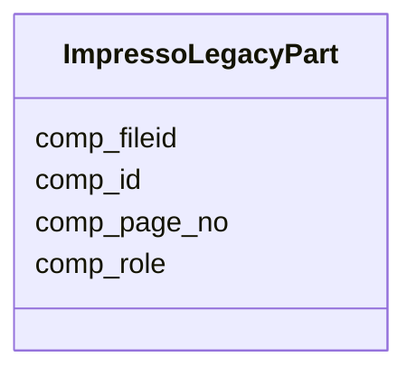

---
search:
  boost: 10.0
---

# Class: ImpressoLegacyPart 


_One original OCR component retained for tracing a content item back to its source._


<div data-search-exclude markdown="1">


URI: [pc:ImpressoLegacyPart](https://pruzhany.org/ns/sourced-entities#ImpressoLegacyPart)





<!-- no inheritance hierarchy -->

## Slots

| Name | Cardinality and Range | Description | Inheritance |
| ---  | --- | --- | --- |
| [comp_role](comp_role.md) | 0..1 <br/> [String](String.md) | Role of the component part (eg. heading, body, etc). | direct |
| [comp_id](comp_id.md) | 0..1 <br/> [String](String.md) | ID of the part. | direct |
| [comp_fileid](comp_fileid.md) | 0..1 <br/> [String](String.md) | ID of the ALTO file the component comes from. | direct |
| [comp_page_no](comp_page_no.md) | 0..1 <br/> [String](String.md) | Page number of the component. | direct |


## Usages

| used by | used in | type | used |
| ---  | --- | --- | --- |
| [ImpressoLegacy](ImpressoLegacy.md) | [parts](parts.md) | range | [ImpressoLegacyPart](ImpressoLegacyPart.md) |
| [ImpressoIssueSection](ImpressoIssueSection.md) | [heading_legacy_parts](heading_legacy_parts.md) | range | [ImpressoLegacyPart](ImpressoLegacyPart.md) |


## Identifier and Mapping Information


### Annotations

| property | value |
| --- | --- |
| impresso | issue.$defs.legacy_part_item |


### Schema Source


* from schema: https://pruzhany.org/ns/impresso_issue


## Mappings

| Mapping Type | Mapped Value |
| ---  | ---  |
| self | pc:ImpressoLegacyPart |
| native | pc:ImpressoLegacyPart |


## LinkML Source

<!-- TODO: investigate https://stackoverflow.com/questions/37606292/how-to-create-tabbed-code-blocks-in-mkdocs-or-sphinx -->

### Direct

<details>
```yaml
name: ImpressoLegacyPart
annotations:
  impresso:
    tag: impresso
    value: issue.$defs.legacy_part_item
description: One original OCR component retained for tracing a content item back to
  its source.
from_schema: https://pruzhany.org/ns/impresso_issue
rank: 1000
attributes:
  comp_role:
    name: comp_role
    annotations:
      impresso:
        tag: impresso
        value: issue.$defs.legacy_part_item.comp_role
      nullable:
        tag: nullable
        value: true
    description: Role of the component part (eg. heading, body, etc).
    from_schema: https://pruzhany.org/ns/impresso_issue
    rank: 1000
    domain_of:
    - ImpressoLegacyPart
  comp_id:
    name: comp_id
    annotations:
      impresso:
        tag: impresso
        value: issue.$defs.legacy_part_item.comp_id
      json_types:
        tag: json_types
        value: string,array
    description: ID of the part.
    from_schema: https://pruzhany.org/ns/impresso_issue
    rank: 1000
    domain_of:
    - ImpressoLegacyPart
  comp_fileid:
    name: comp_fileid
    annotations:
      impresso:
        tag: impresso
        value: issue.$defs.legacy_part_item.comp_fileid
      json_types:
        tag: json_types
        value: string,array
    description: ID of the ALTO file the component comes from.
    from_schema: https://pruzhany.org/ns/impresso_issue
    rank: 1000
    domain_of:
    - ImpressoLegacyPart
  comp_page_no:
    name: comp_page_no
    annotations:
      impresso:
        tag: impresso
        value: issue.$defs.legacy_part_item.comp_page_no
      json_types:
        tag: json_types
        value: integer,array
    description: Page number of the component.
    from_schema: https://pruzhany.org/ns/impresso_issue
    rank: 1000
    domain_of:
    - ImpressoLegacyPart
extra_slots:
  allowed: true

```
</details>

### Induced

<details>
```yaml
name: ImpressoLegacyPart
annotations:
  impresso:
    tag: impresso
    value: issue.$defs.legacy_part_item
description: One original OCR component retained for tracing a content item back to
  its source.
from_schema: https://pruzhany.org/ns/impresso_issue
rank: 1000
attributes:
  comp_role:
    name: comp_role
    annotations:
      impresso:
        tag: impresso
        value: issue.$defs.legacy_part_item.comp_role
      nullable:
        tag: nullable
        value: true
    description: Role of the component part (eg. heading, body, etc).
    from_schema: https://pruzhany.org/ns/impresso_issue
    rank: 1000
    owner: ImpressoLegacyPart
    domain_of:
    - ImpressoLegacyPart
    range: string
  comp_id:
    name: comp_id
    annotations:
      impresso:
        tag: impresso
        value: issue.$defs.legacy_part_item.comp_id
      json_types:
        tag: json_types
        value: string,array
    description: ID of the part.
    from_schema: https://pruzhany.org/ns/impresso_issue
    rank: 1000
    owner: ImpressoLegacyPart
    domain_of:
    - ImpressoLegacyPart
    range: string
  comp_fileid:
    name: comp_fileid
    annotations:
      impresso:
        tag: impresso
        value: issue.$defs.legacy_part_item.comp_fileid
      json_types:
        tag: json_types
        value: string,array
    description: ID of the ALTO file the component comes from.
    from_schema: https://pruzhany.org/ns/impresso_issue
    rank: 1000
    owner: ImpressoLegacyPart
    domain_of:
    - ImpressoLegacyPart
    range: string
  comp_page_no:
    name: comp_page_no
    annotations:
      impresso:
        tag: impresso
        value: issue.$defs.legacy_part_item.comp_page_no
      json_types:
        tag: json_types
        value: integer,array
    description: Page number of the component.
    from_schema: https://pruzhany.org/ns/impresso_issue
    rank: 1000
    owner: ImpressoLegacyPart
    domain_of:
    - ImpressoLegacyPart
    range: string
extra_slots:
  allowed: true

```
</details></div>
